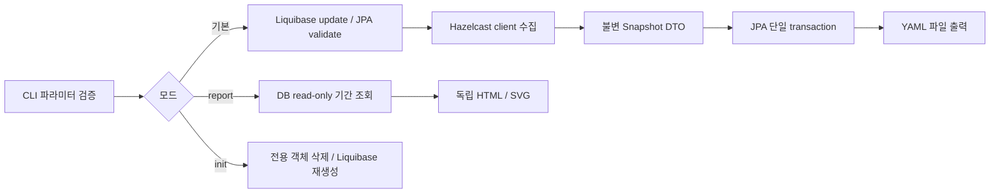

# Hazelcast Monitoring Application 설계 및 구현

- 날짜 형식 변경 검증: Java 17 `clean verify` 51개 통과(실패/오류/건너뜀 0). YAML/HTML 초 단위 형식, 이전 YAML 호환, 기간 입력 및 H2 UTC microsecond round-trip을 확인했다. 상세: `date-format-plan.md`.

- 작성일: 2026-10-27
- 상태: **구현 완료 — 2026-10-27 사용자 단발 CLI 방식 개발 승인 및 Java 17 검증**
- 경로: `common-utilities/hazelcast-monitoring` (기존 모듈과 같은 독립 Maven 프로젝트)
- 패키지: `com.inzent.apim.utilities.hazelcastmonitoring` 하위
- 구현 범위: 단발 CLI 기본 수집 / report / init / install, 설치용 executable JAR과 일반 Java runtime, 검증 및 README.

## 1. 목적과 범위

Hazelcast 클러스터에 Java client로 접속하여 멤버와 등록된 distributed object의 항목 수를 시점별로 기록한다. 결과는 JPA로 DB에 저장하고 같은 스냅샷을 실행시간으로 식별하는 YAML 파일로 출력한다. DB의 이력을 조회하여 인터넷 연결과 웹 서버 없이 열 수 있는 단일 HTML 보고서를 생성한다.

요구 기능은 기본 수집, `report`, `init`, `install` 네 모드다. 한 프로세스는 한 작업을 수행하고 종료한다. 반복 수집은 cron 또는 Windows 작업 스케줄러가 담당한다. 내장 스케줄러, 웹 API, Management Center 대체, 객체 값/키 조회, 서버 측 코드 배포, CP subsystem·Jet 작업의 전체 인벤토리, JVM/CPU/메모리/파티션 상세 계측은 1차 범위에서 제외한다.

실행 중 객체나 멤버는 변할 수 있으므로 결과는 수집 구간의 관측값이며 클러스터 전체의 원자적 스냅샷이 아니다. 실패·미지원·미관측을 0으로 기록하지 않는다.

## 2. 접근 방식과 제안

| 방식 | 장점 | 비용 / 한계 | 판단 |
| --- | --- | --- | --- |
| 단발 CLI + 외부 스케줄러 | executable JAR와 세 모드에 자연스럽고 실행별 실패 추적이 쉽다 | 반복 주기는 외부에서 설정 | **권장 설계** |
| 상주 애플리케이션 + 내장 scheduler | 반복 수집을 한 프로세스에서 수행 | 실행 중복, 재시작, 스케줄 관리 추가 | 현재 범위에서 제외 |
| 웹 서비스 + 화면/API | 온라인 조회·제어에 적합 | 서버 운영·인증·접속 관리 추가 | offline HTML 요구에 불필요 |

2026-10-27 사용자가 단발 CLI 방식을 확정하고 개발을 승인했다. 아래 기본값을 적용하여 독립 모듈을 구현한다.

## 3. 기술 구성과 버전

| 항목 | 제안 |
| --- | --- |
| Java | 17, compiler release 17, 실제 JDK 17 검증 |
| 빌드 | Maven 독립 프로젝트, Spring Boot Maven Plugin `repackage`로 설치 원본 배포 JAR 생성 |
| Spring Boot | 공식 최신 안정판 **4.1.2** (2026-10-27 구현 시 공식 문서와 Maven Central 재확인), POM 고정 |
| 실행 | `WebApplicationType.NONE`, main CLI 분기, 설치 후 runtime/classes + runtime/lib의 java -cp 실행 및 context 종료 |
| Hazelcast | Java client만 생성. Community 5.7.0 API를 설계 기준으로 삼되 실제 대상 서버와의 호환성을 확인하여 버전을 고정 |
| 저장 | Spring Data JPA / Hibernate, Jakarta Persistence |
| 스키마 | Liquibase changelog, Hibernate `ddl-auto=validate` (수집 모드) |
| DB | 기본 H2 file DB로 단독 실행, 운영 PostgreSQL 지원. 두 DB에 대해 migration/조회/초기화 검증 |
| YAML | Boot 관리 계열의 YAML serializer 사용. 문자열 수작업 연결 금지 |
| 보고서 | HTML template + 자체 포함 SVG 꺾은선 그래프 + inline CSS/JS. CDN/외부 font/이미지 없음 |

Boot BOM이 관리하는 JPA, Liquibase, JDBC, serializer 버전을 우선 사용한다. Boot 4의 starter 분리와 Hazelcast 자동 구성을 확인하고, 의도하지 않은 embedded member나 자동 client 생성은 배제한다. Hazelcast는 모드별로 직접 생성한다. 기존 다른 모듈의 POM과 실행 동작은 변경하지 않는다.

대상 클러스터의 버전·보안 설정은 현재 저장소에 없다. 3.x까지의 범용 호환은 약속하지 않으며, 실제 접속 호환성을 구현 검증의 별도 조건으로 둔다. 인증/TLS는 외부 Hazelcast client 설정 파일을 전달받는 방식으로 지원하고 비밀값은 이력에 저장하지 않는다.

## 4. 실행 모드와 입력

| 입력 | 동작 | Hazelcast 연결 | DB 스키마 처리 |
| --- | --- | --- | --- |
| 모드 플래그 미지정 / `--collect` | 한 번 수집 → JPA 저장 → YAML 출력 → 종료 | 필요 | Liquibase update 후 JPA validate |
| `--report` | DB 이력 → 기간 필터 → HTML 출력 → 종료 | 생성 안 함 | 변경하지 않음, 조회에 필요한 스키마 버전 확인 |
| `--init` | 애플리케이션 전용 스키마 객체 삭제 → changelog 재적용 → 검증 → 종료 | 생성 안 함 | 명시적 파괴적 초기화 |
| `--install` | 현재 작업 디렉터리에 runtime/classes·lib 및 manifest / application.yml / 모드별 script 배치 | 생성 안 함 | DB 접근 없음 |

모드 플래그는 값 없이 지정하며 서로 배타적이다. 기존 `--mode=value`, 값이 붙은 `--report=true`, 중복/서로 다른 복수 모드는 입력 오류다. `--help`는 DB와 Hazelcast에 연결하지 않고 사용법을 출력한다. 사용자 CLI 옵션은 화이트리스트로 검증하고, `--spring.*` 외부 설정은 Spring 규칙을 따른다. report 전용 기간 옵션을 다른 모드에서 주면 오류 처리한다. 외부 설정 mode 속성은 CLI 플래그가 없을 때만 적용한다.

주요 옵션 제안:

| 옵션 | 기본 / 의미 |
| --- | --- |
| `--monitor.cluster-id` | 기본 cluster-name. DB 안에서 환경별 클러스터를 구분하는 안정적인 논리 ID; 같은 이름의 별도 클러스터는 반드시 다른 ID 사용 |
| `--monitor.cluster-name` | `dev`, Hazelcast 인증용 cluster-name |
| `--monitor.members` | `127.0.0.1:5701`, 초기 접속 주소 목록 |
| `--monitor.client-config` | 선택적 외부 Hazelcast client YAML 경로. 지정 시 접속/인증/TLS는 이 파일을 기준으로 하고 CLI 접속 설정과 혼합하지 않음 |
| `--monitor.snapshot-dir` | `./output/snapshots`, YAML 출력 폴더 |
| `--monitor.report-file` | `./output/reports/report-<yyyy-MM-dd_HH-mm-ss>-<UUID>.html`, report 출력 파일 |
| `--monitor.start-time` | 선택, `yyyy-MM-dd HH:mm:ss` (Asia/Seoul), 기존 ISO-8601 offset도 지원 |
| `--monitor.end-time` | 선택, 시작시간과 같은 형식 |
| `--monitor.report-zone` | `Asia/Seoul`, 보고서 표시 시간대; DB/필터 비교는 UTC |
| `--monitor.connect-timeout` | `30s`, 최초 클러스터 연결 제한 |
| `--monitor.operation-timeout` | `10s`, 개별 원격 count 호출 제한 |
| `--monitor.collection-timeout` | `120s`, 전체 수집 제한; 남은 객체는 NOT_COLLECTED로 표시 |
| `--spring.datasource.*` | 기본 H2 file, 운영 JDBC URL/계정은 외부 설정/환경변수 |

예정 실행 형태 (구현 후 README에서 확정):

```shell
./collect.sh --monitor.cluster-id=prod-a --monitor.cluster-name=prod --monitor.members=10.0.0.11:5701,10.0.0.12:5701
./report.sh --monitor.cluster-id=prod-a "--monitor.start-time=2026-10-27 00:00:00" "--monitor.end-time=2026-10-28 00:00:00"
./init.sh
```

## 5. 구성 요소와 흐름



예정 패키지 / 책임:

- `cli`: mode 및 옵션 해석, 종료 코드, 입력 검증.
- `config`: datasource, 모드별 초기화, Hazelcast client 설정.
- `collection`: client 수명, membership snapshot, count collector registry.
- `snapshot`: DB와 YAML에 공통 사용되는 불변 DTO 및 상태 enum.
- `persistence`: entity, 명시적 JPA EntityManager transaction service, report batch 조회.
- `export`: YAML serializer 및 임시 파일/최종 파일 관리.
- `report`: 기간 조회, series 구성, HTML/SVG renderer.
- `schema`: Liquibase update, init bootstrap, 스키마 호환 확인.

원격 호출은 DB transaction 밖에서 수행한다. 수집 결과 DTO가 완성되면 summary/node/object를 한 transaction으로 저장한다. YAML 출력은 commit 이후 수행한다. client, executor, JPA context, connection은 모든 종료 경로에서 회수한다.

## 6. 수집 의미와 제한

### 6.1 노드 / 클러스터

- `client.getCluster().getMembers()`의 시작 시점 목록을 기본 관측값으로 사용한다. 종료 시점 UUID 집합과 비교하여 `topology_changed`를 저장한다.
- `active_node_count`는 시작 시점 클라이언트가 관측한 전체 멤버 수(lite member 포함)다. 클라이언트 수는 포함하지 않는다.
- 시작 목록의 노드는 `OBSERVED_ACTIVE`로 기록한다. 종료까지 생존했음을 보장하지 않으며, 장애 노드의 전체 명부를 임의 생성하지 않는다.
- `node_name`은 설정 가능한 member attribute(기본 `monitor.node-name`)를 읽고, 없으면 address 문자열로 대체한다. Member API에서 서버 instance name을 직접 얻을 수 있다고 가정하지 않는다.
- UUID는 서버의 member UUID를 별도 `member_uuid`로 저장한다. node row PK는 관측 이력별 UUID로 둔다.
- `cluster_state`는 1차 구현에서 `UNKNOWN`으로 둔다. client의 공개 API로 확인되지 않은 ACTIVE/PASSIVE/FROZEN을 추측하지 않는다. 수집 성공 여부와 서버 내부 cluster state는 별개다.
- 연결/목록 조회 실패는 `FAILED`, active count는 null로 저장한다. 접근할 수 없는 클러스터를 0개 노드로 표현하지 않는다.

### 6.2 객체 목록과 count

목록은 `getDistributedObjects()`로 발견한 distributed object 범위다. 설정만 있고 아직 생성되지 않은 객체와 CP 객체의 완전한 목록을 의미하지 않는다. `getName()`은 distributed object 이름이며 Map entry key가 아니다. service name 원문도 함께 저장한다.

타입별 collector가 발견된 proxy에 대해 읽기 API만 호출한다. 새 이름으로 `getMap` 등을 호출하거나 `destroy`, `put`, `poll`, `take`, `readAll`, `entrySet`을 호출하지 않는다. 목록 조회·size 호출 자체의 네트워크/서버 비용은 존재한다.

| object type | count 정의 | 처리 |
| --- | --- | --- |
| IMap | entry 수 | `size()` |
| MultiMap | key-value pair 수 (key 수 아님) | `size()` |
| IList / ISet / IQueue | 항목 수 | `size()` |
| Ringbuffer | 현재 유지 항목 수 (capacity 아님) | `size()` |
| ReplicatedMap | API가 관측한 항목 수 | `size()`, eventual consistency 한계 표시 |
| ITopic / ReliableTopic | 수집 제외 | object info / YAML 항목을 생성하지 않음 |
| executor / 기타 | 일반화할 적재 count 없음 | null + UNSUPPORTED |
| JCache / 사용자 정의 서비스 | 1차 collector 범위 밖 | 발견될 경우 null + UNSUPPORTED |

ReliableTopic의 내부 ringbuffer 등이 목록에 노출되면 원본 서비스/이름 그대로 기록한다. 발견하지 못한 topic backlog를 만들어내지 않는다. int 결과는 long으로 변환하여 BIGINT에 저장하지만 원본 API int 범위의 한계는 남는다.

Topic 필터는 `ITopic` 타입을 기준으로 정렬/count/DTO 생성 전에 적용한다. 같은 이름의 Map과 일반 Ringbuffer 등 다른 타입은 기존대로 수집한다. 이전 실행의 Topic DB 이력과 기존 파일은 삭제하거나 변경하지 않는다.

객체별 상태는 `SUCCESS`, `UNSUPPORTED`, `ERROR`, `NOT_COLLECTED`다. 목록 조회 후 소멸/접근 거부/timeout은 ERROR와 정제한 오류 코드를 기록한다. 시간 제한으로 미시도한 객체는 NOT_COLLECTED다. 각 객체에 `observed_at`을 둔다. 기본은 직렬 수집으로 서버 부하를 제한한다.

`SUCCESS`: 목록·멤버 조회 성공, 지원 객체 count가 모두 성공. 미지원 객체 존재만으로 PARTIAL로 낮추지 않는다. `PARTIAL`: 지원 객체 오류/미수집 또는 수집 중 topology 변경. `FAILED`: 연결 또는 필수 목록/멤버 조회 실패. FAILED run에는 불완전한 자식 목록을 확정 데이터처럼 저장하지 않는다. 전체 deadline은 원격 호출 timeout과 client 종료로 제한하며 Future cancel만으로 원격 작업 취소가 보장된다고 간주하지 않는다.

## 7. DB 스키마와 JPA 매핑

테이블 접두사 `hzmon_`, 전용 Liquibase 이력 테이블 `hzmon_databasechangelog`, `hzmon_databasechangeloglock`을 사용한다. UUID는 H2/PostgreSQL에서 지원하는 UUID 타입, 시간은 UTC Instant와 timezone 지원 timestamp 매핑을 사용한다. 실제 DB round-trip 정밀도를 통합 테스트한다.

### monitor summary: `hzmon_monitor_summary`

| 컬럼 | 타입 / 제약 | 의미 |
| --- | --- | --- |
| id | UUID PK | 실행 UUID |
| cluster_id | varchar(200), not null | 논리 클러스터 ID |
| cluster_name | varchar(200), not null | 접속 설정의 cluster-name |
| executed_at | timestamp with time zone, not null | 실행 시작시간, 기간 필터 기준 |
| completed_at | timestamp with time zone, not null | 수집 종료시간 |
| active_node_count | integer, nullable | 시작 시점 관측 멤버 수 |
| collection_status | varchar(32), not null | SUCCESS / PARTIAL / FAILED |
| cluster_state | varchar(32), not null | UNKNOWN (향후 실제 조회 확장점) |
| topology_changed | boolean, not null | 시작/종료 멤버 UUID 집합 차이 |
| object_inventory_observed_at | timestamp with time zone, nullable | 목록 조회시각 |
| object_inventory_complete | boolean, not null | 목록 조회 성공 여부 |
| error_code / error_message | varchar(64) / varchar(2000), nullable | 비밀값 제거·길이 제한 오류 |
| yaml_export_status | varchar(16), not null | PENDING / EXPORTED / ERROR |
| yaml_path | varchar(2000), nullable | 계획한 출력 파일 절대 경로 |

### node info: `hzmon_node_info`

| 컬럼 | 타입 / 제약 | 의미 |
| --- | --- | --- |
| id | UUID PK | 이력 row ID |
| summary_id | UUID FK, not null | 실행 참조 |
| member_uuid | UUID, not null | Hazelcast member ID |
| node_name | varchar(512), not null | attribute 또는 address |
| node_address | varchar(512), not null | host:port (IPv6 표기 지원) |
| node_status | varchar(32), not null | OBSERVED_ACTIVE |
| lite_member | boolean, not null | lite member 여부 |

### object info: `hzmon_object_info`

| 컬럼 | 타입 / 제약 | 의미 |
| --- | --- | --- |
| id | UUID PK | 이력 row ID |
| summary_id | UUID FK, not null | 실행 참조 |
| object_type | varchar(64), not null | MAP / LIST 등 정규화 타입 |
| service_name | varchar(512), not null | Hazelcast 서비스 원문 |
| object_name | varchar(512), not null | distributed object 이름 |
| object_count | bigint, nullable | 성공한 count만 저장, 0은 실제 empty |
| count_status | varchar(32), not null | SUCCESS / UNSUPPORTED / ERROR / NOT_COLLECTED |
| observed_at | timestamp with time zone, nullable | 호출 결과 수신시각, 미시도는 null |
| error_code / error_message | varchar(64) / varchar(2000), nullable | 객체별 오류 |

제약 / 인덱스:

- summary `(cluster_id, executed_at, id)` 조회 인덱스.
- node `(summary_id, member_uuid)` unique.
- object `(summary_id, service_name, object_name)` unique. 이름이 같고 서비스가 다른 객체는 분리한다.
- 자식 FK에 인덱스, count >= 0, active_node_count >= 0의 nullable check. SUCCESS count는 not null, 그 밖은 null.
- 문자열 길이 초과 시 이름을 잘라 동일 객체로 합치지 않는다. snapshot 검증 실패로 실행을 실패시키고 로그에 원인을 남긴다.
- JPA는 자식→summary LAZY 참조, cascade 범위는 실행 aggregate 내부로 제한. 대량 insert batching 및 report DTO projection을 사용한다.
- FAILED run도 DB가 정상인 경우 저장하여 보고서에 장애 구간을 남긴다. DB 장애는 로그/종료 코드로 알리며 저장 성공을 주장하지 않는다.

## 8. Liquibase와 init

`src/main/resources/db/changelog/db.changelog-master.yaml` 아래 불변 changeset을 버전별 추가한다. 정상 수집에서는 비파괴 update만 수행한다. 적용한 changeset을 수정하거나 checksum을 임의 초기화하지 않는다.

모드를 Spring context의 JPA/Liquibase 초기화보다 먼저 판별한다. 특히 init에서 오래된 스키마 때문에 JPA validate나 자동 migration이 먼저 실패하지 않도록, datasource + Liquibase 전용 bootstrap 경로를 사용한다. report는 자동 migration/JPA DDL을 비활성화하고 필요한 read-only 조회 구성을 사용한다. 서로 다른 모드의 Bean이 부작용으로 기동하지 않도록 조건부 구성을 둔다.

`--init`은 기존 모니터링 이력 삭제에 대한 명시적 실행 요청으로 취급하며 별도 대화형 확인을 추가하지 않는다. 실제 삭제 범위는 애플리케이션 소유 객체 allowlist와 전용 Liquibase 이력 테이블로 제한한다. DB 전체에 대한 무조건 `dropAll`은 사용하지 않는다. Liquibase의 drop-all은 사용자 소유 객체 전반을 삭제할 수 있기 때문이다.

절차: 설정/DB 대상 검증 → 전용 init lock 획득 → 자식 테이블 → summary 및 버전별 소유 sequence/index/view 등 삭제 → 전용 changelog/lock 테이블 초기화 → 현재 master 전체 update → 스키마 검증 → lock 반환. 초기화 실패는 nonzero로 종료하고 성공 메시지를 내지 않는다. H2/PostgreSQL DDL rollback 차이를 감안해 부분 초기화 상태에서 init 재실행 가능하도록 존재 여부를 검사한다.

init lock은 삭제 대상 changeloglock에 의존하지 않는다. PostgreSQL은 전체 초기화 동안 전용 connection의 session advisory lock을 유지한다. 기본 H2 file은 정규화한 DB 파일 경로에 대응하는 별도 OS file lock을 프로세스 종료까지 유지하며, H2 자체 DB 파일 잠금과 함께 단일 프로세스 계약을 적용한다. H2 server/AUTO_SERVER 모드는 1차 지원 범위에서 제외한다. init 수행 중 다른 수집/리포트 프로세스는 중단하는 운영 계약을 둔다. lock은 init 중복을 막고, 평시 migration은 Liquibase lock이 조정한다. 다른 애플리케이션의 테이블과 공유 changelog는 삭제하지 않으며 알 수 없는 외부 FK가 있으면 cascade로 제거하지 않고 실패한다.

## 9. YAML 출력과 DB/파일 일관성

파일 경로는 `<snapshot-dir>/<Asia/Seoul yyyy>/<MM>/<dd>/<yyyy-MM-dd_HH-mm-ss>_<runUUID>.yml`이다. UUID로 같은 초의 실행을 구분한다. `snapshots` key와 모든 날짜 문자열은 Asia/Seoul 기준 `yyyy-MM-dd HH:mm:ss`이며 `timeZone`에 시간대를 명시한다. DB의 UTC Instant/microsecond 정밀도는 유지한다. 기존 schemaVersion 1 파일은 DB 관측과 정확히 일치할 때만 재출력 성공으로 인정하고 덮어쓰지 않는다. HTML도 같은 날짜 형식을 사용하며 report-zone을 따른다. 한 파일은 한 실행을 담는다.

```yaml
schemaVersion: 2
timeZone: Asia/Seoul
snapshots:
  "2026-10-27 10:00:00":
    id: "46cc1441-28c8-4f6d-9ef6-8e573a1da32d"
    clusterId: "prod-a"
    clusterName: "prod"
    completedAt: "2026-10-27 10:00:00"
    activeNodeCount: 1
    collectionStatus: "SUCCESS"
    clusterState: "UNKNOWN"
    topologyChanged: false
    objectInventoryComplete: true
    objectInventoryObservedAt: "2026-10-27 10:00:00"
    errorCode: null
    errorMessage: null
    nodes:
      - memberUuid: "415e32eb-9bef-482b-a887-b11dc0e2b992"
        nodeName: "node-a"
        nodeAddress: "10.0.0.11:5701"
        nodeStatus: "OBSERVED_ACTIVE"
        liteMember: false
    objects:
      - objectType: "MAP"
        serviceName: "hz:impl:mapService"
        objectName: "orders"
        objectCount: 120
        countStatus: "SUCCESS"
        observedAt: "2026-10-27 10:00:00"
        errorCode: null
        errorMessage: null
```

YAML은 DB의 관측 데이터와 같은 DTO로 생성한다. DB export 상태 등 가변 운영 메타데이터는 YAML 본문에서 제외한다. DB commit 전 출력하지 않고, 같은 폴더의 임시 파일을 완성한 후 hard link로 최종 파일을 원자적으로 공개한다. hard link 미지원 provider는 replace 없는 move로 대체한다. ATOMIC_MOVE는 provider에 따라 기존 파일을 교체할 수 있어 사용하지 않는다. 최종 파일을 덮어쓰지 않는다.

DB와 filesystem은 분산 transaction이 아니므로 완전한 원자성은 없다. 최초 DB commit은 `PENDING`과 계획 경로를 저장한다. 출력 후 별도 transaction으로 EXPORTED, 실패하면 ERROR로 갱신한다. commit 이후 프로세스가 죽어도 PENDING이 남는다. 다음 기본 실행에서 같은 cluster-id의 PENDING/ERROR를 DB에서 읽어 기존 경로로 재출력한 뒤 신규 수집을 진행한다. 기존 파일이 있으면 동일 run의 정상 YAML인지 확인하고 상태만 복구하며, 내용 불일치는 오류다. 복구는 Hazelcast 재조회 없이 수행하고 batch 단위로 읽는다. 과거 출력 폴더가 쓰기 불가능하면 새 위치로 몰래 옮기지 않고 해당 오류를 남긴다. 실패 상태는 전체 종료 코드에 반영한다.

## 10. 오프라인 HTML 리포트

- 기간 필터: `executed_at >= start AND executed_at < end`의 반개구간. 한쪽만 지정하면 그 방향만 제한하고, 모두 생략하면 해당 cluster-id의 전체 이력을 조회한다. start >= end, offset 없는 시간, 잘못된 zone은 입력 오류다.
- DB 범위는 report 시작 시점에 존재하는 실행을 cutoff로 고정한다. 안정적인 `(executed_at, id)` 순서와 read-only 일관 조회로 페이지를 읽고 동시 추가되는 결과를 중간에 섞지 않는다. H2/PostgreSQL에서 repeatable-read snapshot 또는 동등한 조회 일관성을 검증한다.
- 표제부: cluster-id/name, 요청 기간, 실제 데이터 기간, 생성시간, 표시 zone, 실행 수, SUCCESS/PARTIAL/FAILED 수, 미지원·오류 count 설명.
- 그래프 1: 시간별 active node count. null/FAILED는 선을 끊고 장애 마커로 표시한다.
- 그래프 2: `(cluster_id, service_name, object_name)`별 count. 같은 이름의 다른 타입/서비스를 합치지 않는다. 객체별 선택/검색과 범례를 제공하고 단일 관측점은 점으로 표시한다.
- ERROR/NOT_COLLECTED/UNSUPPORTED는 gap으로 표현한다. 성공적으로 목록을 조회한 실행에서 객체가 없으면 NOT_OBSERVED gap으로 표현한다. 소멸을 count 0으로 추정하지 않는다. 실제 SUCCESS count 0만 0으로 그린다.
- 시각적으로 같은 시간인 실행도 UUID 순으로 별도 관측점을 보존하고 tooltip/table에 정확한 시간을 제공한다. DST 표시는 offset을 포함한다.
- 조회 결과가 없어도 정상 HTML을 생성하며 `조회 결과 없음`을 표시한다. DB 연결 실패나 호환되지 않는 스키마는 빈 보고서로 위장하지 않는다.
- HTML 안에 데이터, SVG, CSS, JavaScript를 모두 포함한다. `file://`로 열 때 외부 fetch, CDN, 서버, 브라우저 storage에 의존하지 않는다. JS가 없어도 기본 SVG와 요약표를 읽을 수 있게 한다.
- 모든 외부 문자열은 HTML/XML escape한다. JSON 데이터는 script 종료 문자열을 안전하게 escape하며 객체명에 HTML/`</script>`가 있어도 실행되지 않도록 검증한다.
- 1차는 downsampling 없이 모든 점을 보존한다. DB는 100개 실행씩 keyset/batch 조회하되 브라우저 무한 용량은 보장하지 않는다. 기본 상한은 실행 10,000건 / object 관측 row 1,000,000건, 설정으로 조정 가능. object series는 최대 1,000개다. 초과 시 잘라내지 않고 기간 축소 안내와 오류 종료한다. 같은 시각의 점은 SVG의 별도 circle 및 실행표로 보존하지만 시각적으로 겹칠 수 있다. 규모별 렌더링 검증 후 기본 상한을 재조정할 수 있다.
- 출력은 임시 파일 완성 후 이동, 기존 지정 파일이 있으면 덮어쓰지 않고 오류 처리한다.

## 11. 종료 / 오류 / 운영 계약

| 종료 코드 | 의미 |
| --- | --- |
| 0 | 모드 작업 성공 (수집 SUCCESS; 미지원 타입만 존재하는 경우 포함) |
| 2 | CLI/설정 오류 |
| 3 | 수집 PARTIAL/FAILED, 또는 과거 YAML export 복구 실패 |
| 4 | DB/migration/init 오류 |
| 5 | 신규 YAML/HTML 또는 install 파일 생성/충돌 오류 |

오류가 겹치면 DB(4) → 신규 파일(5) → 수집/복구(3) 우선순위를 적용하며 로그에 각각 원인을 남긴다. 정상/예외/interrupt에서 소유 자원을 정리한다. 종료 신호가 DB commit 전에 오면 transaction rollback, 이후면 export 상태를 통해 복구한다. interrupt는 복원한다. 로그에는 run UUID와 cluster-id를 포함하고 비밀번호/인증 token 및 원본 데이터 값은 출력하지 않는다.

동일 cluster-id 수집의 동시 실행은 허용하지만 각 run은 별개 관측이다. H2 file 기본 환경은 단일 프로세스 실행을 기준으로 하며 복수 프로세스 운영은 PostgreSQL을 권장한다. 한 DB에 cluster-id가 다른 여러 클러스터 이력을 저장할 수 있다. init은 해당 DB의 모니터링 전체 이력을 삭제한다. 특정 cluster-id만 지우는 기능은 아니다.

## 12. 구현 순서와 검증 기준

구현 계획은 [implementation-plan.md](implementation-plan.md)에 기록한다. CLI/모드 bootstrap → Liquibase/JPA → Hazelcast collector → YAML 복구 → HTML report → executable JAR 및 사용 문서 순서로 진행했다.

검증 기준:

1. 실제 Java 17 Maven verify, 배포 JAR 설치 및 설치 후 일반 Java classpath script의 정상/오류 종료 확인.
2. 테스트 전용 Hazelcast 2-member cluster: map/list/set/queue/multimap/ringbuffer의 실제 count, empty 0, unsupported null, member 변경/객체 소멸/timeout과 PARTIAL 확인. 운영 프로그램은 embedded member를 생성하지 않음.
3. H2 file과 PostgreSQL: Liquibase 최초 생성/비파괴 upgrade/재실행, JPA 관계 및 UTC round-trip, 실제 schema 불일치 상황의 init bootstrap, 부분 init 재시도, 외부 테이블 보존.
4. report/init/help에서 Hazelcast 미접속, report에서 DB schema/데이터 무변경 검증. init 시 report/수집이 먼저 기동하지 않음.
5. DB transaction 실패 시 자식/summary 부분 저장과 YAML 출력 없음. 파일 실패/상태 갱신 실패/commit 후 강제 종료 시 PENDING/ERROR 복구 확인.
6. report 경계시간, 단일/빈 결과, 서로 다른 cluster/service의 같은 이름, null gap, 실제 0, 정렬, 행 제한 초과, HTML/JSON injection 방어.
7. 네트워크 차단 상태에서 단일 HTML 열기, SVG/tooltip/filter 표시 및 외부 요청 0 확인. 대규모 데이터에서 메모리와 출력 크기 측정.
8. 실제 대상 서버 버전·인증·TLS 환경의 접속 확인은 배포 환경 검증 항목으로 구분하고, 로컬 cluster 성공만으로 완료 처리하지 않음.

구현 종료 시 이 문서에 확정 구성·검증 결과를 반영하고, 같은 경로의 `README.md`에 빌드, 외부 설정, DB별 실행, 모드별 예제, scheduler 예제, count 의미, init 삭제 범위, 종료 코드, export 복구 및 report 사용법을 작성한다.

## 13. 공식 근거

2026-10-27 확인. 변동 가능한 버전은 구현 시 다시 확인한다.

- [Spring Boot 프로젝트 — 최신 안정판 4.1.2](https://spring.io/projects/spring-boot/)
- [Spring Boot 시스템 요구사항 — Java 17 이상](https://docs.spring.io/spring-boot/system-requirements.html)
- [Hazelcast Java client — client 생성/종료, Community 의존성](https://docs.hazelcast.com/hazelcast/5.7/clients/java)
- [HazelcastInstance API — distributed object 목록 및 client 수명](https://docs.hazelcast.org/docs/latest/javadoc/com/hazelcast/core/HazelcastInstance.html)
- [Member API — UUID/address/attribute/lite member](https://docs.hazelcast.org/docs/latest/javadoc/com/hazelcast/cluster/Member.html)
- [Ringbuffer API — 항목 수와 capacity의 구분](https://docs.hazelcast.org/docs/latest/javadoc/com/hazelcast/ringbuffer/Ringbuffer.html)
- [Liquibase drop-all — 삭제 범위](https://docs.liquibase.com/reference-guide/database-inspection-change-tracking-and-utility-commands/drop-all)

## 14. 설계 검토 기록

- 2026-10-27: 독립 설계 검토에서 계획 수립을 막는 중요한 미결정 사항 없음. 이후 사용자가 단발 CLI 개발을 승인했다.
- Spring Boot configuration에서 자동 구성을 켜지 않고 모드별로 Liquibase/JPA를 명시적으로 생성한다. Spring Data repository 대신 JPA EntityManager를 사용하여 report/init의 불필요한 schema/client 초기화를 방지했다.
- H2 2.4.240에서 migration connection 종료 후 IN 기반 CHECK 평가가 닫힌 session을 참조하는 동작을 독립 JDBC probe로 재현했다. 동일 의미의 CASE 기반 count/status CHECK로 구현했다.
- 독립 코드 리뷰의 외부 설정 mode 선행 검증과 최초 연결의 전체 deadline 누락을 테스트로 재현하고 수정했다. CLI는 먼저 인수 형식/help만 확인하고 Boot 외부 설정 로딩 후 의미를 검증한다. client의 비동기 시작과 CLIENT_CONNECTED 대기에도 동일한 수집 deadline을 적용한다.
- 리뷰 재검토: 남은 중요한 정확성/데이터 손실/보안 지적 없음. 멤버의 실제 서버 내부 상태와 대상 운영 버전·TLS 검증은 별도 배포 환경 계약이다.

## 15. 구현 검증 결과 (2026-10-27)

- 기본 설정 파일을 `src/main/resources/application.properties`에서 `application.yml`로 변환했다. 설정값은 동일하며 YAML의 boolean 해석을 피하도록 banner-mode `"off"`와 빈 password를 문자열로 명시했다.

- Windows 실제 JDK 17.0.10 / Maven 3.9.11, Spring Boot 4.1.2 / Hazelcast Community 5.7.0.
- `mvn -Ppostgres-tests clean verify`: **24개 테스트, 실패/오류/건너뜀 0, BUILD SUCCESS**. H2 2.4.240 및 임시 PostgreSQL 14.2에서 schema 생성/재실행/init, 외부 테이블 보존, UTC round-trip, 기간·cluster-id 필터, 동일 시각 102개 실행 keyset 조회를 검증했다.
- 실제 Hazelcast 2-member integration: Map/List/Set/Queue/MultiMap/Ringbuffer/empty/Topic, client 모드, count null과 0 구분, per-object 오류와 timeout, 전체 deadline의 초기 접속 포함, 실패 관측, 외부 Spring 설정을 확인했다.
- YAML: 실행시간 index와 UUID 파일, 같은 데이터 재출력, 충돌 파일 무덮어쓰기, ERROR 상태에서 DB 기반 재출력 검증.
- HTML: 빈 결과, 오류 gap, 외부 HTML/script 문자열 escape, 외부 의존성 없는 단일 파일, 기존 파일 무덮어쓰기 검증. 별도 Edge headless 프로필에서 `file://` 보고서 렌더링과 화면을 확인했다.
- `ExecutableSmoke`가 별도 Java 17 프로세스로 실제 JAR의 help/init/수집 3회/report를 실행했다. **노드 수 `[2,2,1]`, orders Map count `[2,3,3]`, YAML 3개, HTML 생성 및 모든 프로세스 종료 확인**.
- JAR: `target/hazelcast-monitoring.jar`. 애플리케이션 class 21개 모두 major version 61(Java 17). sample 보고서/스크린샷은 로컬 ignored `output/example-report.html`, `output/example-report.png`에 보존한다.
- 테스트용 Hazelcast 멤버와 PostgreSQL은 종료했다. 운영 cluster/DB 접근, 커밋, push는 수행하지 않았다. 기존 다른 유틸리티 모듈의 소스는 변경하지 않았다.
- 미검증 범위: 실제 운영 서버 버전·TLS/인증 구성, 다른 OS, 최대 상한 데이터에서의 장시간/대규모 부하. SVG의 동일 시각/동일 값 점은 시각적으로 겹칠 수 있으나 원본 실행 row와 별도 점은 유지한다.

## 16. install 모드 추가 (2026-10-27, 최초 공통 script 구현 기록)

- 실행: `java -jar hazelcast-monitoring.jar --install`. 현재 working directory에 `hazelcast-monitoring.jar`, `application.yml`, `run.bat`, `run.sh`를 배치한다. 원본 JAR이 다른 위치/이름에 있으면 고정 파일명으로 복사한다.
- 구현 클래스: `install/Installer.java`. `ApplicationHome`으로 Boot executable JAR 경로를 찾으며, IDE/classpath 실행에서는 설치를 거부한다. 명시적 CLI install은 인수 형식 검사 후 Spring 설정 로딩 전에 분기한다. 외부 설정의 install 모드도 DB 경로로 진입하지 않는다.
- 템플릿: `src/main/resources/install/`. 설치용 YAML에는 DB/Hazelcast/출력/timeout/리포트 관련 편집 항목을 포함하고 `mode: install`을 넣지 않는다.
- 두 script는 자신의 디렉터리에서 `--spring.config.location=classpath:/application.yml,file:./application.yml`로 시작한다. 외부 파일은 필수이며 CLI가 우선한다. `JAVA_HOME` 우선, 없으면 PATH Java 사용. 인수와 Java 종료 코드를 유지한다.
- Windows는 CRLF와 delayed expansion 비활성화, POSIX sh는 LF/UTF-8 및 지원 파일시스템에서 755 실행 권한을 사용한다. Windows에서 복사한 Linux script는 필요 시 chmod 또는 `sh run.sh`로 실행한다.
- 기존 설정/script는 그대로 보존한다. 내용이 다른 대상 JAR과 디렉터리 충돌은 종료 코드 5로 거부한다. 임시 파일 완성 후 no-replace publication을 사용한다. 설치 전체의 transaction/rollback은 제공하지 않으며 일부 생성 후 실패해도 재실행할 수 있다.
- 독립 리뷰에서 보존 분기 직전 동시 생성 파일의 재검증 누락을 발견하여 JAR 동일성 및 일반 파일 여부를 재검사하도록 수정했다. 동시 다른 JAR 설치 40쌍을 포함한 테스트와 재검토 완료, 중요한 추가 지적 없음.
- 실제 Java 17 clean verify 27개 통과 후 동시 설치 회귀 테스트를 추가했으며, 최종 verify **28개 테스트 통과, 실패/오류/건너뜀 0**. 기존 데이터 수집/저장/리포트 테스트도 함께 실행했다. PostgreSQL 전용 profile은 이번 install 변경에서 재실행하지 않았다.
- Windows batch와 Git Bash POSIX shell로 공백·`&`·`!` 경로, 다른 cwd, 공백 포함 인수, 종료 코드 7 전달을 검증했다. 실제 executable JAR 설치 후 YAML의 DB 경로를 편집하고 Windows init/report, Git Bash report 및 재설치 시 설정 hash 보존을 확인했다. 네이티브 Linux/실제 POSIX 파일 권한은 이번 Windows 환경에서 미검증이다.
- 커밋/push 및 운영 cluster/DB 접근은 수행하지 않았다. 자세한 설치/실행 예제는 README 참조.

## 17. 모드별 실행 script 분리 (2026-10-27)

- 사용자 요청에 따라 기본 수집 `collect.bat`/`collect.sh`, 보고서 `report.bat`/`report.sh`, 초기화 `init.bat`/`init.sh`, 설치 `install.bat`/`install.sh` 8개를 생성한다. 새 설치는 JAR + YAML + script 8개, 총 10개 파일이다.
- 공통 resource `install/launcher.bat.template`, `install/launcher.sh.template`의 mode 자리를 치환한다. 각 script는 고정 `--collect/report/init/install`을 전달하며 인수·cwd·종료 코드·줄바꿈·POSIX 실행 권한 계약은 유지한다.
- 수집에는 명시적 `--collect` alias를 추가했다. 스크립트의 고정 mode는 외부 YAML의 mode보다 우선하며 다른 `--mode` 인수를 추가하면 기존 중복 옵션 검증으로 거부한다.
- 기존 YAML, 모드별 script와 이전 `run.bat`/`run.sh` 사용자 파일은 재설치 시 보존한다. 새 설치에는 공통 run 파일을 생성하지 않는다.
- 모드별 파일 생성과 explicit collect 테스트를 수정 전 실패로 확인했다. 8개 script를 Java probe로 실제 실행하여 고정 mode, 공백 포함 인수, 별도 cwd, 종료 코드 전달을 확인한다. 독립 코드 리뷰에서 중요한 지적 없음.
- 실제 Java 17 `clean verify`: **29개 테스트 통과, 실패/오류/건너뜀 0**. Windows/Git Bash의 8개 script 실행을 모두 검증했다. 패키징된 JAR 설치 후 YAML mode를 report로 설정해도 collect script가 수집을 선택하는 것을 확인했다. Windows init/report/collect, Git Bash report 및 양쪽 install script의 설정 보존도 검증했다. 수집 smoke는 접속 불가 로컬 주소를 사용해 FAILED 저장 및 종료 코드 3을 확인했으며 운영 cluster에는 접근하지 않았다.

## 18. CLI 모드 flag 형식 변경 (2026-10-27)

- CLI 모드 선택을 값 없는 `--collect`, `--report`, `--init`, `--install`로 변경했다. 기존 `--mode=value`, 값이 붙은 flag 및 복수/중복 모드 flag는 설정·DB 접근 전에 입력 오류(2)로 거부한다. 모드 미지정 시 수집 기본값은 유지한다.
- 외부 설정의 `mode` 속성은 fallback으로 유지한다. `Options.selectedMode`가 CLI flag를 우선하여 선택하고, Boot 이후 install 분기도 같은 함수를 사용한다. YAML에 mode=install이 있어도 --report/--init/--collect가 올바르게 우선한다. 명시적 --install은 기존처럼 Boot 설정 로딩 전에 실행된다.
- Windows/POSIX launcher template, 설치 오류 안내, 도움말, README 및 테스트의 실행 예제를 새 형식으로 변경했다. 기존 사용자 script는 덮어쓰지 않으므로 업데이트 시 이전 파일을 백업/이름 변경하고 새 JAR의 --install로 재생성한다.
- 수정 전 새 flag 처리·legacy 거부·외부 install에 대한 report 우선 테스트 실패를 확인했다. Java 17 최종 `clean verify`: **32개 테스트 통과, 실패/오류/건너뜀 0**. 독립 코드 리뷰에서 중요한 지적 없음.
- 실제 JAR --install 및 생성한 Windows init/report/collect/install과 Git Bash report 실행을 확인했다. 외부 mode=install 상태에서도 CLI flag가 우선하고, 이전 구문 및 install/report 충돌은 종료 코드 2로 거부했다. 접속 불가 로컬 주소의 수집 실패 저장과 종료 코드 3도 확인했다.

## 19. Topic 수집 제외 (2026-10-27)

- `ClusterCollector`가 `ITopic`을 객체 정렬/count/DTO 생성 전에 필터링한다. 일반 Topic과 ReliableTopic은 새 DB object row와 YAML 항목에 포함되지 않는다. 관련 DDL 변경은 없다.
- 같은 이름의 Map, 별도 Ringbuffer 및 다른 미지원 객체의 처리와 기존 이력은 유지한다. Topic을 제외하는 정책이며 이름 기반 제외는 사용하지 않는다.
- 실제 2-member cluster에 두 Topic 타입과 같은 이름의 Map을 생성하여 수정 전 실패를 확인했다. 필터 적용 후 Java 17 `clean verify`: **33개 테스트 통과, 실패/오류/건너뜀 0**, executable JAR 재생성. 이전 이력 삭제와 커밋/push는 수행하지 않았다.

## 20. 일반 Java classpath runtime 설치 (2026-10-27)

- `--install`이 루트 executable JAR 복사 방식 대신 `runtime/classes`, `runtime/lib`, `runtime/manifest.properties`를 생성한다. 최초 배포 JAR의 BOOT-INF/classes와 BOOT-INF/lib를 풀고, 모든 모드별 script는 `java -cp ... com.inzent.apim.utilities.hazelcastmonitoring.MonitorApplication`으로 실행한다.
- Windows classpath는 `runtime\classes;runtime\lib\*`, Linux는 `runtime/classes:runtime/lib/*`다. Git Bash/MSYS/Cygwin에서 Windows Java를 사용하는 경우 cygpath와 세미콜론을 적용한다. 기존 mode flag·외부 application.yml·cwd·인수·종료 코드 계약은 유지한다.
- `install/RuntimeLayout.java`가 추출/검증/공개를 담당한다. runtime을 설치 디렉터리 아래 임시 stage에 완성하고 no-replace directory move로 공개한다. JAR의 경로 이탈/중복 파일, runtime 심볼릭 링크를 거부하며 stage 정리는 생성한 정확한 부모/접두사 경로로 제한한다.
- manifest는 상대 파일명과 SHA-256을 기록한다. 재설치 시 실제 payload와 누락/변경/추가 여부까지 비교한다. 다른 버전/손상된 runtime 또는 잘못된 manifest는 설치 오류(5)다. 기존 runtime을 자동 교체하지 않는다.
- `Installer.runningSource`는 배포 JAR 또는 설치된 runtime/classes를 찾는다. 설치된 runtime에서 재설치와 다른 working directory로의 복사가 가능하며 원본 executable JAR은 필요 없다. 루트 설정/script는 보존하며 누락 파일만 생성한다. 기존 루트 JAR과 이전 script는 자동 삭제/교체하지 않는다.
- 테스트 원본을 Boot-layout archive와 실제 dependency를 사용하는 Java probe로 변경했다. classes 추출·라이브러리 로딩·8개 script 실행·원본 제거·runtime 복사·무결성·추가 JAR·ZIP 경로 이탈·동시 다른 버전 설치를 검증한다. 잘못된 Properties escape는 IOException으로 감싸 종료 코드 5로 처리하도록 회귀 테스트 후 수정했다.
- 실제 JDK 17 `clean verify`: **37개 테스트 통과, 실패/오류/건너뜀 0**. Windows/Git Bash classpath 실행 확인, 독립 코드 리뷰 중요 지적 없음. 네이티브 Linux/POSIX 권한은 별도 환경 검증 대상이다.
- 실제 배포 JAR에서 dependency 62개를 추출한 뒤 설치 원본 복사본을 제거했다. 일반 Java init/report/수집 실패 이력 저장/install, Windows 및 Git Bash 재설치, 삭제한 report script 재생성, 편집한 설정 hash 보존 및 다른 디렉터리 runtime 복사/실행을 확인했다. 운영 DB/cluster 접근과 커밋/push는 수행하지 않았다.

## 21. 로컬 Hazelcast 본체 우선 설치 (2026-10-27)

- 설치 실행 디렉터리 최상위 `hazelcast*.jar`를 대소문자 구분 없이 검색한다. `client/HazelcastClient.class`와 `core/HazelcastInstance.class`를 모두 가진 본체 하나만 허용한다. sources/javadoc 및 SDK API가 없는 부가 JAR은 제외한다. 복수 본체·손상/비정규 파일·분리된 client/core 패키지는 설치 오류(5)다.
- `install/LocalHazelcast.java`가 후보 식별과 stage 교체를 담당한다. runtime/lib의 기존 본체만 제거하고 로컬 본체를 원래 파일명으로 복사한다. 부가 dependency와 다른 class/resource는 유지한다. 복사 직후 checksum과 API entry를 재검증하며 최종 manifest는 교체된 파일 목록/hash를 기록한다.
- `RuntimeLayout`은 로컬 후보를 확인한 뒤 동일 runtime shortcut을 판단한다. 설치된 runtime 원본 복사는 먼저 원래 manifest를 검증하고, 그 다음 override를 적용한다. 동일 override 재설치는 허용하며 달라진 기존 runtime을 자동 변경하지 않는다.
- `Installer`는 선택 파일을 HAZELCAST_OVERRIDE와 runtime/lib 경로로 출력한다. 설치된 runtime에서 로컬 원본 JAR 없이 재설치해도 선택 버전이 유지된다. bootstrap 배포 JAR에서 다시 설치할 때는 같은 로컬 JAR을 준비하거나 새 runtime 디렉터리를 사용한다.
- 기본 교체, 동일 override 재설치, addon/source 제외, 별도 runtime 원본 override, 변경된 로컬 원본 거부, 복수/손상/분리 패키지 거부 회귀 테스트를 구현했다. 기존 DB/스키마 변경은 없다.
- 실제 5.3.6 SDK 검사에서 CLIENT_CONNECTED 이후 초기 membership 전 노드 수 0을 기록하는 순서 차이를 발견했다. `collection/ClientReadiness`가 별도 lifecycle/membership listener를 client 생성 전에 등록하고 동일 connect/전체 deadline 안에서 연결과 비어 있지 않은 초기 membership을 모두 기다리도록 수정했다. 양 이벤트 순서와 빈 초기 목록에 대한 회귀 테스트를 추가했다.
- Java 17 `clean verify` 42개 통과 후 split archive와 초기 membership 회귀를 추가했으며 최종 verify **45개 테스트 통과, 실패/오류/건너뜀 0**. 독립 리뷰 중요 지적 없음. 운영 DB/cluster 접근과 커밋/push는 수행하지 않았다.
- 실제 배포본의 내장 5.7.0을 로컬 5.3.6으로 대체하고 runtime 클래스 로딩 경로와 SHA-256을 확인했다. 5.3.6 테스트 클러스터에서 3회 연속 SUCCESS(nodes=1, orders Map=2), DB/YAML/HTML export와 동일 override 재설치, 루트 원본 JAR 제거 후 runtime 자체 재설치를 확인했다. 테스트 멤버는 종료했다.

## 22. Linux cron 절대 경로 실행 (2026-10-27)

- Linux 모드별 script에 설치 디렉터리, 설치 JVM의 Java 실행 파일, runtime classpath와 외부 application.yml URI를 절대 경로로 기록한다. 절대 JAVA_HOME이 있으면 우선하고 상대 값은 오류 2로 거부한다. Windows .bat 동작은 유지한다.
- shell 시작에서 dirname/uname/cygpath 같은 외부 명령을 제거하여 PATH/JAVA_HOME이 없는 cron 환경에서도 실행한다. classpath 구분자는 OS 환경 또는 Java의 drive 절대 경로로 결정한다. 상대 DB/출력 설정을 위해 설치 디렉터리로 cd하는 계약은 유지한다.
- Installer의 단일-pass template 치환과 shell literal quoting으로 경로의 따옴표/달러 등을 보호하고, 설정 URI의 공백/퍼센트/쉼표/세미콜론을 인코딩한다. 경로가 바뀌면 기존 shell을 백업하고 재생성한다.
- 수정 전 cron 유사 빈 환경과 절대 설정 URI 검증 실패를 확인했다. 네이티브 Linux/crond는 이번 Windows 환경에서 실행하지 않으며 Git Bash에서 4개 shell을 PATH/JAVA_HOME/OS/BASH_ENV 제거 상태로 실제 Java 실행하여 검증한다.
- 실제 Java 17 `clean verify`: **46개 테스트 통과, 실패/오류/건너뜀 0**, 독립 리뷰 중요 지적 없음. 실제 배포본에서 절대 경로 script를 다른 cwd/빈 환경으로 호출하여 init·실패 수집 저장·report·누락 shell 재생성과 설정 hash 보존까지 확인했다. 공백/작은따옴표/쉼표/퍼센트 경로의 외부 application.yml이 올바르게 로딩되었다.
