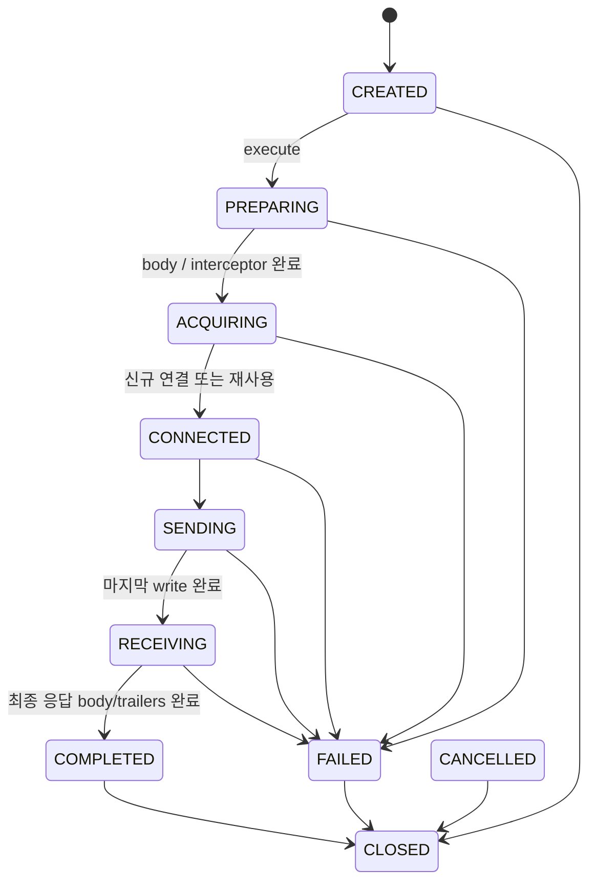

> 초기 설계 이력입니다. 실제 구현의 구조·API·지원 범위는 [project.md](project.md)와 [README.md](README.md)를 기준으로 합니다.

# HTTP Client Executor 설계

- 작성일: 2026-11-19
- 상태: 요구사항 기반 설계안. HT5 raw 전송·원본 기록은 기술 검증이 필요한 미해결 항목이다. Java 소스와 Maven 프로젝트는 아직 생성하지 않았다.
- 요구 원문: [http-client-executor.md](http-client-executor.md)
- Java 기준: 17, 패키지 기준: `com.inzent.apim.utilities.http.client`
- 프로젝트 구조: 사용자 지시에 따라 Maven 모듈을 분리하지 않고 단일 프로젝트·단일 JAR로 통합한다.
- 이 문서의 기본값과 지원 범위는 기존 코드 조사에 따른 설계 판단이며 구현 검증 결과가 아니다.

## 1. 목적과 설계 선택

HT5(Apache HttpClient 5), Netty, pure Java 중 커넥터를 선택하고 동일한 manager/executor/context API로 요청을 실행한다. 정상 HTTP 호출과 잘못된 본문 길이를 보내는 오류 응답 실험을 구분하며, 요청·응답·전송 과정·실패 근거를 실행별로 보관한다.

| 접근 | 장점 | 비용 및 판단 |
|---|---|---|
| 단일 Maven 프로젝트에 세 커넥터와 payload 연동 포함 | 하나의 의존성과 빌드로 사용, 배포 구성이 단순함 | Java 선택 시에도 Apache/Netty 의존성이 포함됨. 사용자 지시에 따라 채택 |
| 공통 코어와 선택형 커넥터 분리 | 라이브러리 격리, Java 단독 사용 가능 | 하위 Maven 모듈을 만들지 않는 사용자 지시에 따라 미채택 |
| 모든 커넥터를 동일한 고수준 HTTP API로 감쌈 | 정상 요청 구현량이 적음 | 부정확한 Content-Length와 전송 원본 요구를 보장할 수 없어 미채택 |

Java 커넥터는 `java.net.http.HttpClient` 대신 JDK `Socket`/`SSLSocket`과 HTTP/1.1 직렬화·파서를 사용한다. JDK HttpClient는 Content-Length 등을 구현체가 관리하므로 요청 그대로의 잘못된 프레이밍을 보장하는 수단으로 사용하지 않는다. HT5는 HTTP/2를 위해 async transport를 사용하고 외부에는 동기 실행 API를 제공한다. Netty는 정상 codec 경로와 HTTP/1.1 raw 쓰기 경로를 분리한다.

### 범위와 명시적 제약

- 1차 범위: HTTP/1.1, HT5/Netty의 HTTPS ALPN HTTP/2, TCP/TLS/mTLS, HTTP forward proxy와 HTTPS CONNECT, 풀, raw/generator 본문, 네 종류의 interceptor, 이력과 자원 정리.
- HTTP/3, WebSocket, SSE 전용 스트리밍 API, HTTP/2 임의 frame 손상, h2c, SOCKS, NTLM/Kerberos proxy 인증은 1차 범위 밖이다.
- HTTP 응답 4xx/5xx는 정상 수신 결과다. 자동 재시도·리다이렉트·cookie 저장·본문 자동 압축 해제는 기본적으로 사용하지 않는다. 3xx도 그대로 반환한다.
- 원문에 모든 커넥터의 HTTP 버전 지원 범위는 명시되어 있지 않다. Java의 HTTP/2와 HT5의 잘못된 길이 전송은 아래와 같이 지원 제한으로 명시한다. 커넥터를 몰래 바꾸거나 본문/헤더를 보정하지 않는다.

## 2. 단일 Maven 프로젝트와 패키지 구성

`http-client-executor/`에 하나의 `pom.xml`과 `src/main/java`, `src/test/java`를 둔다. `packaging=jar`이며 공통 기능과 세 커넥터, payload 연동 코드를 같은 소스 트리에서 개발하고 하나의 JAR에 포함한다. aggregator와 하위 Maven 모듈은 만들지 않는다.

| 패키지 (`com.inzent.apim.utilities.http.client` 기준) | 책임 |
|---|---|
| 기본 패키지 | manager/executor 진입점, connector 선택 |
| `.config`, `.model` | 불변 설정, 공통 값 객체, 요청·응답 모델 |
| `.execution`, `.interceptor` | 실행 context, history, 상태와 이벤트 |
| `.spi`, `.store` | 내부 커넥터 계약, provider registry, BodyStore |
| `.connector.java` | JDK socket/TLS, 공통 값을 직접 사용 |
| `.connector.ht5` | Apache HttpClient 5 async, 전용 변환기 |
| `.connector.netty` | Netty HTTP/HTTP2, 전용 변환기 |
| `.payload` | 기존 `http-payload-generator` 연동 어댑터 |

Maven 좌표는 `com.inzent.apim.utilities:http-client-executor:1.0.0-SNAPSHOT`이다. 이 프로젝트의 POM에 Apache HttpClient 5, Netty HTTP/HTTP2, 기존 `http-payload-generator`를 일반 의존성으로 선언한다. 사용자는 이 artifact 하나를 의존성에 추가하고 `ConnectorType`으로 실행할 구현을 선택한다. 기존 generator는 별도 유틸리티 의존성으로 재사용하고 소스를 복제하지 않는다.

pure Java는 전송 구현이 JDK만 사용한다는 의미다. 통합 artifact에는 Apache/Netty 및 generator의 압축 native 라이브러리 의존성도 전이된다. 커넥터 선택을 위한 Maven profile이나 optional 의존성은 두지 않는다. 일반 JAR과 전이 의존성을 배포하며 fat/shaded JAR 생성은 초기 범위에 넣지 않는다.

공통 API 시그니처에 Apache/Netty 타입을 노출하지 않는다. `.spi`의 `ConnectorProvider`는 같은 JAR 내부 구현 경계로 유지하고, 세 구현을 내장 registry에 명시적으로 등록한다. `ServiceLoader` 검색이나 외부 플러그인 등록은 초기 범위에 넣지 않는다. provider 객체 등록은 자원을 만들지 않으며 executor 생성 시 선택한 커넥터의 client/pool/worker만 초기화한다.

의존성 버전은 구현 시 Java 17 호환 안정 버전을 확인해 단일 POM의 properties/dependencyManagement에 고정한다. payload-generator의 현재 POM에는 Netty `4.2.21.Final`이 지정되어 있으나 이를 버전 조사 결과로 간주하지 않는다. 직접·전이 Netty 의존성 전체를 같은 버전으로 정렬하고 Apache HttpCore도 HttpClient의 호환 조합을 따른다.

단일 POM에 package 단계 `maven-source-plugin:jar-no-fork`를 연결해 전체 소스를 담은 sources JAR을 첨부한다. 프로젝트 루트 `*.md`를 일반 JAR의 `META-INF/docs/http-client-executor/`에 넣어 요구 원문과 본 설계, 구현 후 README를 포함한다. 생성되는 XML은 pretty format으로 저장한다.

## 3. 공통 모델과 커넥터 기능 협상

| 타입 | 계약 |
|---|---|
| `ConnectorType` | `HT5`, `NETTY`, `JAVA` |
| `ConnectMethod` | 불변 token 값 객체, GET/POST 등 상수와 `of(String)`으로 확장 메서드 지원. CR/LF·공백 등 잘못된 token 거부 |
| `ConnectVersion` | `HTTP_1_1`, `HTTP_2`; 요청 버전을 정확히 요구하며 묵시적 downgrade 금지 |
| `ResponseStatus` | code와 optional reason phrase. 알려지지 않은 유효 3자리 코드도 보존, HTTP/2 reason은 빈 값 |
| `HttpHeaders` | 순서 있는 다중 값 entry 목록, 이름 조회는 대소문자 무시. 입력 복사, CR/LF 주입 거부 |
| `HttpRequestPayload` | URI, method, 요청/실제 version, effective headers, 생성/변경 본문 참조, connector 식별자 |
| `HttpResponsePayload` | status, 실제 version, headers, trailers, 본문 참조, interim response 목록 |
| `ConnectorCapabilities` | versions, raw HTTP/1.1, capture levels, 지원 TCP/풀/전용 option 목록 |

HT5/Netty 변환기는 method/version/status/headers를 양방향 변환한다. Java는 이 공통 값을 직접 직렬화·파싱한다. native 요청·응답 객체는 실행 scope 내부에만 유지하고 context에는 이식 가능한 snapshot을 보관한다. Apache/Netty의 자원 객체를 public context에 붙이지 않는다.

| 기능 | HT5 | Netty | Java |
|---|---|---|---|
| HTTP/1.1 HTTP/HTTPS | 지원 | 지원 | 지원 |
| HTTP/2 HTTPS ALPN | 지원 | 지원 | 미지원 |
| mTLS / HTTP proxy / CONNECT | 지원 | 지원 | 지원 |
| 정상 본문 교체 | 지원 | 지원 | 지원 |
| 길이 불일치 본문 그대로 전송 | 미지원 | raw HTTP/1.1 | raw HTTP/1.1 |
| 논리 요청·응답 기록 | 지원 | 지원 | 지원 |
| 실제 HTTP/1.1 plaintext 직렬화 바이트 기록 | 1차 미지원 | 지원 | 지원 |

`WireMode.STANDARD`와 `RAW_HTTP1`을 실행 설정으로 제공한다. RAW_HTTP1은 Java/Netty + HTTP_1_1만 허용한다. 기능 불일치는 build 시 가능한 범위에서, URI 등 실행별 값은 execute의 연결 전 검증에서 `UnsupportedCapabilityException`으로 명시한다. HT5는 interceptor가 본문을 변경하면 명시된 길이와 새 길이를 연결 전에 대조한다. 맞지 않으면 전송하지 않고 실패하며 헤더·본문을 수정하지 않는다. 모든 커넥터에서 길이 불일치 전송이 필수라면 HT5 저수준 writer 확장이 추가로 필요하고, 이를 이번 설계의 지원 기능으로 주장하지 않는다.

## 4. Manager와 설정 우선순위

`HttpClientManager`는 생성 시 받은 불변 기본 `ConnectionConfigure`와 자신이 생성한 executor를 관리한다. 기본 설정은 manager 수명 중 변경하지 않는다. `manager.executorBuilder(ConnectorType)`로 builder를 만들고 설정 전체 주입 또는 필드별 override를 적용한다.

설정 합성 순서는 `라이브러리 기본값 < manager 기본값 < builder.connectionConfigure(...) 전체 대체 < builder 필드별 override`다. 각 build는 방어적으로 복사한 새 snapshot과 전용 pool을 만든다. 한 executor의 변경이나 close가 다른 executor에 영향을 주지 않는다. 연결 수 제한은 executor 단위이며 manager 전체 제한으로 해석하지 않는다.

커넥터 옵션은 `Ht5Options`, `NettyOptions`, `JavaOptions`의 typed immutable builder로 주입한다. 다른 connector 옵션이나 공통 설정과 중복되는 전용 값은 거부한다. native client 자체 주입과 문자열 Object map은 초기 API에 넣지 않는다. 공통 설정을 전용 옵션으로 우회하지 않는다.

### ConnectionConfigure 제안 기본값

| 구분 | 속성 | 기본값과 의미 |
|---|---|---|
| TCP | connectTimeout / tcpNoDelay / keepAlive | 5초 / true / true |
| TCP | sendBufferSize / receiveBufferSize / localAddress | 미지정이면 OS 기본 |
| 시간 | poolAcquireTimeout / tlsHandshakeTimeout | 5초 / 10초 |
| 시간 | responseIdleTimeout / executionTimeout | 30초 / 60초. idle은 응답 데이터 간 무수신, execution은 준비부터 정리 진입까지 전체 deadline |
| TLS | SSLContext 또는 keyStore/trustStore 설정 | 기본 JDK trust, hostname 검증 활성. 두 TLS 구성 방법 동시 지정 금지 |
| TLS | protocols / client key alias | TLSv1.3,TLSv1.2 / 미지정. 필요 시 mTLS alias 명시 |
| proxy | enabled / host,port / credentials | false / 활성화 시 필수 / 선택적 Basic 인증 |
| 풀 | maxConnTotal / maxConnPerRoute | 100 / 20, 모두 양수이며 perRoute ≤ total |
| 풀 | leaseOrder / idleTimeout / timeToLive | LIFO / 30초 / 5분 |
| 종료 | shutdownTimeout | 5초, 이후 active 전송 취소 및 자원 회수 |

timeout은 양수 `Duration`만 허용하며 무제한 sentinel은 초기 API에 넣지 않는다. TCP keepalive와 HTTP 연결 재사용은 별개다. TLS trust-all은 기본 제공하지 않으며 인증서·키 비밀번호·proxy 비밀정보는 로그/이력에 남기지 않는다. HTTP 목적지 proxy 요청은 absolute-form, HTTPS는 CONNECT 후 목적지 hostname 검증과 mTLS를 수행한다. proxy 자체의 TLS(HTTPS proxy)는 1차 미지원이다. URI userinfo는 거부하고 인증정보는 전용 설정에만 받는다.

pool route key는 scheme/정규화 host/실효 port/proxy endpoint/TLS identity로 구성한다. HTTP/1.1은 한 lease에서 한 실행만 처리하며 pipelining은 사용하지 않는다. raw 연결은 단발성이다. HTTP/2의 maxConn 값은 물리 연결 수이고 별도 `maxConcurrentStreamsPerConnection` 기본 100과 서버 SETTINGS 중 작은 값을 따른다. stream 대기는 동일 acquire deadline에 포함한다. 공정한 대기열·엄격한 연결 상한을 공통 정책으로 제공하고 leaseOrder는 FIFO/LIFO를 지원한다. idle/TTL 만료 연결은 새 lease에서 제외하며 active 실행을 TTL만으로 끊지 않는다.

전용 옵션 예시는 HT5의 reactor thread 수, Netty의 event loop thread 수·HTTP/2 window, Java의 read buffer 크기다. 지원하지 않는 socket option은 묵시적으로 무시하지 않고 build 실패로 처리한다.

## 5. Executor와 URI 결정

`HttpClientExecutor`는 thread-safe하고 여러 context를 동시에 실행할 수 있다. 기본 `location(URI)`, `path(String)`, `method(ConnectMethod)`, `version(ConnectVersion)`을 보유한다. 기본 method는 GET, version은 HTTP_1_1, path는 빈 값이다. location은 전체 URL을 매번 지정하는 용도로 생략할 수 있다.

`ExecutionContext.builder(executor)`는 executor의 요청 기본값을 복사한다. `url(URI)`을 지정하면 완성된 절대 HTTP(S) URI로 사용하며 location/path를 추가하지 않는다. url과 context path를 함께 지정하면 모호성을 피하기 위해 build 오류다. url 미지정 시 context path가 executor path를 대체하며 다음 규칙으로 조합한다.

1. location은 HTTP(S) 절대 URI이고 query/fragment/userinfo를 허용하지 않는다. base path는 허용한다.
2. path는 상대 경로와 optional query만 허용하고 scheme/authority/fragment를 거부한다. 선행 `/`는 base path를 버리는 의미가 아니라 경계 구분자로 취급한다.
3. base path의 마지막 `/`와 path의 첫 `/`만 합쳐 하나로 만든다. `/api/` + `/orders?q=1` → `/api/orders?q=1`. path가 비면 base path를 유지하고 빈 최종 경로는 `/`다.
4. 이미 percent-encoded된 octet과 query 순서를 보존한다. 내부의 중복 slash와 dot segment는 자동 정규화하지 않는다. 유효하지 않은 URI는 연결 전에 거부한다.
5. 전체 URL·method·version·headers·본문을 연결 전 불변 effective request로 확정한다. HTTP/1.1 Host와 HTTP/2 authority는 이 URL에서 생성하며 상충하는 사용자 값은 거부한다.

헤더 합성은 generator 기본 헤더 이후 사용자가 같은 이름을 지정하면 해당 이름의 전체 목록을 교체한다. raw mode의 명시적 Content-Length는 유지한다. STANDARD는 실제 본문 길이와 framing 헤더의 정합성을 검증하며 Content-Length/Transfer-Encoding 동시 지정과 지원하지 않는 transfer coding을 거부한다.

## 6. 본문과 Payload Generator

공통 `RequestBody`는 `empty()`, `bytes(String contentType, byte[])`, `PayloadBody` 어댑터를 받는다. 중복 body 지정은 마지막 값으로 교체하지 않고 build 오류로 처리한다. bytes는 방어 복사하며 empty와 길이 0인 명시적 본문을 구분한다.

같은 프로젝트의 `.payload` 패키지에 있는 `PayloadBody`가 기존 `HttpPayloadGenerator.generate(...)`와 ContentType/ContentEncoding/contentLength/blockSize/chunked 옵션을 묶는다. generator의 Netty headers는 callback 안에서 공통 headers로 복사하고, InputStream 역시 callback 안에서 BodyStore로 끝까지 복사한다. callback 이후 원래 stream을 보관하거나 비동기로 읽지 않는다. generator는 HTTP chunk framing을 생성하지 않으므로 framing은 connector가 담당한다.

### contentGenerated 계약

- 본문 준비 후 `byte[] contentGenerated(byte[] content)`를 한 번 호출한다. null 반환은 전달한 배열을 최종 본문으로 유지하고(배열 내부 변경도 반영), non-null은 반환 배열을 그대로 최종 본문으로 채택한다. interceptor 경계를 나온 뒤 방어 복사해 후속 외부 변경을 차단한다.
- 최종 본문에는 재압축, 문자 변환, padding, truncation을 적용하지 않는다. 기존 Content-Encoding과 Content-Type도 자동 변경하지 않는다. 초기 생성 본문과 최종 본문 길이를 각각 이력에 기록한다.
- hook가 없으면 대용량 본문을 파일/stream으로 처리한다. hook가 있으면 전체 배열이 필요하므로 `maxInterceptorBodyBytes` 기본 16 MiB를 적용한다. 입력 초과는 hook/연결 전에 실패한다. 반환 배열 초과도 연결 전에 실패하며 잘라 보내지 않는다. 큰 배열 자체를 사용자 hook가 할당하는 위험은 이 제한으로 방지할 수 없다.
- 원본 generator 헤더에는 생성 시점의 인코딩된 길이가 들어간다. RAW_HTTP1은 hook 이후 길이가 달라도 해당 Content-Length를 유지한다. STANDARD는 불일치 시 실패한다. null 반환으로 배열을 수정한 경우도 동일하다.

## 7. RAW_HTTP1 전송과 오류 응답 실험

Java는 공통 raw writer로 socket output에, Netty는 HTTP encoder를 통과하지 않는 전용 raw pipeline으로 header bytes + 최종 body bytes를 쓴다. TLS일 때도 TLS handler/SSLSocket의 암호화는 그대로 거친다. HTTP/2와 raw mode의 조합은 금지한다.

- RAW_HTTP1의 헤더는 생성 본문 또는 명시된 헤더로 확정하고, hook 결과의 실제 길이에 맞춰 다시 계산하지 않는다. Content-Length와 Transfer-Encoding을 동시에 주는 별도의 request smuggling 실험은 범위 밖으로 두고 거부한다.
- chunked면 최종 배열 그대로를 chunk data로 넣고 유효한 chunk framing과 종료 chunk를 writer가 만든다. 임의의 손상된 chunk delimiter/길이 조작 API는 초기 범위 밖이다.
- raw 요청은 pool에서 lease하지 않고 전용 연결을 할당하되 동일 total/perRoute 연결 예산에는 포함한다. 정상 pool에 반환하지 않으며 response 완료/실패 후 반드시 폐기한다.
- `RawEndPolicy.KEEP_OUTPUT_OPEN`을 기본으로 사용한다. 선언 길이보다 짧으면 서버가 기다릴 수 있으며 응답/전체 timeout으로 종료한다. 오류 status 응답을 반드시 받을 수 있다고 보장하지 않는다.
- 선택적 `SHUTDOWN_OUTPUT`은 마지막 write 후 출력만 닫고 응답을 읽는다. TLS close_notify와 서버의 half-close 처리에 따라 응답이 없거나 예외가 생길 수 있으므로 HTTP/HTTPS 각각 통합 검증한다.
- 선언 길이보다 길면 여분이 다음 요청처럼 해석될 수 있으므로 단발 연결만 사용한다. 서버 조기 응답도 별도 읽기 경로로 수신한다. 서버가 먼저 닫아 일부 쓰기만 성공하면 부분 전송으로 기록하며 전체 body 전달 성공으로 표시하지 않는다.

## 8. ExecutionContext, 실패와 이벤트

`ExecutionContext`는 single-use, `AutoCloseable`이다. public `execute()`는 같은 context를 반환하며 한 번만 호출할 수 있다. build 입력 오류는 예외로 반환한다. execute 중 일반 실행 실패는 `FAILED`와 `ExecutionFailure`를 context에 기록해 반환한다. 필요 시 호출자가 `throwIfFailed()`로 원래 원인을 가진 `ClientExecutionException`을 받을 수 있다. JVM `Error`는 최선의 기록·정리 후 다시 던진다.



취소는 active 모든 상태에서 CANCELLED로 전이할 수 있다. diagram의 SENDING 중에도 connector는 조기 응답을 수신·저장할 수 있다. 응답 완료와 송신 완료는 별도 flag이며 조기 응답으로 송신이 중단되면 requestSent를 발행하지 않는다. COMPLETED는 전송이 일관되게 종료되고 최종 응답을 완전히 읽은 경우다.

| interceptor 메서드(설계 시그니처) | 발생 및 예외 정책 |
|---|---|
| `byte[] contentGenerated(byte[])` | 본문 준비 직후, 연결 전. 예외면 전송하지 않고 실패 |
| `void connectResult(ConnectResult)` | 실행당 1회, route 사용 준비 또는 획득/연결/TLS 실패. `NEW/REUSED/FAILED` 및 단계·원인 포함 |
| `void requestSent(RequestSentEvent)` | 모든 요청 bytes의 로컬 write 완료 후 1회. 원격 수신 확인이 아님 |
| `void responseReceived(ResponseReceivedEvent)` | 최종 응답 body와 trailers까지 수신 완료한 경우 1회. 부분 수신에는 호출하지 않음 |

기본 interceptor는 no-op이며 본문 배열 hook 활성 여부를 별도 capability로 표시해 불필요한 materialization을 피한다. context당 하나의 interceptor를 받는다. 체인 확장은 초기 범위 밖이다. 내용 변경 hook만 제어 훅이고 나머지 알림 예외는 `interceptorFailures`에 기록하며 transport를 중단하지 않는다. Error는 예외적으로 기록/정리 후 전파한다. 준비 실패에는 connectResult가 없고, 연결을 시도한 경우 성공 또는 실패 중 하나만 발행한다.

콜백은 context별 직렬화해 호출하고 Netty event loop/HT5 I/O thread에서는 사용자 코드를 실행하지 않는다. 동기 execute 호출 스레드가 event queue를 소비하며 대기한다. requestSent보다 일찍 도착한 완전 응답의 알림은 송신 성공/중단이 확정된 뒤 전달한다. hook는 executor.close/context.close의 재진입을 거부하며 cancel 요청만 허용한다. 공유 interceptor의 context 간 thread safety는 호출자가 책임진다.

`cancel()`은 idempotent하며 실행 전에는 이후 execute를 금지하고 실행 중에는 socket/channel 또는 HTTP/2 stream을 중단한다. 스레드 interrupt는 취소로 기록하고 호출 스레드 interrupt 상태를 유지한다. 임의의 사용자 hook나 custom generator가 무한 대기하면 deadline만으로 해당 코드를 강제 종료할 수 없다는 제한을 문서화한다.

## 9. 이력과 원본 기록

이력은 순번, stage, 시작/종료 Instant, monotonic 소요시간, 성공/실패, 원인, connection/stream ID를 보유한다. 단계는 PREPARE_BODY, INTERCEPT_BODY, ACQUIRE, DNS, TCP_CONNECT, PROXY_CONNECT, TLS_HANDSHAKE, SEND, RECEIVE, RELEASE다. 커넥터에서 관측할 수 없는 세부 시간은 `UNAVAILABLE`, 재사용으로 생략된 단계는 `SKIPPED`로 기록하고 0ms 측정값으로 꾸미지 않는다.

요청 summary에는 URL/method/요청·실제 version, 헤더, 생성·최종·write 성공 byte 수, route, 재사용 여부를 포함한다. 응답에는 interim/final status, headers/trailers, body, 완료 여부와 부분 오류를 남긴다. 본문은 자동 decompress하지 않은 entity bytes이며 chunk framing은 별도 capture에만 들어간다.

`CaptureLevel`은 NONE, LOGICAL, HTTP1_PLAINTEXT_BYTES이며 기본 LOGICAL이다. HTTP1_PLAINTEXT_BYTES를 요구했는데 미지원이면 실행 전에 실패한다. Java는 실제 output write에 전달된 순서를 tee하고 Netty는 HTTP 직렬화 후 TLS 전 outbound 지점에서 기록한다. 시도한 bytes와 write 완료 확인 범위를 구분하며 write 도중 IOException이 나면 실제 원격 도달량은 `UNKNOWN`이다. HTTP/2는 논리 headers/body와 stream ID만 제공한다. HTTP/2 HPACK frame을 요청별 독립 패킷으로 재구성했다고 표시하지 않는다.

요구 원문의 “packet 원본”은 이 설계에서 **TLS 암호화 전 HTTP 애플리케이션 직렬화 bytes**로 정의한다. TCP segmentation/재전송, TLS record, NIC packet 또는 서버 수신의 증거가 아니다. 진짜 네트워크 packet이 필요하면 별도 pcap 수집이 필요하다. 이 정의와 HT5의 1차 capture 제한을 공개 API 문서에도 명시한다.

이력 summary의 Authorization/Proxy-Authorization/Cookie/Set-Cookie는 기본 마스킹한다. raw capture와 본문은 원문을 보존하므로 민감정보를 포함할 수 있다. 명시적으로 capture를 켠 실행에 한해 context 전용 파일에 저장하며 기본 로그에는 출력하지 않는다.

## 10. 저장·응답 파서·자원 수명

- `BodyStore`는 1 MiB까지 memory, 초과 시 임시 파일로 전환한다. request/response/capture 각각 `maxStoredBytes` 기본 64 MiB와 초과 정책을 둔다. request는 초과 시 전송 전 실패, response는 초과 시 실행 실패와 연결 폐기, 선택 capture는 초과분 저장을 중단하고 `truncated=true`를 표시한다. 완전 raw capture가 필수인 옵션에서는 초과 시 실패한다.
- hook가 없는 generator는 memory/file store로 복사하며 큰 원문 byte[]를 만들지 않는다. 모든 limit는 인코딩 후 bytes 기준이다. limits를 늘릴 때 임시 디스크 용량과 배열 hook 상한을 별도로 고려한다.
- Java/Netty raw response parser는 HTTP/1.1 status line·다중 headers·interim 1xx·Content-Length·chunked/trailers·close-delimited를 처리한다. HEAD와 204/304는 body가 없고 101/프로토콜 전환은 지원 오류다. 100 Continue는 기록만 하며 자동 Expect 전송은 하지 않는다.
- 응답 header 총량 기본 64 KiB, line 기본 8 KiB, interim 기본 최대 16개를 제한한다. 중복 Content-Length는 같은 값만 수용하고 모순된 길이와 TE/CL 동시 응답은 protocol failure로 종료한다. EOF 전 종료·불완전 chunk는 partial response로 보존한다.
- 서버가 HTTP/1.1 body를 끝내지 않거나 SSE처럼 계속 보내면 idle/전체 timeout 또는 body limit로 종료한다. 응답을 완전히 소비하고 framing이 정상인 연결만 pool에 반환한다. HTTP/2 stream 실패는 가능한 경우 해당 stream만 reset한다.
- context는 완료 후 본문 store와 capture를 소유한다. `close()` 후에는 파일/stream에 접근할 수 없고 작은 불변 summary/history는 조회 가능하다. close는 idempotent하고 실행 중에는 cancel을 요청한 뒤 실행 반환 후 호출하도록 명시한다. 실행 중 직접 close는 IllegalStateException이다.
- executor는 client/pool과 자신이 생성한 worker·event loop를 소유한다. close 시 신규 context 실행을 차단하고 shutdownTimeout 대기 후 취소한다. 완료 context의 파일은 삭제하지 않으며 사용자가 context를 닫아야 한다. manager close는 소유 executor를 모두 닫는다.
- 생성 중 실패·timeout·취소·callback 예외에서도 lease/socket/channel/stream/ByteBuf/임시 파일을 정리한다. 본래 원인은 유지하고 정리 실패를 suppressed로 붙인다. 삭제 실패한 store는 close 재시도가 가능하게 남기고 무조건 정리 성공으로 표시하지 않는다.

## 11. 예정 공개 API 사용 흐름

다음은 구현 예정 계약 예시이며 실행 가능한 현재 API가 아니다. content type은 raw body와 함께 지정하고 Content-Length는 실제 bytes 길이로 생성된다.

```java
ConnectionConfigure defaults = ConnectionConfigure.builder()
    .maxConnTotal(100)
    .maxConnPerRoute(20)
    .build();

try (HttpClientManager manager = HttpClientManager.create(defaults);
     HttpClientExecutor executor = manager.executorBuilder(ConnectorType.JAVA)
         .location(URI.create("https://localhost:8443/api"))
         .path("/orders")
         .method(ConnectMethod.POST)
         .version(ConnectVersion.HTTP_1_1)
         .build();
     ExecutionContext context = ExecutionContext.builder(executor)
         .body(RequestBody.bytes("application/json", "{}".getBytes(StandardCharsets.UTF_8)))
         .build()) {
    context.execute();
    context.throwIfFailed();
    HttpResponsePayload response = context.response();
}
```

길이 오류 실험은 JAVA/NETTY executor의 RAW_HTTP1을 선택하고 context interceptor에서 `contentGenerated` 결과를 바꾼다. 예를 들어 생성 본문 2 bytes / Content-Length 2에서 3 bytes를 반환하면 헤더는 2, 최종 본문은 3 그대로 쓴다. HT5/STANDARD에서는 전송 전 실패한다. generator 사용은 `PayloadBody`를 body에 전달하고 같은 context 실행 흐름을 따른다.

## 12. 구현 순서와 수용 기준

1. 단일 POM과 소스 트리를 구성하고 공통 모델·내장 provider registry·기능 협상·설정 snapshot·URI 합성·context 상태·BodyStore 계약을 구현한다. HT5 미해결 항목의 선행 기술 검증은 14절을 따른다.
2. Java HTTP/1.1 serializer/parser, TCP/TLS/mTLS/proxy, raw 쓰기와 capture를 구현해 공통 계약의 기준 동작을 만든다.
3. payload adapter와 배열 hook를 추가하고 callback 수명·최종 본문 보존을 검증한다.
4. HT5 async adapter와 Netty HTTP/1.1·HTTP/2 adapter를 구현한다. pooling·cancel·interceptor 직렬화 계약을 공통 테스트로 검증한다.
5. `http-client-executor/project.md`를 실제 구성에 맞게 갱신하고 구현 완료 후 같은 경로의 `README.md`에 단일 Maven 의존성, 커넥터 선택, 실제 API, 지원표, 사용법, 제한과 종료 책임을 작성한다.

| 검증 | 수용 조건 |
|---|---|
| 공통 모델/URI | custom method, 미지의 status, 중복 headers, escaped path/query, URL/path 충돌과 미지원 version 검증 |
| 설정/동시성 | manager와 executor 설정 격리, total/perRoute 상한, FIFO/LIFO, acquire timeout, H2 stream limit |
| TLS/proxy | 신뢰 인증서 성공, hostname/신뢰 실패, client cert 필수 mTLS, proxy absolute-form/CONNECT/Basic, 비밀 마스킹 |
| generator | 모든 기존 타입/encoding 헤더·bytes 보존, callback 이후 stream 미사용, 빈 본문·큰 본문·압축 취소 |
| interceptor | null/동일/새 배열 반환, 입력 배열 변경, hook 상한, 정확한 순서·횟수, 재사용/실패/조기 응답·알림 예외 |
| raw HTTP/1.1 | 독립 socket 서버가 길이보다 작은/같은/큰 bytes를 직접 확인. HTTP/HTTPS 모두 본문 무보정·단발 연결 검증 |
| capture | 서버 수신 bytes와 plaintext capture 비교, 부분 write UNKNOWN, capture limit/truncated, 미지원 요구의 전송 전 실패 |
| 응답 파싱 | 1xx/HEAD/204/304/chunked/trailer/close-delimited, 잘못된 framing, 조기 EOF, 4xx/5xx 결과 보존 |
| 자원 | timeout/cancel/interruption/생성 실패/close 경쟁 시 연결·stream·ByteBuf·thread·파일 회수와 원인 보존 |
| Maven | 단일 POM의 Java 17 clean verify, 세 커넥터·payload를 포함한 일반/소스 JAR, Markdown 경로, 의존성 정렬, 선택한 커넥터만 자원 초기화, 테스트 생략 install 확인 |

기능 통합 테스트는 로컬 fixture로 수행하고 외부 서버에 의존하지 않는다. raw 검증 서버는 고수준 HTTP parser가 추가 bytes를 버리기 전에 socket bytes를 기록한다. Netty는 PARANOID leak detection과 refCnt 단언을 함께 사용한다.

빌드 예정 명령은 `mvn -f http-client-executor/pom.xml clean verify`다. 기존 payload-generator가 독립 모듈이므로 선행 `mvn -f http-payload-generator/pom.xml -Dmaven.test.skip=true install`이 필요하다. 검증 후 설치는 `mvn -f http-client-executor/pom.xml -Dmaven.test.skip=true install`로 수행한다. install은 앞선 lifecycle에 test가 포함되므로 phase 이름만으로 자동 생략된다고 설명하지 않는다. 설치 명령에서 테스트 실행과 컴파일을 명시적으로 생략하고, 검증은 별도 verify로 수행한다.

## 13. 참고 및 설계 근거

- [기존 generator API](../http-payload-generator/src/main/java/com/inzent/apim/utilities/http/payload/HttpPayloadGenerator.java)와 [callback 구현](../http-payload-generator/src/main/java/com/inzent/apim/utilities/http/payload/DefaultHttpPayloadGenerator.java): headers/stream은 callback scope에서 소비해야 한다.
- [기존 curl executor](../curl-http-mock-executor/project.md): 실행별 요청·응답·오류 기록과 body store 운영 경험을 참고하되 프로세스 실행 및 native Netty 공개 타입은 새 core에 옮기지 않는다.
- [Oracle Java 17 HttpRequest.Builder](https://docs.oracle.com/en/java/javase/17/docs/api/java.net.http/java/net/http/HttpRequest.Builder.html): 구현체가 Content-Length 등 헤더를 제한/관리할 수 있다는 API 계약.
- [Apache HttpClient architecture](https://hc.apache.org/httpcomponents-client-5.6.x/architecture.html): classic은 HTTP/1.1, async는 HTTP/1.1과 HTTP/2를 지원한다. 실제 채택 artifact 버전은 구현 시 별도 확정한다.
- [Netty HTTP/2 codec](https://netty.io/4.2/api/io/netty/handler/codec/http2/Http2FrameCodec.html)와 [multiplex API](https://netty.io/4.2/api/io/netty/handler/codec/http2/Http2MultiplexCodec.html): `Http2FrameCodecBuilder` + `Http2MultiplexHandler` 조합을 사용한다.
- [JDK SSLSocket](https://docs.oracle.com/en/java/javase/17/docs/api/java.base/javax/net/ssl/SSLSocket.html): TLS output shutdown과 입력 종료는 peer 종료 방식에 영향을 받는다.

공개 API 세부 메서드명, 내부 worker/queue 구조, 성능 최적화는 위 계약을 유지하는 범위에서 구현 시 결정한다. 성능 수치와 모든 커넥터의 raw 전송 동등성은 검증 전 보장하지 않는다.

## 14. 요구사항 대조와 구현 착수 조건

검토 결과, 공통 API·설정·generator·context·이벤트의 설계는 구현 계획 수립이 가능하나, 위 1차 지원표만으로 원문 전체를 충족했다고 볼 수 없다. 다음 두 항목은 사용자에게 승인된 범위 축소가 아니라 설계상의 미해결 기술 항목이다.

| 원문 요구 | 현재 설계와의 차이 | 해소 조건 |
|---|---|---|
| hook 결과는 Content-Length와 달라도 반드시 전송 | HT5 STANDARD는 전송 전에 거부함. Java/Netty도 RAW_HTTP1 선택이 필요함 | HT5 HTTP/1.1 저수준 writer 확장으로 선언 길이와 무관하게 최종 배열 전체를 쓰는 경로를 검증하고 지원표 갱신 |
| context에 전송 원본 보관 | HT5는 논리 기록만 계획되어 있음 | HT5에서 직렬화 후 TLS 전의 실제 쓰기를 기록하는 확장 지점을 검증하고 HTTP/1.1 원본 기록 제공 |

후속 구현의 첫 기술 검증은 HT5 HTTP/1.1 전송 계층 확장이다. Apache connection/session 또는 serializer 확장 경계에서 길이 제한 entity writer를 우회하면서 client의 route/proxy/TLS 관리와 수신 처리를 유지할 수 있는지 확인한다. 정확한 확장 클래스·protected API·지원 버전은 아직 확인하지 않았으며 존재한다고 가정하지 않는다. 별도 Java/Netty socket으로 전송한 뒤 HT5라고 표시하는 대체 구현은 허용하지 않는다.

이 검증은 로컬 TCP/TLS fixture에서 선언 길이보다 작은/같은/큰 본문, 서버 조기 응답, 원본 capture, 취소·close를 대상으로 한다. 성공해야 HT5 raw 기능을 구현 계획의 확정 범위에 넣는다. 실패하면 HT5 transport 확장 방식을 재설계하며 요구사항을 완료 처리하지 않는다. HTTP/2의 임의 길이 위반은 정상 frame 계층에서 보장할 수 없으므로 해당 버전의 명시적 제한으로 계속 남긴다.

원문의 본문 교체 의도를 기본 실행에서도 보존하려면 HTTP/1.1에서 hook 활성 실행을 raw 경로로 배정하는 정책이 필요하다. HT5 검증 성공 후 `AUTO` 모드를 기본으로 추가해 hook 활성 HTTP/1.1을 커넥터 자신의 raw 경로로 배정하고, 엄격한 검증을 원하는 사용자가 STANDARD를 명시하도록 한다. 이때 실제 wire mode를 context에 기록하고 서로 다른 connector로는 전환하지 않는다. 현재 지원표와 RAW_HTTP1 예시는 이 최종 정책 이전의 구현 가능 경로를 설명한다.

문서 검토는 위 두 항목을 찾아 이 절에 반영했다. 설계안 작성과 요구사항 전체 충족·기술 검증 완료는 구분하며, 현재 빌드·네트워크 동작을 검증했다는 의미는 아니다.
