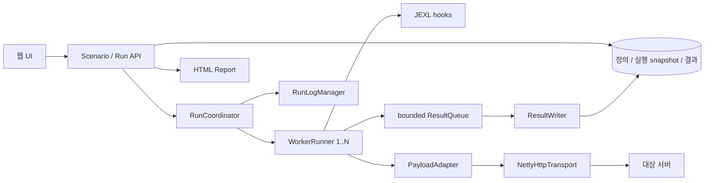

# HTTP Mock Request Caller 구현 설계

## 구현 현황 (2026-11-12)

시나리오 CRUD/버전 관리, payload 전체 조합과 seed 순서, Netty HTTP/HTTPS 호출, worker/ramp-up/취소, 네 레벨 JEXL hook, bounded 결과 저장과 journal 복구, 개별 rolling 로그, 진행 SSE·이력 검색·요청/본문 조회·offline HTML 보고서와 브라우저 콘솔을 구현했다. 실제 실행/설정은 [README.md](README.md)에 정리한다. 아래 최초 설계와 차이가 있으면 이 절과 README의 실제 동작을 우선한다.

- Boot 4.1.2 / Java 17 / Netty 4.1.139.Final / JEXL 3.7.1을 고정했다. JPA 대신 parameterized JDBC + Liquibase로 불변 JSON snapshot과 결과를 저장한다. ORM session 없이 writer 경계와 멱등 저장을 명시하기 위한 선택이다. Thymeleaf 대신 자체 정적 HTML/CSS/JS를 사용해 별도 frontend 빌드를 제거했다.
- 연결은 요청별 생성/종료이며 keep-alive 재사용은 후속 범위다. transport 오류의 부분 응답은 정리·폐기하고 오류로 기록한다. 응답 자동 decompression은 없다.
- 스크립트는 제한된 JSON map facade를 사용한다. 본문 각각 384KiB 이하의 IDENTITY/GZIP/DEFLATE만 UTF-8 텍스트로 노출하고 초과/다른 codec은 bodyAvailable=false로 표시한다. 본문 override와 분석용 응답 view 수정은 지원한다. live stream/ByteBuf는 노출하지 않는다.
- 네트워크 단계별 상세 시간 대신 전체 wire 완료 시간/전체 요청 시간/바이트·상태·오류와 2의 거듭제곱 bucket 근사 percentile을 수집한다. connect timeout은 최대 10초와 전체 요청 남은 시간 중 작은 값, TLS도 전체 deadline 안에서 처리한다.
- hook/path iteration 상세는 실행당 1000개를 보존하고 초과 표시한다. 전체 요청 결과는 개별 영속화한다. 결과 writer는 1024건 queue를 사용하고 한 건씩 JDBC 저장한다.
- 기본 7일 retention, cleanup tombstone, startup orphan 정리, run 1GiB/앱 전체 4GiB body 예산을 구현했다. 임시 디스크는 생성 전 여유 검사와 streaming을 사용하며 설계의 정밀한 run별 임시 quota는 미제공이다. 실행별 로그 예산은 시작 전 최대 파일 크기×개수×stream 수를 검증한다.
- 취소와 terminal 전환을 동일 lock으로 보호하며 deadline interrupt 전달/해제를 동기화한다. DB 장애는 checksummed journal로 전환하고 재시작 시 replay한다. 잘린 마지막 record는 격리하고 LOST_RESULTS를 유지한다. 완전한 record의 checksum 손상은 기동 오류로 알린다.
- sources JAR 첨부, 루트 Markdown 포함, 기본 install 테스트 생략을 적용했다. commit/push는 수행하지 않았다.

### 구현 검증 기록

- 2026-11-15: 사용자 푸시 요청에 따라 현재 구현과 UI 개선 전체를 develop에 커밋하여 origin/develop에 반영한다. 기존 command.md의 최신 작업 내용을 포함하고 target 계열·data·로그 파일은 제외한다. 푸시 검증은 실행 중인 기본 JAR과 분리한 target-push 디렉터리에서 Java 17 clean verify와 Node JSON 테스트로 수행한다.

  푸시 전 재검증: Java 17.0.10 clean verify 36개 및 Node JSON 테스트 3개 통과(실패/오류/건너뜀 0). JS 문법, 소스 JAR 생성과 루트 Markdown 5개 패키징 및 커밋 범위의 산출물 제외를 확인했다.

- 2026-11-12: 시나리오 inline JSON을 하단 전문보기 버튼으로 여는 native dialog 편집 레이어로 변경했다. 괄호/키/문자열·숫자·boolean/null 색상을 구분하고 입력 중에도 갱신한다. draft의 정렬·오류 표시·적용·취소/Esc와 원본 편집 상태 분리를 제공하며 토큰은 textContent로 렌더링한다. Java verify 36개와 Node 토큰 보존·escape/HTML-like 문자열·미완성 입력 테스트 3개 통과. 실제 JAR 브라우저에서 색상 구분, 적용 후 저장, 취소/문법 오류의 원본 보존, Esc 후 focus 복귀, 긴 줄의 수평 스크롤 동기화(약 24253px), HTML-like 문자열의 비실행과 390px 모바일 레이어를 확인했다.

- 2026-11-12: main의 1500px 최대 너비 제한을 제거하고 min-width:0/width:100%로 브라우저의 가용 너비에 따라 본문이 확장·축소되도록 변경했다. 브라우저 1920px/2560px에서 메뉴 260px을 제외한 main 너비 1660px/2300px을 확인했고 390px 모바일에서도 가로 넘침이 없음을 확인했다. 좌측 메뉴와 본문의 독립 스크롤 및 기존 반응형 breakpoint는 유지한다.

- 2026-11-12: 데스크톱 workspace 높이를 viewport에 맞추고 좌측 메뉴와 main을 독립 스크롤 영역으로 변경했다. 브라우저에서 상세 본문 scrollTop 약 1215px 이동 시 메뉴 top=86px/scrollTop=0과 pageScroll=0을 확인했다. 740px 이하 세로 배치는 보존한다. 기존 target JAR이 실행 중이므로 수정 executable/sources JAR은 target-layout에 별도 생성했다.

- Windows JDK 17.0.10 / Maven 3.9.11에서 `mvn -f http-mock-request-caller/pom.xml -DskipTests=false clean verify`: **36개 테스트, 실패/오류/건너뜀 0, BUILD SUCCESS**.
- 실제 HTTP/HTTPS와 기본/커스텀 truststore·호스트명, 7개 ContentType × 6개 Encoding과 override, fixed/chunked·본문 한도·partial EOF·interrupt·대용량 파일 소유권을 확인했다.
- 정의/URL/조합, JDBC version·snapshot·재시작·시간 경계·멱등 키, hook/worker/cancel, 로그 rolling/gzip, JEXL 제한·동시 평가, CSRF/REST·HTML escaping·artifact 소유권을 검증했다.
- 독립 코드 리뷰의 terminal/cancel 경합, stale deadline interrupt, LOST_RESULTS의 보존, journal의 ASCII/UTF-8 crash tail, 부분 파일 삭제 quota 문제를 수정했다. journal prefix 복구와 loss 상태는 회귀 테스트에 포함했다.
- 실행 JAR을 18085 포트에서 기동해 브라우저로 정의 저장 → ramp-up 1초/2 workers 실행 → 실제 HTTP 200 두 건 성공 → HTML 보고서 다운로드를 확인했다. 검증용 JVM은 종료했다.
- executable JAR / sources JAR 생성과 루트 Markdown 5개 포함, Netty 라이브러리 버전 정렬을 JAR에서 확인했다. `-DskipTests=true install`에서 **Tests are skipped** 및 두 JAR 설치를 확인했다. `node --check` 통과.
- PostgreSQL 실제 서버, Linux/native codec의 다른 플랫폼 조합, 대규모 장기 부하, 실제 OS 디스크/메모리 고갈은 검증하지 않았다. 현재 테스트는 Windows/JDK 17의 로컬 실서버·H2·장애 주입 기준이다.
- 구현·검증은 현재 develop 작업 경로에서 수행했으며 커밋/push하지 않았다. 기존 command.md 사용자 변경은 보존했다.

- 작성일: 2026-11-12
- 요구사항: [command.md](command.md)
- 상태: 아래는 최초 설계 기록이며 현재 구현 여부와 차이는 문서 첫머리의 구현 현황 및 README를 따른다.
- 모듈: `http-mock-request-caller`, 독립 Maven executable JAR
- Maven 좌표: `com.inzent.apim.utilities:http-mock-request-caller:1.0.0-SNAPSHOT`
- Java: 17, 클래스 기본 패키지: `com.inzent.apim.utilities.http.caller`

## 1. 목적과 범위

시나리오별 HTTP 요청 목록과 payload 조합을 여러 worker에서 실행하고, 진행 현황·개별 결과·실행 이력을 웹에서 조회하는 독립 애플리케이션을 만든다. 시나리오/path/worker/request의 전·후처리 JEXL 스크립트, 실행별 로그 분리, HTML 보고서 다운로드를 제공한다.

1차 범위는 단일 JVM, HTTP/1.1 및 HTTPS, 영속 이력, 유한 반복 실행이다. HTTP/2, SSE/WebSocket 대상에 대한 장기 연결 부하, 분산 실행, cron 예약, curl 호환 옵션과 임의 Java 코드 실행은 후속 범위다. 화면 갱신용 SSE와 대상 서버에 전송하는 HTTP 프로토콜은 별개다.

최초 작업은 구현 설계 문서 작성이었으며 이후 사용자의 구현 요청에 따라 소스·POM·DB schema와 실행용 README를 추가했다.

## 2. 기존 코드와 접근 방식

| 방식 | 장점 | 제약과 판단 |
| --- | --- | --- |
| 독립 Spring Boot 앱 + 직접 Netty 전송기 + 기존 payload 라이브러리 | 시나리오·영속화·UI 책임 분리, Netty 전송 요구 충족 | 새 실행 엔진 필요. **채택안** |
| `spring-base-http2-mock` 확장 | 기존 조합 계산과 SSE 처리 참고 가능 | 현재 전송은 JDK HttpClient이고 mock 서버까지 결합되어 있어 독립 caller 목적과 다름 |
| `curl-http-mock-executor` 확장 | 요청/응답 기록·본문 파일 저장 설계 참고 가능 | 실제 전송이 curl 프로세스여서 Netty 전송 요구에 맞지 않음 |

`http-payload-generator`의 공개 API와 enum을 직접 의존한다. 기존 모듈 소스는 복사하지 않는다. Spring 모듈의 mixed-radix 조합 순회, admission/취소 경합 처리 방식과 curl 모듈의 BodyStore 수명 계약은 참고하되 전송 구현을 재사용하지 않는다. 기존 응답 서버 모듈들은 통합 테스트 대상으로만 사용하고 애플리케이션에 내장하지 않는다.

### 기술 기준

| 항목 | 설계 선택 |
| --- | --- |
| Spring Boot | 설계일 공식 최신 안정판 **4.1.2**. RC/M/SNAPSHOT 제외, 구현 시작 시 공식 stable 재확인 후 정확한 버전을 POM에 고정 |
| 웹/UI | Spring MVC + 내장 Tomcat, Thymeleaf와 자체 JS/CSS. 별도 Node 빌드 없이 JAR 단독 실행 |
| 대상 HTTP 호출 | Netty `Bootstrap`, `HttpClientCodec`, `SslHandler`, HTTP content streaming |
| Payload | `http-payload-generator:1.0.0-SNAPSHOT`, 공개 ContentType/ContentEncoding 사용 |
| Script | Apache Commons JEXL **3.7.1**, 허용된 facade만 노출 |
| 저장 | Spring Data JPA + 파일 기반 H2 기본, Liquibase migration. PostgreSQL은 선택 프로필 |
| 로그 | Logback 기반 실행/worker별 동적 rolling appender |
| 통계 | 요청별 불변 결과 + 실행/path별 집계, 지연 histogram의 근삿값 percentile |

기존 생성기의 Netty는 `4.1.139.Final`이다. 신규 앱의 모든 `io.netty` artifact를 하나의 검증된 4.1 계열 BOM으로 정렬하고 `dependency:tree`와 codec/native 통합 테스트로 검증한다. Boot가 관리하는 버전을 무조건 혼합하거나 이 설계만으로 4.2 바이너리 호환성을 가정하지 않는다. Boot 기본 Netty 버전과 충돌하면 MVC 앱에 한정한 Netty BOM override를 검증하고, 해결되지 않으면 구현 차단 항목으로 기록한다. Brotli/Zstd의 OS별 native 배포 조건도 생성기 계약을 따른다.

## 3. 요구사항 대응표

| command.md 요구 | 설계 위치/구성 |
| --- | --- |
| standalone 최신 Boot 웹 앱 | 기술 기준, 모듈 구조, 빌드 |
| Netty 요청 + payload 생성기 | NettyHttpTransport, PayloadAdapter, 본문 수명 |
| endpoint/path/payload 배열 | ScenarioDefinition, RequestPathDefinition, PayloadMatrix |
| worker 크기/ramp-up | RunCoordinator, WorkerRunner, 램프업 공식 |
| control/worker 개별 rolling 로그 | RunLogManager, 실행별 control/worker 파일 |
| 네 레벨 전·후처리 | ScriptEngineService, 실행 순서와 실패 정책 |
| 계층별 정보와 map, header/body 접근 | ScriptContext facade, WorkerContext, RequestExchange |
| CRUD/제목·시간 검색/실행 이력 | REST API 및 UI |
| 진행·결과·HTML 다운로드 | RunProgressService, ResultWriter, HtmlReportService |

## 4. 핵심 도메인과 저장 모델

| 모델/테이블 | 주요 필드와 계약 |
| --- | --- |
| `ScenarioDefinition` / `scenario` | UUID id, version(낙관적 잠금), title, description, endpointBaseUrl, enabled, worker/loop/ramp-up/timeout, 로그 설정, scenario/worker hooks, createdAt/updatedAt |
| `RequestPathDefinition` / `scenario_path` | UUID id, scenarioId, order, name, requestUrl(optional), requestPath, method, 다중 headers, PayloadMatrix, path/request hooks, 성공 상태 코드 범위 |
| `ScenarioRun` / `scenario_run` | UUID runId, scenarioId, scenarioVersion, 불변 전체 정의 snapshot(JSON/schemaVersion), seed, 상태, 시작/종료 시각, 취소/오류, planned/started/completed 집계 |
| `WorkerRun` / `worker_run` | runId, workerIndex, threadName, 예정/실제 시작, 종료, 상태, 수행 건수 |
| `PathIterationResult` / `path_iteration_result` | runId, workerIndex, loopIndex, pathId, pre/post 결과, 생략 사유. path pre 실패처럼 요청 0건인 경우도 보존 |
| `RequestResult` / `request_result` | 단위 실행 UUID, run/worker/loop/path/combination 식별자, 선택 payload 값, 실제 URI/method, 상태 코드, 성공 여부, 오류 단계/종류, 시간, 송수신 바이트, hook 결과, 본문 참조 |
| `BodyArtifact` / `body_artifact` | UUID, runId/requestId, 요청/응답 구분, 길이/hash, 인코딩, 관리 상대 경로, 보관 여부 |
| `RunAggregate` / `run_aggregate` | 실행/path별 status·오류 카운터, 지연 histogram, 바이트, snapshot sequence, 마지막 영속 시각 |

정의의 payload 배열·header·script 묶음은 schemaVersion을 가진 JSON 필드로 보관하며 관계 검색 대상은 일반 컬럼으로 둔다. 실행 snapshot은 생성 후 수정하지 않는다. 실행 중 시나리오를 편집해도 이미 실행 중인 버전에는 영향이 없다. 삭제는 soft delete이며 기존 이력과 snapshot은 유지한다. 삭제된 시나리오의 신규 실행은 거부한다.

검색 인덱스: scenario(title), scenario_run(scenarioId, startedAt, id), scenario_run(startedAt, id), request_result(runId, pathId, id). 제목은 실행 당시 snapshot 제목 기준으로 검색한다. 시간은 DB/API에 UTC ISO-8601로 저장/교환하고 화면·HTML은 기본 Asia/Seoul로 표시한다. `from` 포함, `to` 미포함, timezone offset 없는 시간 입력은 거부한다. 목록은 기본 20, 최대 100, 시간 내림차순 + UUID 보조 정렬로 페이지를 구성한다.

## 5. 시나리오 입력 계약

### 5.1. 대상 URL과 요청

- `endpointBaseUrl`은 필수 http/https 절대 URI다. path의 `requestUrl`은 대체 base URL이며 누락 시 scenario base를 사용한다.
- base URL은 prefix path를 허용하고 query/fragment/user-info는 거부한다. `requestPath`는 빈 값 또는 `/`로 시작하는 상대 요청 경로와 query이며, scheme/authority/fragment와 `.`/`..` 세그먼트는 거부한다.
- 합성은 base의 trailing `/`와 path의 leading `/`를 하나로 연결하여 prefix를 유지한다. `https://host/api/` + `/orders?q=1` → `https://host/api/orders?q=1`. `URI.resolve`에 의한 prefix 소실을 피하고 이미 인코딩된 문자를 이중 인코딩하지 않는다.
- CR/LF, 잘못된 percent encoding과 비정상 header는 실행 전에 거부한다. Host와 TLS SNI는 최종 URI에서 계산한다.
- `method` 기본 POST. GET/HEAD는 본문 없는 호출만 허용하고 길이 0·IDENTITY·chunked=false 조합을 요구한다. 다른 표준 메서드는 본문을 허용한다.
- 추가 header는 다중 값을 유지한다. Host, Content-Length, Transfer-Encoding, Content-Type, Content-Encoding, Connection, Upgrade, Expect는 엔진이 관리한다. script 수정 후에도 같은 검증을 적용한다.
- HTTPS는 인증서 체인·호스트명 검증 기본 활성화. 별도 truststore를 설정할 수 있다. redirect와 자동 retry는 기본 및 1차 구현에서 사용하지 않아 계획된 요청과 실제 호출 수를 일치시킨다.

### 5.2. Payload 배열과 무작위화

각 path의 `payload`는 `chunked[]`, `contentType[]`, `contentEncoding[]`, `contentLength[]`, `blockSize[]` 다섯 배열을 받는다. 단일 값도 길이 1 배열이며 null·빈 배열·null 요소를 거부한다. type/encoding은 기존 enum의 이름을 그대로 사용한다.

```text
pathCombinationCount = chunked.length × contentType.length × contentEncoding.length
                       × contentLength.length × blockSize.length
planned = maxWorkers × loopCount × Σ(pathCombinationCount)
```

각 worker는 `loopCount`(기본 1)만큼 path 목록 전체를 반복하며 각 path에서 모든 조합을 실행한다. 조합은 입력 순서를 유지하고 blockSize가 가장 빨리 변한다. 동일 배열의 중복 값도 별도 조합으로 취급한다. long overflow, 타입별 최소 양수 길이, 조합/총 요청 수 상한을 실행 예약 전에 검사한다. 전체 카테시안 곱 객체를 메모리에 만들지 않고 mixed-radix 인덱스로 지연 선택한다.

생성기 본문은 현재 62개 영숫자 순환 패턴으로 **결정적**이며 난수 생성 API가 아니다. `command.md`의 random 요구는 본 모듈의 `selectionMode=SHUFFLED_ALL`로 조합 실행 순서를 seed 기반 무작위화하는 것으로 해석한다. 기본은 이 모드이며 `ORDERED_ALL`도 제공한다. 실제 seed를 실행 snapshot에 보관하고 worker/loop/path별 파생 seed를 사용한다. 무작위 순서는 전체 조합을 한 번씩 방문하는 인덱스 순열로 계산하며 상한 내 작은 인덱스 배열 사용도 허용한다. 임의 sampling으로 조합을 누락하지 않는다.

본문 자체의 난수가 필요할 경우 별도 생성기 확장이 필요하다. 이번 설계는 이를 구현된 기능으로 가정하지 않는다. 요청별 변수는 request pre script의 명시적 body override로 처리한다.

## 6. 실행 엔진과 수명주기

### 6.1. 역할과 동시성



- `RunCoordinator`: 실행별 제어 작업, pre/post, worker 예약, 취소, 최종 집계·정리. 공용 control executor는 허용된 동시 실행 수 이상 확보하며 worker pool과 분리한다.
- `WorkerRunner`: worker별 전용 플랫폼 thread에서 script/생성기/요청 순서를 실행한다. worker당 동시 outstanding 요청은 1개다. 전체 worker permit은 예약 시 일괄 확보하여 과다 thread 생성을 막는다.
- Netty event loop: DNS/연결/송수신 callback만 처리한다. JEXL, 파일 I/O, payload 압축, DB 저장, 보고서 생성은 수행하지 않는다.
- `ResultWriter`: bounded queue를 batch 저장한다. queue가 차면 worker를 제한 시간까지 대기시켜 backpressure를 적용한다. writer 실패·대기 timeout은 실행을 실패 처리하며 결과를 조용히 버리지 않는다. `(runId, requestId)` unique key로 멱등 저장하고 제한된 재시도 뒤에는 아래 복구 journal로 전환한다.

DB 장애 시 신규 요청을 중단하고 아직 저장하지 못한 결과·최종 집계·artifact 참조를 실행별 append-only journal에 기록한다. journal은 JSON Lines/schemaVersion/checksum을 사용하고 종료 전 force하며 run당 64MiB, 앱 전체 256MiB로 제한한다. 재시작 시 완전한 record만 멱등 재적재하고 aggregate는 저장된 요청으로 재계산한다. journal 참조 artifact는 재적재 전 삭제하지 않는다. 이 경우 메모리 상태는 FAILED/PERSISTENCE_ERROR이고 DB가 회복될 때 종료 상태를 반영하며, API에는 `persistenceState=RECOVERY_PENDING`을 표시한다.

journal도 기록할 수 없으면 `persistenceState=LOST_RESULTS`와 누락 가능 건수를 앱 상태/기본 로그에 노출하고 신규 실행을 거부한다. DB가 보유한 마지막 상태는 종료로 위장하지 않는다. 재시작 시 미종료 run은 INTERRUPTED로 복구하며 최종 수치가 불완전할 수 있음을 표시한다. 프로세스 강제 종료와 DB/디스크 동시 장애에서 모든 결과의 영속성을 보장하지 않는다.

### 6.2. 상태

`QUEUED → STARTING → RUNNING → FINALIZING → COMPLETED | FAILED`

어느 비종료 상태에서든 취소는 `STOPPING → FINALIZING → CANCELLED`로 진행한다. 프로세스 재시작 시 미종료 이력은 `INTERRUPTED`로 복구하고 자동 재실행하지 않는다. QUEUED는 admission을 확보하고 snapshot 저장을 완료한 상태이며, 자원이 없으면 대기열에 무한 축적하지 않고 429로 거부한다.

COMPLETED는 계획된 작업의 실행 또는 정책에 따른 생략을 마치고 관리 처리가 완료된 상태다. HTTP 오류/요청 script 오류로 실패 요청이 있어도 실행 엔진이 끝까지 수행했으면 COMPLETED이며 별도의 `outcome=SUCCESS|WITH_FAILURES`로 표시한다. 실패 요청뿐 아니라 path hook 실패·실패에 의한 생략도 WITH_FAILURES다. worker/scenario hook 오류, 저장/자원 오류 등 엔진 중단은 FAILED다. 첫 fatal 원인을 보존하며 이미 기록한 사용자 취소는 후속 정리 오류로 덮어쓰지 않는다. 정상 영속 경로에서는 실제 자원 회수와 결과 flush 이후 종료 상태를 한 번만 확정하며 저장 장애는 아래 persistenceState로 구분한다.

같은 시나리오의 동시 실행은 기본 거부(409)하고 다른 시나리오는 전역 한도 안에서 허용한다. 정의 검증과 중복 실행 lock·admission·run 생성은 실패 시 모두 롤백한다. 시작 API의 선택 `Idempotency-Key`는 같은 요청의 중복 run 생성을 막으며 보관 기간은 실행 이력과 같다.

### 6.3. 램프업과 종료 조건

```text
worker i의 예정 시작 = t0 + rampUpSeconds × i / (maxWorkers - 1)
i = 0..maxWorkers-1
```

worker가 1개이거나 ramp-up이 0이면 모두 즉시 시작한다. t0는 scenario pre 성공 직후다. `ScheduledExecutorService`로 예약하며 control thread에서 sleep하지 않는다. 마지막 worker는 ramp-up 종료 시점에 시작한다. worker가 먼저 완료되어도 재생성하지 않으므로 maxWorkers는 동시성 상한이며 도달 시점의 활성 worker 수 보장은 아니다.

기본 종료는 전체 worker의 유한 loop 완료다. 실행 전체 timeout은 scenario pre부터 정리 전 실행 단계까지 적용하며, 미기동 예약 취소·실행 worker interrupt·연결 close·본문 생성 취소를 요청한다. 정리에는 별도 shutdown timeout을 적용한다. 취소/timeout 뒤 신규 요청을 시작하지 않으며 이미 시작한 요청의 terminal 결과는 메모리에서 정확히 한 번 확정하고 requestId로 멱등 저장한다. 영속 실패의 보장 범위는 위 journal 계약을 따른다. 예약 취소 worker는 started로 계산하지 않는다.

### 6.4. hook 실행 순서

```text
scenario.pre (control)
  ramp-up에 따라 worker 실행
    worker.pre
      loop 1..loopCount
        정의 순서의 path
          path.pre
            각 payload 조합
              요청 deadline 시작 / 기본 payload 생성·BodyStore 준비
              request.pre
              최종 요청 검증 / body override 재인코딩 / Netty 전송 / 응답 수집
              request.post
          path.post
    worker.post
모든 worker 종료·취소 회수
scenario.post (control)
결과 flush / 집계 확정 / 로그 종료 / terminal 상태 기록
```

path hook은 **worker의 각 loop에서 해당 path의 전체 조합을 감싸는 한 쌍**이다. command의 절차 예시에 누락된 path 레벨을 이렇게 보완한다. request hook은 조합별 단위 요청 한 쌍이다. 각 scope는 진입한 경우 pre 성공 여부와 무관하게 post를 finally에서 한 번 시도한다. 진입 전 취소된 scope는 두 hook 모두 실행하지 않는다. post는 성공·실패·취소 정보를 읽을 수 있고 원래 오류와 post 오류를 별도 보관한다.

| 실패 위치 | 기본 동작 |
| --- | --- |
| scenario.pre | worker 시작 없이 scenario.post 후 FAILED |
| worker.pre/post | 해당 worker 종료, 실행 fatal 오류로 다른 worker 취소, scenario.post 시도 |
| path.pre | 해당 iteration 요청 전체 생략, path.post 시도, 다음 path 진행. 생략 수를 별도 집계 |
| path.post | iteration 실패 기록, 다음 path 진행 |
| 기본 생성/request.pre/최종 검증/재인코딩 | 전송 없이 단위 실패 기록, request.post 시도, 다음 조합 진행. 기본 생성 실패 시 pre는 SKIPPED |
| HTTP/timeout/request.post | 해당 요청 실패 기록, 다음 조합 진행 |
| scenario.post | worker 결과 보존, 실행 FAILED |
| 결과 저장·필수 로그 초기화 실패 | 신규 요청 중단, 정리 후 FAILED |

후처리는 각 script 제한 시간과 별도 전체 cleanup 예산 안에서 수행한다. interrupt가 설정된 worker에서 직접 무제한 post를 실행하지 않고 scope 소유권을 정리 실행기로 순차 이전한다. 종료되지 않은 pre와 같은 context를 post가 동시에 수정하지 않도록 한다. 이전 script의 실제 종료를 확인할 수 없으면 해당 post를 `SKIPPED_UNSAFE_CONTEXT`로 기록하고 context를 재사용하지 않는다.

## 7. JEXL 컨텍스트와 수정 계약

| 이름 | 노출 범위 | 내용/수정 가능 범위 |
| --- | --- | --- |
| `scenario` | 전체 scope | 실행 snapshot의 읽기 전용 id/title/base/options |
| `run` | 전체 scope | runId, seed, cancel 상태, 읽기 전용 진행 snapshot |
| `path` | path/request | 현재 path 정의와 선택 조합 정보, 읽기 전용 |
| `worker` | worker/path/request | index, 실제 threadName/id, 전용 `vars` map |
| `exchange` | request | id, 실제 요청 draft, 응답 view, 오류와 단계, 제한된 body API |
| `scope` | 해당 hook | pre/post, 상태, 오류, 해당 iteration 집계 |

scenario pre가 설정한 초기 `vars`는 worker 시작 시 제한된 JSON 호환 값으로 깊은 복사한다. worker마다 독립 map이고 같은 worker의 path/request에서 공유한다. scenario post는 worker vars의 읽기 전용 최종 snapshot 목록을 본다. 공용 mutable map이나 실제 Thread, Channel, ApplicationContext, EntityManager를 노출하지 않는다. map 크기·문자열/배열 길이·중첩 깊이를 제한하고 임의 Java 객체 저장을 거부한다.

`exchange.request`는 pre에서 method/URI/추가 headers/body를 수정할 수 있다. 전송 직전 다시 검증하고 불변 wire snapshot으로 고정한다. `exchange.response`는 post에서 headers와 body를 읽고 **분석용 view**를 수정할 수 있다. 이미 받은 wire 응답은 바뀌지 않으며 원본 상태·길이·hash와 view override를 분리해 저장한다. 기본 성공 판정은 wire 상태 200..299이며, post가 `exchange.assertSuccess(false, reason)`로 업무 실패를 추가할 수 있다. wire 전송 오류를 script가 성공으로 덮어쓸 수 없다.

body는 live InputStream/ByteBuf 대신 관리되는 `BodyView`를 사용한다. `readText(maxBytes)`, `readBytes(maxBytes)`, `replaceText(text)`, `replaceBytes(bytes)`만 노출한다. 기본 read/write 상한은 1 MiB이며 초과 시 잘라서 정상 값처럼 반환하지 않고 명시적 오류를 낸다. 전체 body는 artifact로 보관할 수 있고 API로 별도 다운로드한다. 기본 payload는 request.pre 전에 생성하므로 pre에서 생성 본문을 읽을 수 있다. 생성·압축된 BodyStore는 읽을 때 제한적으로 decode한다. request body override는 원문 bytes로 취급하고 생성기 본문을 대체하며 path에 명시된 contentType/encoding/chunked 계약으로 재인코딩한다. 최종 바이트 기준 framing을 다시 계산한다. 생성 중 실패/취소에도 이미 진입한 request scope의 post는 오류와 unavailable body view를 받는다.

JEXL은 저장/검증 시 컴파일하고 정의 버전별 제한된 cache에 보관한다. `strict=true`, `silent=false`, cancellable 실행, 명시적 features/permissions/sandbox를 설정한다. 3.7 계열의 기본 features는 수정 연산을 제한하므로 필요한 facade 메서드 호출·worker map 변경만 동작하도록 테스트하고 전역 기본값을 FULL/UNRESTRICTED로 되돌리지 않는다. class/new/pragma/import/반사/파일/프로세스/네트워크 접근과 임의 loop는 차단한다. 허용 API는 모든 호출이 유한 시간에 끝나도록 설계한다.

script 기본 timeout은 1초이며 앱이 관리하는 제한된 실행기에서 평가한다. timeout은 interrupt 취소와 engine 협조 취소를 사용한다. JEXL 권한만으로 적대적인 코드를 완전히 격리할 수는 없으므로 운영자가 작성한 script를 대상으로 한다. 취소에 응답하지 않는 작업은 slot을 반납하거나 무한 새 thread로 교체하지 않고 앱을 degraded 상태로 표시하여 신규 실행을 거부한다. 실제 script 종료 전 해당 실행을 정상 정리 완료로 표시하지 않는다.

예시(설계상 facade API):

```jexl
// worker.pre
worker.vars.put('token', 'test-token');

// request.pre
exchange.request.setHeader('X-Test-Token', worker.vars.get('token'));
exchange.request.setHeader('X-Run-Id', run.id);

// request.post
exchange.assertSuccess(exchange.response.status == 200, 'expected HTTP 200');
```

## 8. Payload와 Netty 자원 계약

`DefaultHttpPayloadGenerator.generate(...)` callback의 InputStream은 callback 밖으로 가져가지 않는다. payload 전용 작업에서 callback 내부에 caller 소유 `BodyStore`로 복사한 뒤 Netty에 전송한다. 작은 본문은 메모리, 큰 본문은 실행별 임시 파일을 사용하며 전체 본문에 `readAllBytes()`를 호출하지 않는다. 생성기 압축 파일과 caller 복사본이 일시적으로 함께 존재하므로 디스크 예산은 두 배 이상을 고려한다.

Netty pipeline은 TLS(HTTPS인 경우) → HttpClientCodec → ChunkedWriteHandler → 응답 수집 handler를 기본으로 한다. `HttpObjectAggregator`로 전체 응답을 적재하지 않는다. HTTP 요청은 DefaultHttpRequest + HttpContent + LastHttpContent로 전송한다. fixed-length는 **인코딩된 실제 바이트 수**를 쓰고 chunked는 Content-Length를 제거한다. 생성기 스트림은 chunk framing이 없는 인코딩 본문이므로 framing은 Netty가 한 번만 적용한다. 본문을 다시 gzip 하는 compressor를 추가하지 않는다.

디스크 read/write는 event loop 밖의 bounded I/O 실행기로 넘긴다. outbound는 writability와 소량 pending chunk로 제한하고 inbound는 bounded 큐가 차면 autoRead를 일시 중지한다. handler에서 worker로 ByteBuf를 전달하면 retain/release 책임을 명시하고 마지막 소비자에서 해제한다. 정상·전송 실패·취소·handler 예외 모두에 대해 미전송/미소비 buffer를 회수한다. 부분 응답과 1xx, chunked, HEAD/204/304, 비정상 조기 EOF를 처리하며 wire와 애플리케이션 오류를 구분한다.

1차 구현은 worker별 origin당 keep-alive 연결 최대 1개를 재사용하며 worker 종료 시 닫는다. path origin 수와 전체 연결 수 상한을 적용한다. 서버의 Connection: close, 잘못된 framing, timeout 이후 연결은 폐기한다. 요청 pipelining과 멀티플렉싱은 하지 않는다. TCP 연결/이름 해석 제한, TLS handshake 제한, 전체 요청 제한을 별도로 설정하고 전체 요청 제한은 pre script·본문 생성부터 응답 및 post까지 포함한다. 개별 제한과 실행 남은 시간 중 작은 값을 적용한다.

응답은 자동 압축 해제 없이 wire body를 저장하며 Content-Encoding을 함께 기록한다. script가 텍스트를 읽을 때만 지원 코딩을 제한적으로 decode하고 압축 해제 후 크기도 검사한다. 잘못된 codec/압축 폭증은 script body 접근 실패로 기록한다. 응답 전체 수신 상한을 넘으면 연결을 닫고 BODY_LIMIT 오류 및 partial artifact를 남긴다.

`BodyStore` 소유자는 단위 실행이다. 시나리오 `bodyRetention=NONE|FAILURES|ALL`을 제공하며 기본은 FAILURES다. pre/post의 본문 접근을 위해 결과 판정까지 임시 본문을 유지한다. NONE은 판정 후 모두 삭제하고, FAILURES는 최종 실패 요청의 존재하는 요청/응답 본문만, ALL은 모든 본문을 보관한다. 실패 전 본문이 생성되지 않았다면 absent, 부분 수신이면 partial로 기록한다. 응답 view override는 원본과 별도 artifact로 취급한다.

필요한 artifact만 영속 디렉터리로 원자 이동하고 DB에는 임의 절대 경로 대신 artifact ID를 기록한다. enqueue 성공 시 보관 파일 소유권을 ResultWriter로 넘겨 DB 또는 journal의 참조를 확정한다. enqueue 실패 시 단위 실행이 정리하며, writer 소유 파일은 복구·보관 정책이 정리한다. 불필요 임시 파일은 항상 삭제하고 삭제 실패는 정리 오류로 기록한다. 앱 시작 시 orphan temp와 DB/journal에 없는 영속 파일을 안전한 관리 디렉터리 아래에서만 정리한다. 모든 worker가 종료한 뒤에만 전역 permit을 반환한다.

## 9. 진행·결과·보고서

카운터는 `planned`, `started`, `completed`, `succeeded`, `failed`, `skipped`, `inFlight`를 구분한다. started는 request scope에 진입한 수이며 네트워크 전송 전 실패도 포함한다. `inFlight=started-completed`, `completed=succeeded+failed`. 최종에는 `planned=completed+skipped`를 만족하도록 취소/미기동/실패 scope의 남은 요청을 skipped로 확정한다. 실행 중 progress는 completed/planned와 resolved=(completed+skipped)/planned를 함께 표시한다. failed가 있는 완료를 화면에서 성공으로 표시하지 않는다.

요청 시간은 monotonic clock으로 측정하고 시각은 UTC Instant로 기록한다. 전체 요청 시간(pre~post), 생성 시간, 연결/TLS 시간(신규 연결만), wire 전송/응답 시간, 첫 응답까지 시간을 구분한다. throughput은 실행 경과시간과 완료 건수로 계산한다. p50/p95/p99는 유효 wire 완료 시간 histogram 기준 근삿값이며 표본 수를 표시한다. HTTP 상태와 CONNECT/TLS/TIMEOUT/SCRIPT_PRE/SCRIPT_POST/BODY_LIMIT/IO/CANCELLED 등의 오류를 별도 집계한다.

writer가 저장 완료한 결과를 바탕으로 영속 aggregate를 갱신한다. 실시간 메모리 값과 DB checkpoint에는 sequence/asOf를 포함해 차이를 알린다. SSE는 1초 주기의 집계 snapshot만 보내며 개별 요청 event를 무제한 쌓지 않는다. 구독별 큐는 최신 snapshot으로 병합하고 느린 구독은 종료한다. SSE 종료/화면 이탈은 실행을 취소하지 않으며 재접속은 REST 최신 조회 후 재구독한다.

HTML 보고서는 종료한 실행에 대해서만 생성한다. 실행 snapshot, 설정/seed, 전체 및 path별 통계, 상태/오류 분포, worker 타임라인, 실패 요청 일부와 생략 개수를 포함한다. 전체 요청은 페이지 조회/API 다운로드로 분리하고 대량 본문을 HTML에 inline으로 넣지 않는다. 외부 CDN 없이 자체 CSS/SVG와 escaped text로 구성하고 script/응답/제목을 HTML로 실행하지 않는다. 보고서에서는 Authorization/Cookie/Set-Cookie와 설정된 민감 header를 마스킹하며 본문은 기본 제외한다. UTF-8 `text/html`, 안전한 runId 기반 파일명과 attachment로 다운로드한다.

## 10. 실행별 로그와 보관

```text
data/logs/<runId>/control.log
data/logs/<runId>/worker-0001.log
data/logs/<runId>/archive/worker-0001.<index>.log[.gz]
data/bodies/<runId>/<artifactId>.bin
data/reports/<runId>/report.html
```

시나리오의 `logging.enabled=false`이면 개별 파일/appender를 만들지 않는다. 활성화 시 control 전용 1개와 실제 시작한 worker별 1개를 생성한다. event-loop 오류도 runId/workerIndex를 명시해 소유 worker 로그로 전달한다. MDC는 매 task 경계에서 설정하고 finally에서 제거하며 비동기 thread 전파를 암묵적으로 가정하지 않는다.

기본 `maxFileSize=10MiB`, `maxFiles=5`, `gzip=true`. maxFiles는 **현재 활성 파일을 포함한 stream별 전체 파일 수**다. 따라서 archive는 최대 4개이고 maxFiles=1은 rolling 시 기존 내용을 제거한 활성 파일 하나만 유지한다. 압축 중 임시 파일은 짧게 추가될 수 있으며 압축 실행기와 디스크 총량 제한을 둔다. 롤링은 record 경계에서 하므로 최대 record 16KiB만큼 크기 상한을 넘을 수 있다. worker 수와 파일 크기의 곱을 admission에서 계산한다.

run 종료 시 appender stop/detach, 압축 작업 완료 확인 후 참조를 해제한다. 실행 중 로그 저장 실패는 LOG_IO fatal로 전환하되 결과 DB와 앱 기본 logger로 진단을 남긴다. 기본 로그에 전체 body/token을 기록하지 않는다. 보관은 기본 7일이며 실행 중인 run은 삭제하지 않는다. 이력/본문/보고서/로그 삭제는 DB tombstone 후 파일 삭제를 재시도하고 완료 후 DB 삭제한다. 진행 중 artifact 다운로드에는 읽기 lease를 두어 삭제와 경합하지 않게 한다.

## 11. REST API와 화면

모든 API prefix는 `/api`다. 오류는 공통 ProblemDetail로 반환하고 validation field/code 및 runId가 있으면 포함한다.

| 메서드/경로 | 동작 |
| --- | --- |
| `GET /scenarios?title=&page=&size=` | 정의 검색 |
| `POST /scenarios` | 정의 등록, 201 |
| `GET /scenarios/{id}` | 정의 상세 |
| `PUT /scenarios/{id}` | version 기반 수정. 충돌 409 |
| `DELETE /scenarios/{id}` | soft delete. 실행 중 삭제는 409 |
| `POST /scenarios/{id}/validate` | 저장된 정의의 조합/URL/스크립트 컴파일 검증, 전송 안 함 |
| `POST /scenarios/{id}/runs` | snapshot 실행, 202와 runId/Location |
| `GET /runs?scenarioId=&title=&from=&to=&status=` | 실행 당시 제목/시간·상태 검색, pagination |
| `GET /runs/{runId}` | 설정 snapshot·집계·진행·오류 |
| `GET /runs/{runId}/events` | 최신 진행 snapshot SSE |
| `POST /runs/{runId}/cancel` | idempotent 취소 요청, 비종료 202/이미 종료 200 |
| `GET /runs/{runId}/requests?pathId=&success=&page=` | 요청 결과 목록 |
| `GET /runs/{runId}/requests/{requestId}` | 헤더·본문 참조·hook 상세 |
| `GET /runs/{runId}/artifacts/{artifactId}` | 해당 run 소유인지 검증 후 body 다운로드 |
| `GET /runs/{runId}/report` | 종료 실행 HTML 생성/다운로드. 실행 중 409 |
| `GET /runs/{runId}/logs?workerIndex=` | 해당 로그의 파일 목록/제한된 tail. 임의 파일 경로 입력 금지 |

UI는 시나리오 목록/편집, 실행 목록, 실행 상세의 세 흐름으로 구성한다. 편집 화면은 path 순서·대체 URL·다중 header·5개 payload 배열·네 레벨 hooks·worker/ramp-up/log 설정과 계산된 예상 건수를 표시한다. 실행 전 compile/validation 오류를 해당 필드에 표시한다. 실행 상세는 상태, 계획/완료/생략, 활성 worker, 램프업 타임라인, path별 통계, 요청 상세, 로그, 취소와 HTML 다운로드를 제공한다. 실행 시작 후 바로 상세 화면으로 이동하고 브라우저를 닫아도 실행은 유지한다.

기본 bind는 `127.0.0.1:8085`다. 상태 변경은 same-origin/CSRF 보호를 적용하고 외부 CDN에 의존하지 않는다. 공유 네트워크로 노출하려면 인증된 reverse proxy와 허용 origin을 설정한다. body/로그/artifact도 동일한 접근 경계를 적용한다.

## 12. 기본 한도와 자원 예산

아래 값은 구현 시 설정 가능한 제안 기본값이다. 단위가 없는 크기는 byte가 아닌 명시된 MiB/GiB 기준이다.

| 설정 | 기본값/검증 |
| --- | --- |
| 동시 run / 전체 worker | 4 / 64 |
| maxWorkers / loopCount / rampUpSeconds | 4 / 1 / 0. worker 1..32, loop 양수, ramp-up 0 이상이며 run timeout 미만 |
| path 수 / origin 수 | run당 100 / 16 |
| 총 요청 수 | run당 100,000 이하, 조합도 이 상한 안에서 제한 |
| 원문 payload / 응답 수신 상한 | 요청당 64MiB / 64MiB |
| 메모리 BodyStore / script body | 256KiB / 1MiB |
| connect / TLS / request / run timeout | 5초 / 5초 / 30초 / 15분 |
| script / cleanup / 앱 shutdown timeout | hook당 1초 / run당 10초 / 앱 30초 |
| 결과 queue / batch / flush | 1,024건 / 100건 / 최대 1초, queue 대기 최대 5초 |
| headers / header bytes / script 길이 | 64개 / 32KiB / hook당 32KiB |
| worker vars | 최대 256 key, 직렬화 크기 1MiB, 깊이 8 |
| body 임시/영속 예산 | run당 각각 1GiB / 1GiB, 앱 전체 각각 4GiB / 4GiB |
| bodyRetention / 복구 journal | FAILURES / run당 64MiB, 앱 전체 256MiB |
| 실행별 로그 예산 | run당 1GiB, 앱 전체 4GiB, 개별 record 최대 16KiB |

예상 요청 수에 원문 크기를 곱한 양을 미리 디스크에 할당하지 않는다. 실제 artifact 쓰기 전에 예산을 예약하고 초과 시 STORAGE_LIMIT으로 실행을 중단한다. 생성기의 내부 압축 임시 파일은 직접 quota callback을 지원하지 않으므로 생성 전 보수적인 압축 worst-case 여유 공간을 확인하고 생성 동시성을 worker 한도 내에서 제한한다. OS quota/전용 temp 경로도 운영 설정으로 제공한다. 압축 실패/디스크 부족은 무압축으로 대체하지 않는다.

## 13. 구현 파일 구성과 단계

```text
http-mock-request-caller/
  command.md
  project.md
  pom.xml                              # 구현 단계에서 추가
  README.md                            # 구현 완료 후 사용법
  src/main/java/com/inzent/apim/utilities/http/caller/
    HttpMockRequestCallerApplication.java
    config/                            # properties, executors, MVC, persistence
    scenario/                          # 정의, validation, snapshot, CRUD
    execution/                         # coordinator, worker, state, admission
    transport/                         # NettyHttpTransport, channel, deadline
    payload/                           # PayloadMatrix, permutation, adapter
    script/                            # JEXL engine, facade, hook lifecycle
    result/                            # writer, aggregates, body/artifacts
    logging/                           # RunLogManager, rolling lifecycle
    report/                            # offline HTML
    web/                               # REST, SSE, UI controllers, DTO
  src/main/resources/
    application.yml
    db/changelog/
    templates/
    static/
  src/test/java/com/inzent/apim/utilities/http/caller/
```

1. **모듈/정의 저장**: Boot POM, 설정 한도, Liquibase, scenario/path CRUD·검증, snapshot. payload 의존성/Netty 정렬을 먼저 확인한다.
2. **단위 전송**: PayloadMatrix와 BodyStore, HTTP/HTTPS Netty 전송, 길이/framing·오류·deadline·취소·buffer 회수.
3. **실행 엔진**: admission, run 상태, 반복/램프업, bounded 결과 저장, 앱 종료/재시작 복구.
4. **스크립트**: 네 scope, 명시 facade, pre/post 실패/취소와 context 이전, body get/set.
5. **관측 기능**: 진행 집계/SSE, 실행별 rolling 로그, 결과 검색/상세, artifact 보관·삭제, HTML 보고서.
6. **UI/배포 문서**: 시나리오 편집·검색·실행 상세, 실제 사용법 README, 패키징과 전체 검증.

각 단계는 아래 수용 기준 중 관련 항목을 통과한 뒤 다음 단계로 진행한다. exact 클래스 분할, CSS, batch SQL 등은 명시 계약을 유지하는 범위에서 구현자가 결정한다.

## 14. 빌드·배포 계약

- Maven `package`에서 Boot repackage executable JAR과 `maven-source-plugin:jar-no-fork`의 sources JAR을 생성·첨부한다.
- 루트 `*.md`는 resource filtering 없이 `META-INF/docs/http-mock-request-caller/`로 복사한다. 생성된 Markdown도 resource 수집 전에 생성되도록 lifecycle을 연결하고 JAR 내용으로 검증한다.
- `install`은 테스트를 실행하지 않는다. Maven은 install에서도 앞선 test phase를 통과하므로 `install` goal만으로 자동 생략된다고 가정하지 않는다. 모듈 기본 `skipTests=true`를 두고 검증 명령에서는 명시적으로 false로 덮어쓴다. Failsafe 사용 시 같은 속성을 연결한다.
- 검증은 `mvn -f http-mock-request-caller/pom.xml -DskipTests=false clean verify`, 설치는 `mvn -f http-mock-request-caller/pom.xml -DskipTests=true install`로 분리한다. 이는 향후 구현 후 실행할 명령이며 현재 POM은 없다.
- 선행 payload 모듈은 검증 후 `-Dmaven.test.skip=true install`로 설치한다. 루트 aggregator가 없으므로 모듈 간 자동 reactor 빌드를 전제하지 않는다.
- 외부 application.yml과 data 디렉터리로 운영하며 H2 파일은 단일 앱 프로세스만 연다. 배포 시 native codec 지원 플랫폼과 디스크 쓰기 권한을 확인한다.
- commit/push 요청이 있는 경우 기술문서를 먼저 갱신한다. 이번 설계 작업에서는 commit/push하지 않는다.

## 15. 수용 기준과 검증 계획

1. **정의/URL**: CRUD, 낙관적 잠금, soft delete, 실행 snapshot 불변, base fallback/override, prefix·query·encoding, 부정 URI/header 거부.
2. **조합**: 다섯 배열 전체 곱, 순서/중복, seed 재현, 모든 조합 정확히 한 번, 최소 길이·빈 배열·overflow·상한 거부, 전체 곱 객체 비생성.
3. **worker**: fake clock으로 램프업 예정 시각, worker=1/ramp=0, early completion, 같은 시나리오 중복/전역 admission, QUEUED 취소·시작 경합과 permit 정확히 한 번 반환.
4. **스크립트**: 네 scope 순서·실행 횟수, path 반복 경계, pre 실패 뒤 post, map 격리, thread 정보, header/body 수정의 wire 반영, 응답 view와 원본 분리, 차단 API·무한 loop·timeout·context 동시 접근 방지.
5. **전송**: 실제 로컬 Netty mock으로 HTTP/HTTPS, 신뢰 실패/별도 truststore, fixed/chunked, 전체 타입·encoding·multipart boundary, HEAD/204/304/1xx, keep-alive, malformed/partial/timeout/body limit, retry·redirect 미수행 검증.
6. **자원**: PARANOID Netty leak detector, 전송 직전/생성 중/응답 중 취소, 결과 queue 포화, DB 장애·디스크 부족·로그 실패, 모든 buffer/file/channel/task 회수. app shutdown과 재시작 INTERRUPTED 복구. DB 실패 journal·중복 재적재·불완전 record·journal 자체 실패, NONE/FAILURES/ALL 보관 및 writer 소유권 이전을 검증한다.
7. **집계**: 완료/실패/생략 불변식, 실행 중 inFlight, 시간/바이트/상태·오류 집계, percentile 표본, DB checkpoint 지연, 느린 SSE와 재접속이 실행에 영향 없음.
8. **로그**: disabled 파일 미생성, control/worker 분리, size/maxFiles/gzip 경계, MDC 혼선 없음, appender/압축 자원 정리와 보관 삭제 경합.
9. **화면/리포트**: 제목·시간·상태 검색, 수정/실행/취소, 요청 상세·본문, offline HTML 다운로드, 한글/escaping/민감정보 마스킹과 대량 결과 제한.
10. **패키지**: JDK 17 verify 통과, executable JAR 단독 기동, sources JAR 첨부, JAR 내부 루트 Markdown 전체 포함, install 로그에서 테스트 미실행, Windows/Linux native codec 점검.

이 항목들은 구현 이후의 검증 계획이다. 설계 작성 시 빌드/테스트 실행이나 기능 검증을 완료했다고 간주하지 않는다.

## 16. 판단 사항과 참고 근거

요구사항에 없는 기본값은 이 문서에서 선택했다. 특히 유한 loopCount=1, random=seed 기반 전체 조합 순서 무작위화, worker별 path hook, requestUrl=base override, worker당 outstanding=1, HTTP/1.1 1차 범위, H2 영속화, 응답 수정=분석용 view, 종료 후 HTML 생성이 구현 범위를 결정하는 주요 판단이다. body 자체 난수와 HTTP/2는 후속 요구로 분리했다.

공식 자료는 2026-11-12 확인했다. 버전은 변동 가능하므로 구현 착수 시 다시 확인하고 검증한 버전을 고정한다.

- [Spring Boot 공식 releases](https://github.com/spring-projects/spring-boot/releases): 최신 안정판과 preview를 구분하는 근거.
- [Spring Boot 시스템 요구사항](https://docs.spring.io/spring-boot/system-requirements.html): 확인 당시 4.1.2, Java 17 이상 및 Maven 지원 기준.
- [Apache Commons JEXL](https://commons.apache.org/proper/commons-jexl/): 확인 당시 3.7.1 및 features/permissions 기본값 변경.
- [JEXL permissions API](https://commons.apache.org/proper/commons-jexl/apidocs/org/apache/commons/jexl3/introspection/JexlPermissions.html): 권한 제한은 완전한 적대적 코드 격리를 보장하지 않음.
- [Netty reference counting](https://netty.io/wiki/reference-counted-objects.html): ByteBuf 소유권과 해제 책임.
- 로컬 계약: [payload API/스트림 수명](../http-payload-generator/README.md), [기존 Spring 실행/조합](../spring-base-http2-mock/project.md), [curl 기록/본문 수명](../curl-http-mock-executor/project.md).
