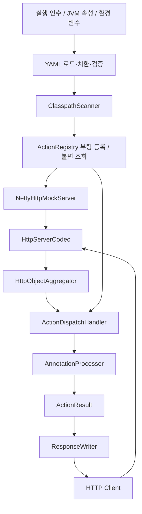

# Netty HTTP Mock Server 구성 설계

- 작성일: 2026-11-02
- 상태: stereotype 없는 processor 직접 binding 및 임베디드 실행 구현 완료, Java 17 `clean verify` 통과(40개 테스트). 최종 결과는 문서 하단 실행 기록 참조.
- 요구사항 참고: [command.md](command.md). 구성 설계 후 사용자의 fake-close/delay-close 추가 및 개발 시작 요청을 반영했다.
- 기본 패키지: `com.inzent.apim.utilities.netty.http.mockserver`

## 1. 목적과 범위

요청 헤더 `x-response-action`으로 실행할 모의 응답을 선택하는 Java 17 HTTP 서버를 구성한다. 정상 응답, 본문 복사, HTTP 오류 응답, 연결 종료, keep-alive 응답 후 연결 종료(fake close) 및 지정 시간 후 연결 종료(delay close)를 재현한다. `HttpResponseType`을 선언한 processor 클래스를 추가하여 확장한다.

Java 17, Netty, Lombok, 실행 가능한 JAR, YAML 설정 및 실행 인수를 적용한다. 설정 해석·클래스 탐색·등록·디스패치·수명주기는 Java 표준 API로 구현한다. 기존 `http-mock-response-server` 모듈은 참조 대상으로 두고 새 모듈에서 의존하거나 변경하지 않는다.

초기 범위는 HTTP/1.1 평문 서버, 전체 본문 수신 후 처리, 부팅 시 등록 및 설정 확정이다. TLS, HTTP/2, 스트리밍, 실행 중 설정/플러그인 교체, 외부 관리 API, 임의 스크립트 실행은 후속 범위다. TCP RST를 반드시 보장하는 장애 모드는 초기 범위에 포함하지 않는다.

요구사항에서 미정인 바인딩 주소·기본 응답·오류 계약·설정 우선순위는 아래 설계 기본값으로 제안한다. 사용자가 이미 확정한 값으로 간주하지 않는다.

## 2. 구성 방식 검토

| 방식 | 장점 | 제약 | 판단 |
| --- | --- | --- | --- |
| Java 표준 API로 부팅 시 classpath 탐색 | 요구한 자동 탐색과 의존성 제한을 충족 | 디렉터리/JAR 탐색과 오류 처리를 직접 구현 | 채택 |
| ClassGraph 등 탐색 라이브러리 | 다양한 classloader 대응 용이 | 추가 실행 의존성 필요 | 복잡한 배포 구조가 필요하면 재검토 |
| 명시 목록 또는 ServiceLoader | 탐색 범위와 로딩 동작이 명확 | annotation 기반 자동 발견 외에 등록 파일 필요 | 초기 요구와 차이가 있어 미채택 |

실행 JAR는 의존성을 펼쳐 합치는 Maven Shade 방식으로 설계한다. 중첩 JAR 실행기와 Spring은 도입하지 않는다. 요청 처리 경로에서는 스캔·리플렉션 생성·파일 접근을 수행하지 않는다.

## 3. 전체 구조



부팅 흐름과 요청 흐름을 분리한다. 검증한 설정과 registry는 불변으로 공개하고, 연결별 handler는 pipeline마다 생성한다. processor는 공유 인스턴스이므로 요청 상태를 필드에 저장하지 않는다.

## 4. 프로젝트와 패키지 구성

```text
netty-http-mock-server/
├── command.md                       # 원본 요구사항
├── project.md                       # 구성 설계 및 향후 변경 기록
├── README.md                        # 구현 종료 후 실제 사용법 작성
├── pom.xml                          # Java 17, 의존성, 실행 JAR 설정
├── src/main/resources/com/inzent/apim/utilities/netty/http/mockserver/application.yml
├── src/main/java/com/inzent/apim/utilities/netty/http/mockserver/
│   ├── MockServerApplication.java
│   ├── config/                      # 인수, YAML, 치환, 설정 검증
│   ├── annotation/                  # 헤더 binding용 HttpResponseType만 유지
│   ├── discovery/                   # ClasspathScanner
│   ├── registry/                    # 헤더 값 → processor 불변 map
│   ├── processor/                   # AnnotationProcessor 및 기본 processors
│   ├── server/                      # HttpMockServer interface, bootstrap, initializer, dispatch
│   └── response/                    # ActionResult, ResponseWriter, 오류 응답
├── src/test/java/com/inzent/apim/utilities/netty/http/mockserver/
└── examples/EmbeddedExample.java     # library JAR 소비자 예제
```

위 구조로 구현했으며 [implementation-plan.md](implementation-plan.md)에 구현 단계와 실행 기록을 정리한다. Lombok은 불변 설정 record의 builder/toBuilder 생성에 사용한다. 요청·응답 본문이나 전체 설정을 로그에 남기지 않는다.

## 5. Header와 processor 계약

### 5.1 원본 예제 보정

- Netty 타입은 `FullHttpRequest`, `FullHttpResponse`다. 원본의 `HttpFullRequest`, `HttpFullResponse`를 해당 이름으로 보정한다.
- `HttpResponseType`은 processor 클래스에 붙이며 `@Target(ElementType.TYPE)`과 runtime retention으로 선언한다.
- 개별 action stereotype/configuration annotation은 사용하지 않는다.
- 헤더 값은 processor의 `HttpResponseType.value()`에서 읽으며 processor에 직접 연결한다.
- 여기서 processor는 런타임 실행 객체다. `javax.annotation.processing.Processor` 기반 컴파일 처리기와 별개다.

### 5.2 선언 예시

```java
@Target(ElementType.TYPE)
@Retention(RetentionPolicy.RUNTIME)
public @interface HttpResponseType {
    String value();
}

@HttpResponseType("copy-and-send")
public final class ResponseCopyAndSendActionProcessor
        extends AnnotationProcessor {
    // process(Channel, FullHttpRequest) 구현은 processor 소스 참조.
}
```

별도 action 정의 클래스와 `HttpResponseProcessor`, `Response*Action` stereotype은 제거했다. `@HttpResponseType` processor만 부팅 시 등록한다. annotation 타입 해석/설정 전달/기본값 Proxy는 사용하지 않는다.

### 5.3 실행 결과 모델

원본의 `FullHttpResponse process(T, Channel, FullHttpRequest)` 반환형은 정상 HTTP 응답에는 적합하지만, 응답 없이 연결을 종료하는 동작을 표현하기 어렵다. 구현에서는 다음 형태로 확장했다. 원본과의 바이너리 호환 요구는 없다.

```java
public abstract class AnnotationProcessor {
    public abstract ActionResult process(
        Channel channel, FullHttpRequest request);
}
```

- `SendResponse(FullHttpResponse response)`: dispatcher에 응답 소유권을 넘긴다.
- `FakeCloseResponse(FullHttpResponse response)`: dispatcher에 응답 소유권을 넘긴다. 응답 헤더는 `Connection: keep-alive`로 강제하고, 응답 전송 완료 후 채널을 닫는다.
- `CloseConnection`: HTTP 응답 없이 현재 연결을 종료한다.
- `DelayCloseConnection(long delayMillis)`: HTTP 응답 없이 지정 밀리초 후 현재 연결을 종료하도록 예약한다. 예약과 종료는 dispatcher가 담당한다.
- `ActionResult`는 위 네 경우만 허용하는 sealed interface로 설계한다. null 반환은 processor 결함으로 처리한다.
- generic T, `annotationType()`, `validate(annotation)` 없이 processor를 직접 호출한다.
- `Channel`은 주소 조회 등에만 사용한다. processor의 직접 write/close 및 요청 release는 금지하고 실제 전송·종료를 한 곳에서 수행한다.
- processor 호출은 동기 실행하고 결과를 즉시 반환한다. 파일 I/O·외부 통신·sleep 등 blocking 작업은 금지한다. `DelayCloseConnection`의 지연 종료는 dispatcher가 비동기로 예약한다. 지연 응답 전송은 향후 별도 계약으로 확장한다.

### 5.4 제공 action

| 헤더 값 | Processor | 동작 |
| --- | --- | --- |
| `ok` | `ResponseOkActionProcessor` | 200, UTF-8 `OK` |
| `copy-and-send` | `ResponseCopyAndSendActionProcessor` | 200, 요청 본문을 byte 단위로 복사 |
| `error-500` | `ResponseErrorActionProcessor` | 고정 상태 500과 오류 본문 |
| `close` | `ResponseCloseActionProcessor` | 응답 없이 연결 종료 |
| `fake-close` | `ResponseFakeCloseActionProcessor` | 200, UTF-8 `OK`, `Connection: keep-alive` 응답 전송 완료 후 채널 종료 |
| `delay-close` | `ResponseDelayCloseActionProcessor` | `x-delay-amount` 밀리초 대기 후 HTTP 응답 없이 채널 종료 |

헤더 매핑용 `String value()`는 `HttpResponseType`에만 둔다. 상태/본문/연결 제어는 processor가 작성한다. copy-and-send는 Content-Type을 한 값만 선택하여 복사하고 누락 시 `application/octet-stream`을 사용한다. 인증·쿠키 등 요청 헤더 전체를 반사하지 않는다.

`ResponseFakeCloseActionProcessor`에 `@HttpResponseType("fake-close")`를 선언하고 `FakeCloseResponse`를 반환한다. 이 action은 응답에 표시한 연결 유지 정책과 실제 채널 수명을 다르게 하여, 클라이언트의 연결 재사용 실패 처리를 시험하기 위한 동작이다.

`ResponseDelayCloseActionProcessor`에 `@HttpResponseType("delay-close")`를 선언한다. processor가 `x-delay-amount`를 검증하고 `DelayCloseConnection(delayMillis)`를 반환한다. `close` action에 지연을 추가하는 동작으로 정의하며, fake close처럼 응답을 먼저 전송하지 않는다.

```http
GET / HTTP/1.1
Host: localhost:8080
x-response-action: delay-close
x-delay-amount: 1500
```

위 요청은 전체 요청 수신과 헤더 검증 후 종료를 예약한 시점부터 1,500ms 뒤 채널을 닫는다. 이벤트 루프 실행 상황에 따라 실제 종료는 늦어질 수 있으며 정밀 실시간 타이밍을 보장하지 않는다.

## 6. 부팅 시 탐색과 등록

1. 설정의 `scan-packages`를 검증한다. 빈 prefix와 패키지 경계가 없는 부분 문자열 매칭은 허용하지 않는다.
2. 애플리케이션 classloader의 package resources와 `java.class.path`를 이용하여 탐색 대상을 합친다. 파일 디렉터리는 `Files.walk`, 일반 JAR는 `JarFile`로 탐색한다.
3. 일반 `.class`만 대상으로 하고 `module-info`, `package-info`, 합쳐진 JAR의 `META-INF/versions`는 제외한다. multi-release 전용 action과 JPMS module-path, 사용자 정의/중첩 JAR classloader는 초기 지원 범위 밖이다.
4. FQCN 기준 중복을 제거하고 이름순으로 정렬한다. `Class.forName(name, false, classLoader)`로 초기화 없이 로드한다. 경로를 class 이름으로 변환할 때 패키지 경계를 검사한다.
5. 각 클래스에서 직접 선언한 `HttpResponseType`을 읽는다. 선언이 없는 클래스는 등록하지 않는다. 설정 annotation 타입이나 별도 정의 클래스를 탐색할 필요가 없다.
6. `HttpResponseType.value()` 형식과 중복, public/concrete AnnotationProcessor 여부, 공개 무인수 생성자를 검사한다. processor는 클래스별로 한 번 생성한다.
7. 생성한 processor 인스턴스를 `HttpResponseType.value()`에 직접 연결한다. 추가 stereotype annotation을 해석하거나 생성하지 않는다.
8. 동일 값, 잘못된 processor, 로딩·생성 실패는 모두 기동 실패다. 요청마다 processor 생성이나 registry reflection을 수행하지 않는다.
9. `Map.copyOf` 등으로 registry를 불변화한 후 포트를 bind한다. 파일 스트림·walk·JarFile은 부팅 단계에서 닫는다.

action 값은 대소문자를 구분하고 `[A-Za-z0-9][A-Za-z0-9._-]{0,63}`으로 제한한다. 등록 값과 요청 헤더 값에 같은 규칙을 적용한다. classpath 안의 action 코드는 신뢰 가능한 애플리케이션 코드로 취급하며 외부 입력으로 클래스를 동적 로드하지 않는다.

## 7. 요청 처리와 응답 계약

핵심 pipeline은 `HttpServerCodec → HttpObjectAggregator → RequestTimeoutHandler → ActionDispatchHandler`로 구성한다. 그 앞에 연결 수 admission과 terminal byte guard, codec과 aggregator 사이에 terminal message guard를 둔다. 종료 결정 후 수신되는 데이터를 해제하여 후속 processor/프로토콜 응답 생성을 차단한다. `RequestTimeoutHandler`는 연결별 handler다. codec의 시작 줄/헤더 한도와 aggregator의 본문 한도를 설정으로 전달한다. aggregator는 수신 메시지를 전체 요청으로 합치는 역할을 한다. 자세한 동작은 [Netty 공식 API](https://netty.io/4.1/api/io/netty/handler/codec/http/HttpObjectAggregator.html)를 기준으로 구현한다.

1. decoder 오류와 HTTP 버전을 검사한다. 본문 수신은 aggregator 한도 내에서만 허용한다.
2. 헤더 이름은 HTTP 규칙대로 대소문자를 구분하지 않는다. 헤더 누락은 `default-action`을 사용한다. 동일 헤더가 여러 개이거나 빈 값/잘못된 값이면 400을 반환한다. 값은 양 끝의 공백을 제거한 뒤 검증하며 쉼표 구분 목록은 지원하지 않는다.
3. registry에 없는 정상 형식의 action은 400 `UNKNOWN_ACTION`이다. 기본 action 미등록은 부팅 실패다.
4. processor를 실행하고 ActionResult를 전송하거나 연결을 종료한다. processor 예외/null은 500 `PROCESSOR_ERROR` 후 연결 종료다. 예외 세부 내용은 응답에 노출하지 않는다.
   `delay-close`의 지연 헤더 검증 실패는 processor 결함이 아닌 요청 오류로 구분하여 400 `INVALID_DELAY_AMOUNT` 후 닫는다. 전용 요청 검증 예외를 일반 processor 예외보다 먼저 처리한다.
5. 일반 정상 응답은 HTTP/1.1 keep-alive 규칙을 따르며 `Connection: close` 요청은 flush 완료 후 닫는다. `fake-close`는 요청의 Connection 값과 관계없이 응답에 `Connection: keep-alive`를 명시하고, 응답 전송 완료 후 닫는다. HTTP/1.0 등 지원하지 않는 버전은 505 후 닫는다.
6. `HEAD`는 선택 action의 응답 본문 길이를 Content-Length에 반영하고 실제 본문은 보내지 않는다. 본문 금지 상태(204/304)는 HTTP 규칙에 맞게 본문·framing을 정규화한다. 기본 action은 이 상태를 사용하지 않는다.

`ResponseWriter`가 Content-Length 및 connection framing을 확정한다. 응답에 Transfer-Encoding과 Content-Length를 동시에 설정하지 않는다. processor는 요청의 hop-by-hop 헤더를 응답에 복사하지 않는다.

`FakeCloseResponse`는 일반 keep-alive 판정보다 우선한다. `ResponseWriter`가 최종 헤더를 `Connection: keep-alive`로 설정하고 정상 Content-Length로 전체 응답을 구성한 뒤, 해당 응답의 `writeAndFlush`가 반환한 `ChannelFuture`에 `ChannelFutureListener.CLOSE`를 연결한다. write 직후 채널을 닫거나 `Connection: close`로 헤더를 다시 쓰지 않는다. 전송 성공이면 전송 완료 후 종료하고, 실패이면 실패 완료 시에도 채널을 닫는다. 여기서 완료는 Netty의 outbound write 완료이며 클라이언트 애플리케이션의 수신 확인을 의미하지 않는다. HEAD도 동일하게 헤더 전송 완료 후 닫고 본문은 보내지 않는다.

`delay-close`에서만 `x-delay-amount`를 추가로 해석한다. 헤더 이름은 대소문자를 구분하지 않으며, 정확히 하나의 값이 필수다. 양 끝 공백 제거 후 ASCII 10진 정수만 허용한다. 0은 지연 없이 종료 예약을 뜻한다. 누락·빈 값·중복·음수·부호·소수·단위 문자열·쉼표 목록·숫자 overflow는 400 `INVALID_DELAY_AMOUNT`다. 설계 기본 범위는 0~2,147,483,647ms로 정하고 `long`으로 파싱 후 범위를 검사한다. 이 범위는 구현 기본값에 대한 설계 선택이다. 다른 action에서는 이 헤더를 무시한다.

dispatcher는 `channel.eventLoop().schedule(..., delayMillis, TimeUnit.MILLISECONDS)`로 close 작업을 한 번 예약한다. 예약 즉시 연결을 terminal 상태로 전환하고 다음 요청 수신 타이머를 중지한다. delay-close 대기 중에는 상대측 FIN을 감지할 수 있도록 auto-read를 유지하고 후속 수신 bytes/messages는 terminal guard에서 해제한다. 후속 요청을 실행하거나 새로운 수신 timeout으로 먼저 종료하지 않는다. 기존에 큐에 들어온 후속 요청도 해제한다. 예약 작업은 연결 context/state만 참조하고 요청·본문·annotation을 보관하지 않는다. 이전 요청의 예약된 응답은 즉시 flush하되, 지연 시작 시각을 그 전송 완료까지 미루지 않는다. `delay-close` 요청 자체에는 최종 HTTP 응답을 생성하지 않으며, 앞선 aggregator 단계의 `100 Continue` 등 프로토콜 처리는 그대로 적용한다.

애플리케이션이 만드는 오류 본문은 UTF-8 plain text의 `오류코드\n` 형식이며 Content-Type은 `text/plain; charset=UTF-8`이다. 예를 들어 `UNKNOWN_ACTION\n`, `BAD_REQUEST\n`, `INVALID_DELAY_AMOUNT\n`, `PROCESSOR_ERROR\n`, `HTTP_VERSION_NOT_SUPPORTED\n`을 사용한다. 기본 `error-500` action은 `MOCK_ERROR\n`을 반환한다. codec/aggregator가 직접 생성하는 프로토콜 오류 응답은 Netty 기본 형식을 따르므로 같은 본문을 보장하지 않는다. HEAD에는 오류 본문도 보내지 않는다.

연결별 terminal 상태를 두어 `close`, `fake-close`, `delay-close`, 프로토콜 오류, processor 오류 또는 `Connection: close` 응답이 선택되는 즉시 이후 요청 dispatch를 중단한다. 이미 pipeline에 들어온 후속 요청은 handler의 자동 release로 폐기한다. 일반 종료는 앞선 응답 write의 순서를 유지하되 마지막 응답 flush 후 닫는다. `CloseConnection`은 앞서 예약한 write를 flush한 뒤 닫으며, 해당 요청과 이후 요청에는 응답을 생성하지 않는다. `fake-close`는 자신의 응답까지 전송하고 후속 요청에는 응답을 생성하지 않는다. `delay-close`는 위 예약 시간에 종료하는 별도 계약을 따른다.

| 상황 | 처리 |
| --- | --- |
| 잘못된 요청/헤더/action | 400 후 연결 종료 |
| 본문 크기 초과 | aggregator의 413 처리 후 연결 종료 |
| 헤더/시작 줄 한도 초과 | decoder 실패를 400 후 종료로 처리 |
| 요청 수신 시간 초과 | 응답 없이 연결 종료 |
| processor 내부 오류 | 500 후 연결 종료 |
| `fake-close` action | `Connection: keep-alive` 응답 전송 완료 후 채널 종료 |
| `delay-close` action | `x-delay-amount` 밀리초 후 최종 HTTP 응답 없이 채널 종료 |
| 잘못된 `x-delay-amount` | 400 `INVALID_DELAY_AMOUNT` 후 연결 종료 |
| 전송 실패/이미 끊어진 연결 | 추가 응답 없이 자원 정리 |
| `Expect: 100-continue` | aggregator의 프로토콜 처리 사용; 실패/크기 초과 경로 통합 검증 |

수신 제한 시간은 연결 활성화 시 시작하고, 이전 요청 완료 후 다음 요청 대기 시 다시 시작한다. 다음 요청의 전체 본문이 완료되면 해당 타이머를 취소한다. byte 도착마다 연장하지 않는다. 초기값 30초로 유휴 연결과 느린 요청 모두 제한한다. 비동기 action을 추가하면 응답 대기와 다음 요청 순서를 별도로 설계해야 한다.

## 8. 메모리·동시성·종료

- dispatch는 `SimpleChannelInboundHandler<FullHttpRequest>`의 자동 release 계약을 사용한다. processor는 요청이나 그 content를 반환 후 보관하지 않는다.
- copy 응답은 요청 buffer를 그대로 공유하지 않고 독립 buffer에 복사한다. 반환 전 생성 실패는 processor가 자신이 만든 buffer를 해제한다.
- processor가 응답을 반환하면 dispatcher가 소유한다. `SendResponse`와 `FakeCloseResponse` 모두 같은 소유권 규칙을 적용한다. write 이전 검증 실패·비활성 채널·동기 예외 경로는 dispatcher가 해제한다. `writeAndFlush`로 소유권을 넘긴 이후에는 Netty가 처리하며 close listener에서 이중 해제하지 않는다.
- processor와 registry는 공유되므로 immutable/stateless 계약을 적용한다. 연결별 timeout 상태와 handler는 공유하지 않는다.
- 지연 종료의 ScheduledFuture는 연결별로 하나만 보관한다. 조기 연결 해제·서버 종료 시 취소하고 참조를 제거한다. 예약 실행 시에도 참조를 제거하며 종료는 중복 호출에 안전하게 한다. 예약 거부 시 즉시 채널을 닫고 자원을 회수한다. 대기 중 연결도 max-connections에 포함하고, 서버 종료는 예약 시각까지 기다리지 않는다. 이미 앞선 응답의 전송 실패 또는 상대측 연결 해제가 발생한 경우에도 지연 시간을 보장하지 않는다.
- 연결 수 제한을 channel 활성화 시 원자적으로 적용하고 초과 연결은 닫는다. 활성 연결은 ChannelGroup으로 추적하고 종료 시 한 번 제거/반환한다.
- 제안 한도 100개 연결 × 요청 본문 1 MiB로 본문만 최대 약 100 MiB를 점유할 수 있고 copy 중에는 추가 buffer가 필요하다. 실제 heap/direct-memory는 헤더·네트워크 buffer·전송 대기열까지 포함해 부하 검증으로 정한다.
- 전송 대기열이 상위 watermark에 도달하면 auto-read를 끄고 하위 watermark 복귀 시 재개한다. 단일 read에서 전달된 요청까지 고려해 연결별 pending write 수를 제한하며 초과 시 닫고 미전송 응답을 해제한다.
- 종료는 중복 호출에 안전하게 한다. server channel close → 자식 연결 close → worker/boss `shutdownGracefully` 순서로 수행한다. 종료 대기 한도 후 남은 연결을 닫으며 기동 도중 실패한 경우에도 생성한 자원을 회수한다.
- shutdown hook은 같은 종료 경로를 호출한다. 시작 실패는 프로세스 종료 코드 1, 정상 종료는 0으로 한다.

## 9. YAML과 실행 인수

### 9.1 YAML 파서 선택

Java 표준 API에는 YAML 파서가 없으므로 설계 시 제안한 **추가 의존성 `org.snakeyaml:snakeyaml-engine:3.2`를 적용**했다. YAML 1.2를 기본 Java 자료구조로 읽는 라이브러리이며 [공식 저장소](https://github.com/snakeyaml/snakeyaml-engine)의 지원 범위에 Java 17이 포함된다. 실제 JDK 17 빌드·설정 처리 테스트로 호환성을 확인한다.

YAML은 map/list/scalar로 파싱 후 명시적으로 설정 객체에 매핑한다. 임의 Java 객체 태그, 중복 키, 다중 문서는 거부한다. 문서는 최대 1 MiB, 중첩 깊이는 40, alias는 허용하지 않는다. event 단계에서 깊이와 alias를 검사한 뒤 객체를 생성한다. unknown key·타입 오류·명시적 null root도 부팅 실패로 처리하며 빈 문서만 기본값으로 해석한다.

### 9.2 설정 예시

```yaml
server:
  host: "${SERVER_HOST:127.0.0.1}"
  port: "${SERVER_PORT:8080}"
  boss-threads: 1
  worker-threads: 0
  backlog: 128
  reuse-address: true
  tcp-no-delay: true
  keep-alive: true
  max-connections: 100
  max-initial-line-length: 4096
  max-header-size: 8192
  max-content-length: 1048576
  request-timeout-ms: 30000
  write-buffer-low-water-mark: 32768
  write-buffer-high-water-mark: 65536
  max-pending-responses: 8
  shutdown-timeout-ms: 10000
mock:
  header-name: x-response-action
  default-action: ok
  scan-packages:
    - com.inzent.apim.utilities.netty.http.mockserver.processor
```

worker-threads의 0은 Netty 기본값 사용, 양수는 명시 스레드 수다. 포트는 1~65535, 크기·시간·연결 수·pending response 수는 양수로 제한한다. watermark는 `0 <= low < high`, backlog와 boss thread는 양수로 검증한다. `keep-alive`는 TCP SO_KEEPALIVE 옵션이며 HTTP 응답의 연결 유지 여부는 요청 규칙으로 결정한다.

### 9.3 로드와 치환 규칙

1. `--config=<path>`가 있으면 해당 외부 YAML만 사용하고 파일 오류는 실패 처리한다. 없으면 JAR의 `application.yml`을 사용한다. 상대 경로는 프로세스 작업 디렉터리 기준이다.
   설정 객체의 기본값은 9.2 예시와 동일한 코드 상수로 제공한다. 선택한 YAML은 명시한 필드만 덮어쓰며, 외부 YAML을 선택했을 때 내부 YAML을 추가 병합하지 않는다. 따라서 부분 외부 YAML은 허용하지만 명시적 null은 허용하지 않는다. 빈 문서는 기본값 설정으로 해석하고, root가 map이 아닌 문서는 거부한다.
2. CLI 형식은 `--key=value`만 지원한다. `--config`는 파일 선택용으로 분리한다. 나머지는 평탄한 map으로 파싱하며 중복 키와 빈 key를 거부한다.
3. `${NAME}`은 실행 인수 `--NAME=value` → JVM system property `-DNAME=value` → OS 환경 변수 순으로 조회한다. `${NAME:default}`는 세 곳 모두 없을 때만 기본값을 사용한다. 빈 문자열은 존재하는 값으로 보고 타입 검증에서 판단한다.
4. YAML을 먼저 파싱하고 문자열 scalar에만 치환한다. map key와 YAML 구문 자체는 치환하지 않는다. 재귀 치환과 중첩 `${...}`는 거부하고 치환 결과를 다시 평가하지 않는다. 미해결 변수와 잘못된 표현식은 부팅 실패다.
5. 점 표기 CLI(`--server.port=9090`)는 최종 설정 경로를 직접 덮어쓰며 치환된 YAML보다 우선한다. 고정 schema에 정의한 scalar 경로만 허용하고 scan-packages 목록의 CLI 교체는 초기 지원에서 제외한다.
6. 점 없는 CLI key는 실제 placeholder에서 소비되어야 한다. 알 수 없는 직접 override나 사용되지 않은 CLI 변수는 오타로 간주하고 거부한다. override 값에는 placeholder 평가를 하지 않는다.
7. 문자열을 숫자/boolean/목록 등으로 엄격 변환하고 전체 설정을 검증한다. 오류에는 설정 경로를 출력하되 원문 변수 값과 설정 전체를 로그에 남기지 않는다.

실행 형식:

```shell
java -DSERVER_HOST=127.0.0.1 -jar netty-http-mock-server.jar --config=./application.yml --SERVER_PORT=8081 --server.port=9090
```

위 예시의 최종 포트는 직접 override한 9090이다. 실제 산출물 경로는 `target/netty-http-mock-server.jar`다.

## 10. 빌드와 의존성

| 항목 | 사용 목적 | 범위 |
| --- | --- | --- |
| `io.netty:netty-bom` | Netty 구성요소 버전 정렬 | dependencyManagement |
| `io.netty:netty-codec-http`, `io.netty:netty-handler` | HTTP codec, aggregator, transport 관련 API | runtime 포함 |
| `org.projectlombok:lombok` | 컴파일 시 반복 코드 생성 | provided 및 annotation processor |
| `org.snakeyaml:snakeyaml-engine` | YAML 해석 | runtime 포함, 3.2 |
| `org.junit.jupiter:junit-jupiter` | 의미 있는 단위/통합 검증 | test, 5.13.4 |
| Maven Compiler / Surefire / Shade | Java 17 컴파일, 테스트, 실행 JAR | build plugin |

Netty는 4.1 API 기준으로 구현하고 Maven Central에서 확인한 4.1.139.Final로 고정했다. Lombok은 1.18.48, Compiler/Surefire/Failsafe/Shade는 각각 3.14.1/3.5.4/3.5.4/3.6.1이다. Netty 4.1은 [공식 종료 예고](https://netty.io/news/2026/09/09/4-1-EOL-announcement.html)에 따라 2027-07-01 지원 종료 예정이므로 후속 유지보수 시 4.2 전환을 검토한다. 별도 DI/스캔/JSON/logging framework는 추가하지 않고 로그는 `System.Logger`를 사용한다.

Shade manifest의 Main-Class는 `MockServerApplication` FQCN으로 지정한다. 필요한 service resource 병합과 서명 metadata 처리를 확인하며, 최종 JAR를 임시 빈 디렉터리에서 `java -jar`로 실행하여 개발 classpath에 의존하지 않는지 검증한다.

## 11. 구현 순서와 완료 기준

1. 설정 schema, CLI·치환·검증과 YAML parser 적용 여부 확정.
2. HttpResponseType, processor 직접 binding, registry와 디렉터리/JAR scanner 구현.
3. 기본 processor와 응답 소유권 계약 구현.
4. bootstrap/pipeline, 오류 매핑, 연결 제한·backpressure·종료 구현.
5. 실행 JAR와 실제 요청 통합 검증 후 README에 빌드·실행·설정·action 추가 방법 기록.

| 검증 영역 | 확인할 사례 |
| --- | --- |
| 설정 | CLI/JVM/환경 우선순위, 직접 override, default/누락/빈 값, 중복 key, unknown key, 잘못된 타입, 큰 YAML/alias 제한 |
| 탐색/등록 | 디렉터리와 최종 JAR, annotation 사용 발견, value 충돌, processor 타입/생성자 오류, 부팅 실패 시 bind 없음 |
| HTTP | 기본/복사/오류/종료 action, 중복·빈·알 수 없는 헤더, binary body, HEAD, keep-alive, 연속 요청 응답 순서 |
| fake close | 실제 socket에서 200·`Connection: keep-alive`·전체 Content-Length 본문 수신 후 EOF 확인, HEAD, 요청 `Connection: close`에도 응답 헤더 유지, pipelined 후속 processor 미실행, write 실패 시 종료·해제 |
| delay close | 0/양수 지연 후 EOF, 유효 요청에 최종 응답 없음, 누락/중복/음수/잘못된 형식/범위 초과의 400, 일반 수신 timeout보다 긴 지연, 후속 요청 미실행, 다른 연결 처리 비차단, 조기 해제·서버 종료 시 예약 취소 |
| 프로토콜 한도 | 잘못된 framing, 과대 본문/헤더/시작 줄, Expect 처리, 미완료·느린 요청 timeout |
| 자원 | 동시 연결 상한, 느린 reader와 pending write 한도, processor 예외, 전송 실패, 반복 시작/종료, 기동 실패 회수 |
| 배포 | Java 17 clean verify, 실제 실행 JAR의 스캔/설정/HTTP 응답, 외부 YAML 경로와 정상 종료 |

Netty leak detection을 활성화한 테스트와 buffer refCnt 검사를 함께 수행한다. 로그에 경고가 없다는 사실만으로 메모리 안전성을 판정하지 않는다. 성능 수치는 구현 후 동시 접속·본문 크기·heap/direct-memory 조건을 명시하여 측정한다.

실제 구현 검증 결과는 아래 실행 기록에 남긴다. 성능 부하 측정과 지원 범위 밖 기능의 검증을 포함하지 않으며 Git commit/push는 수행하지 않는다.

## 12. 설계 근거

- [Netty HttpObjectAggregator](https://netty.io/4.1/api/io/netty/handler/codec/http/HttpObjectAggregator.html): 전체 요청 집계 및 Expect/크기 초과 동작 확인 기준.
- [Netty FullHttpRequest](https://netty.io/4.1/api/io/netty/handler/codec/http/FullHttpRequest.html): 실제 타입명과 reference-counted buffer 계약 확인 기준.
- [Java 17 ElementType](https://docs.oracle.com/en/java/javase/17/docs/api/java.base/java/lang/annotation/ElementType.html): annotation 적용 대상 구분 기준.
- [SnakeYAML Engine 공식 저장소](https://github.com/snakeyaml/snakeyaml-engine): YAML 파서 제안의 지원 범위와 기본 Java 자료구조 처리 기준.

## 13. 구현 및 검증 기록 (2026-11-02)

- `ok`, `copy`, `error-500`, `close`, `fake-close`, `delay-close`와 annotation/processor 자동 등록을 구현했다. 설정 로드·치환·검증, bootstrap, HTTP framing, terminal guard, 연결 수/미완료 write 제한과 종료 자원 정리를 포함한다.
- JDK 17.0.10 / Maven 3.9.11에서 `mvn clean verify` **BUILD SUCCESS**. 설정 6개, 등록/processor 5개, handler 6개, 실제 socket 13개, 별도 실행 JAR 2개로 **총 32개, 실패/오류/건너뜀 0**이다.
- 실패 테스트를 먼저 확인한 뒤 설정·등록·서버·실행 JAR를 구현했다. fake-close는 전체 본문/HEAD 이후 EOF, delay-close는 0·양수 지연과 일반 수신 timeout보다 긴 대기, 후속 요청 차단과 다른 연결 처리를 검증했다.
- 별도 코드 리뷰에서 지연 종료 중 auto-read 중단으로 peer FIN을 감지하지 못하는 문제를 확인했다. 실제 socket 회귀 테스트의 수정 전 실패를 확인하고, delay-close에서는 수신을 유지하며 terminal byte guard로 후속 데이터를 해제하도록 수정했다. peer 종료 시 연결 admission 반환도 확인했다.
- 명시적 YAML null root를 빈 문서로 처리하던 문제 역시 수정 전 실패를 확인하고 event 단계에서 거부하도록 수정했다. 빈 문서는 기본값을 유지한다. 설정 기동 오류에 항목명을 출력하는 실행 JAR 회귀 검증도 포함한다.
- 부팅 후 메타데이터 reflection 없이 typed binding을 실행한다. 복사 응답은 독립 buffer를 사용하고, request/응답 실패/예약 취소 경로를 refCnt 및 가상 시간 테스트로 검증했다. 느린 transport에서 미완료 응답 수 상한 도달 시 종료·해제도 확인했다. leak detection은 paranoid로 실행했다.
- 최종 JAR는 `target/netty-http-mock-server.jar`이며 의존성을 포함한다. 테스트는 빈 작업 디렉터리와 공백을 포함한 외부 YAML 경로에서 별도 JVM을 실행해 여섯 action의 탐색/응답과 잘못된 설정 종료 코드 1을 검증했다.
- Shade는 service resource와 Netty version properties를 병합한다. 의존성 manifest 중복 경고는 manifest transformer가 Main-Class를 지정하는 패키징 과정에서 발생하며, 실행 JAR 검증은 통과했다. handler 테스트의 두 WARNING은 의도적으로 예외/null을 반환한 processor의 500 매핑 사례다.
- 실제 성능/장기 부하 측정, 운영 OS별 종료 시그널 실험은 수행하지 않았다. 별도 JVM 테스트는 테스트 정리를 위해 프로세스를 종료하며, 애플리케이션의 정상 자원 회수는 in-process lifecycle 테스트로 검증했다.
- 실제 사용법과 확장 예시는 [README.md](README.md)에 작성했다. 기존 모듈과 사용자 변경을 유지했으며 commit/push는 수행하지 않았다.

## 14. Embedded 실행 인터페이스 및 배포 (2026-11-02)

- 공개 계약은 `com.inzent.apim.utilities.netty.http.mockserver.server.HttpMockServer extends AutoCloseable`이다. 기존 `NettyHttpMockServer`가 구현하며 기존 생성자와 메서드는 유지한다.
- `fromArguments(String...)`, `create(ServerConfig)`, `create(ServerConfig, ActionRegistry)` factory로 시작 전 인스턴스를 생성한다. 설정/등록 검증은 생성 시 수행하고 `start()` 시점에 포트와 자체 I/O event loop를 생성한다.
- `start(): int`는 동기 bind 후 포트를 반환한다. 호스트의 이후 작업은 차단하지 않는다. `awaitClose()`는 listen channel 종료 대기만 수행하므로 정리는 `close()`로 별도 보장한다. `close()`는 중복 호출에 안전하고 호스트 스레드에서 실행해야 한다.
- 임베디드 경로는 shutdown hook과 System.exit를 사용하지 않는다. 장기 실행 호스트는 시작 callback에서 생성/start하고 종료 callback에서 close한다. 종료/기동 실패 후 재사용 대신 새 인스턴스를 만든다.
- Maven JAR Plugin 3.5.1의 추가 execution으로 `library` classifier를 attach한다. `target/netty-http-mock-server-library.jar`에는 프로젝트 클래스와 리소스만 포함하며, 호스트 Maven 의존성은 `<classifier>library</classifier>`를 지정한다. Netty/YAML은 POM의 전이 의존성으로 해석한다. 기존 executable JAR 이름과 main class는 유지한다.
- 호스트 루트 application.yml을 서버 설정으로 읽던 충돌을 별도 소비자 테스트로 재현한 후, 내부 기본 YAML을 패키지 경로로 이동했다. 외부 `--config` 선택과 설정 우선순위는 유지한다.
- 임베디드 단계별 실행 절차와 Maven/수동 classpath 예제는 [README.md](README.md), 컴파일 가능한 전체 예제는 [examples/EmbeddedExample.java](examples/EmbeddedExample.java), 작업 계획은 [embedded-plan.md](embedded-plan.md)에 기록했다.
- Java 17.0.10 `mvn clean verify`: **36개, 실패/오류/건너뜀 0**. 기존 32개 + interface/socket lifecycle 3개 + library 소비자 별도 JVM 1개다. library 소비자는 개발 classes 디렉터리를 제외한 JAR classpath로 예제를 컴파일하고, 호스트 application.yml 충돌 방지·HTTP 응답·자체 스레드 종료·호스트 코드 계속 실행을 확인한다.
- 별도 코드 리뷰에서 API/패키징/리소스/생명주기 변경에 추가 지적 없음. commit/push는 수행하지 않았다.
- 실제 `mvn install`로 library classifier의 로컬 저장소 설치도 확인했다. runtime 의존성을 복사한 classpath로 README의 javac/java 예제를 실행해 200 OK와 호스트 코드 계속 실행 출력, 프로세스 정상 종료를 확인했다. Jar plugin forceCreation으로 반복 package/install 시 thin JAR를 재생성한 뒤 shade한다.

## 15. Processor 클래스의 HttpResponseType 직접 binding 기록 (2026-11-02)

이 절은 직접 binding 도입 시점의 기록이며, 당시의 T annotation/default Proxy 계약은 아래 16절의 stereotype 제거로 폐기했다. 현재 API는 5절과 README를 따른다.

- 사용자 요청에 따라 `@HttpResponseType("copy-and-send")`를 processor 클래스에 직접 선언하는 방식으로 변경했다. 헤더 매핑은 이 annotation의 value만 사용한다. 설정 annotation의 value, 기존 HttpResponseProcessor 메타 annotation과 action 정의 클래스는 제거했다.
- 기본 탐색 경로는 `com.inzent.apim.utilities.netty.http.mockserver.processor`다. `ActionRegistry.ofClasses`에도 processor 클래스를 전달한다. annotation 없는 클래스는 등록하지 않고, 동일 헤더 값/비정상 형식/잘못된 processor 타입/생성자 오류는 부팅 실패다.
- `AnnotationProcessor<T>`의 typed 실행 계약을 유지한다. T annotation을 processor에 직접 붙이면 해당 설정을 사용하고 생략하면 기본 member 값으로 annotation을 생성한다. public/RUNTIME 타입만 허용하며 기본값 없는 member를 명시하지 않으면 부팅 실패다.
- 기본 annotation 생성은 Java Proxy와 Method.getDefaultValue를 사용한다. 배열은 접근마다 복사하고 equals/hashCode는 [Java 17 Annotation 계약](https://docs.oracle.com/en/java/javase/17/docs/api/java.base/java/lang/annotation/Annotation.html)을 따른다. processor 생성 및 binding은 부팅 시 한 번 수행하며 요청 경로에서 다시 탐색하지 않는다.
- 기본 복사 헤더는 `copy-and-send`이며 `copy` alias는 제공하지 않는다. 외부 YAML의 scan 경로와 명시 registry 입력, 커스텀 processor의 메타데이터를 함께 이전해야 한다. fake-close/delay-close와 임베디드 API의 동작은 유지한다.
- Java 17.0.10 `mvn clean verify`: **41개, 실패/오류/건너뜀 0**. 설정 6개, registry/processor 9개, handler 6개, 실제 socket 14개, embedded lifecycle 3개, 실행 JAR 2개, library 소비자 1개다. 실행 JAR에서 여섯 processor 발견과 새 복사 헤더 응답을 확인했다.
- 기본값 annotation의 배열 방어 복사·equals/hashCode, 명시적 설정 및 필수 member 처리, processor 등록 오류, 기존 copy 헤더의 400을 검증했다. focused 코드 리뷰에서 추가 지적 없음. 세부 변경 계획은 [processor-binding-plan.md](processor-binding-plan.md), 사용법은 [README.md](README.md) 참조.

## 16. Processor stereotype 제거 (2026-11-02)

- 사용자 요청에 따라 여섯 `Response*Action` 설정 annotation과 `ConfiguredAnnotations` Proxy를 삭제했다. annotation 패키지에는 헤더 binding용 `HttpResponseType`만 남긴다.
- `AnnotationProcessor`의 generic T, `annotationType()`, `validate(annotation)`과 process의 annotation 인수를 제거했다. 최종 실행 계약은 `ActionResult process(Channel, FullHttpRequest)`다.
- registry는 추가 binding 객체 없이 불변 `Map<String, AnnotationProcessor>`를 보관하고 processor를 직접 호출한다. `HttpResponseType` 값/processor 타입/공개 무인수 생성자/중복 검사는 유지한다.
- 상태/본문은 processor에서 직접 작성한다. 기본 error-500은 고정 500이고, copy-and-send/fake-close/delay-close 및 embedded lifecycle 계약은 유지한다.
- 새 API로 외부 processor를 구현하는 `ProcessorApiTest`의 수정 전 실패를 확인하고 구현했다. 삭제한 annotation/default Proxy 테스트는 제거하고 직접 실행/등록 실패 테스트로 정리했다.
- Java 17.0.10 `mvn clean verify`: **총 40개, 실패/오류/건너뜀 0**. 설정 6개, embedded lifecycle 3개, 간소화 API 1개, registry 7개, handler 6개, 실제 socket 14개, 실행 JAR 2개, library 소비자 1개다. focused 코드 리뷰에서 추가 지적 없음.
- README의 processor 추가 예제를 클래스 하나로 변경하고 이전 generic 구현의 마이그레이션 방법을 정리했다. commit/push는 수행하지 않았다.

## 17. Git 반영 준비 (2026-11-02)

- 사용자의 push 요청에 따라 이 모듈의 요구사항·설계/구현 계획·README·Java 소스·테스트·Maven 설정·임베디드 예제를 develop에 커밋하여 origin/develop에 반영한다.
- 최종 계약은 `HttpResponseType` header binding과 stereotype 없는 `AnnotationProcessor.process(Channel, FullHttpRequest)`이며, 기본 여섯 action과 임베디드 interface/library artifact를 포함한다.
- push 전 JDK 17 clean verify를 다시 수행한다. 빌드 산출물 target은 제외하고, 다른 모듈과 저장소 루트의 기존 미커밋 변경 및 별도 스테이징 파일은 이번 커밋에 포함하지 않는다.
- push 직전 재검증: JDK 17.0.10 `mvn clean verify` BUILD SUCCESS, 총 40개 테스트 실패/오류/건너뜀 0. 모듈 whitespace 검사도 통과했다.
- 앞 절의 commit/push 미수행 표기는 각 구현 단계 당시의 기록이다. 실제 원격 반영 결과는 Git 커밋과 원격 브랜치 동기 상태로 확인한다.
