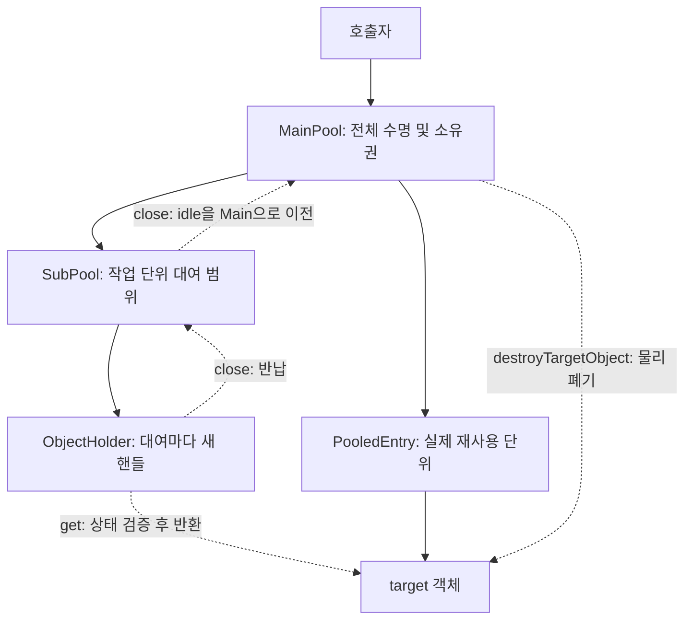
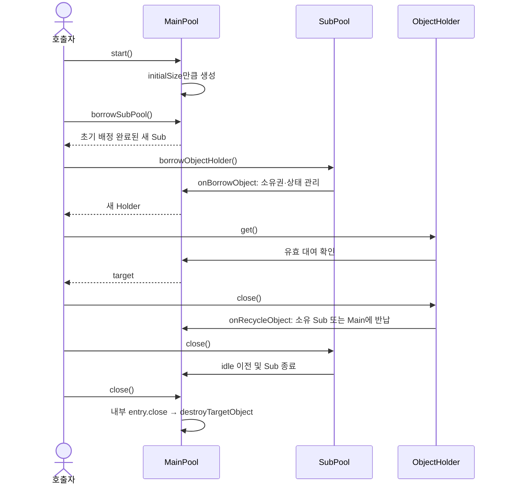

# Main/Sub Object Pool

Java 17에서 Main → Sub → ObjectHolder 계층으로 객체를 재사용하는 독립 utility module이다. 운영 외부 의존성 없이 동작한다.

Main은 애플리케이션 수명 동안 유지하고, Sub는 요청이나 작업 단위로 대여한다. 각 target 사용은 ObjectHolder 범위로 감싼다. 세 타입 모두 `java.io.Closeable`을 구현하며 try-with-resources로 반납과 종료를 보장할 수 있다.

## 설계 구조

### 계층과 책임



| 구성 | 역할 | 보관하는 내용 |
| --- | --- | --- |
| `MainPool<T>` | 생성·폐기, Sub 발급, Holder 대여/반납, 상태·용량 관리 | 전체 entry registry, target 동일성 registry, Main idle ID, Sub 관리 상태 |
| `SubPool<T>` | 작업 범위의 Holder 대여·반납·종료 | SubState와 활성 기간의 Main 참조. 종료·최종 반납 후 Main 참조 해제 |
| `ObjectHolder<T>` | `get()`으로 target 접근, `close()`로 대여 종료 | Main 참조와 Sub/entry ID·대여 세대. 반납 후 Main 참조 해제 |
| `PooledEntry<T>` | 실제 target의 재사용 및 물리 폐기 | target, 소유 Sub, 현재 Holder와 상태. 외부에 공개하지 않음 |
| `SubState<T>` | Sub의 로컬 LIFO와 대여/반납 상태 | target 대신 entry ID, 현재 대여 수, 초기 수와 통계. 외부에 공개하지 않음 |
| `PoolConfig` | 용량·초기 배정 설정 | 생성 시 검증하는 불변 record |
| `PoolStats` / `SubPoolStats` | 상태 조회 | 불변 snapshot. target이나 Main 참조를 포함하지 않음 |

실제 재사용 단위는 target과 PooledEntry다. Sub와 Holder 핸들은 대여마다 새 인스턴스를 발급한다. 이전 Holder를 다시 닫아도 다음 대여의 객체를 반납할 수 없도록 핸들 동일성과 대여 세대를 검증한다.

### 소유권과 동시성

한 target은 Main idle, 특정 Sub idle, 특정 Holder에 대여 중, 폐기 중 가운데 한 상태에만 속한다. 모든 registry·ID 저장소·상태·카운트 전이는 Main의 단일 ReentrantLock으로 보호한다. Sub에 별도 락을 두지 않아 Main/Sub 사이의 락 순서 문제를 피한다.

생성·폐기 훅과 종료 진단 로깅은 Main 락 밖에서 실행한다. 생성 중에는 용량을 예약해 동시 생성으로 maxSize를 초과하지 않게 한다. 생성 완료 전에 Main/Sub가 닫히면 해당 대여를 취소하고 새 target을 폐기한다.

Main과 Sub의 idle 저장소는 LIFO다. target이 어느 Sub에서 계속 재사용된다는 보장은 없으며, 전체 상한에 도달하면 다른 Sub idle을 회수할 수 있다.

### 수명 상태

| 대상 | 상태 전이 | 의미 |
| --- | --- | --- |
| Main | `NEW → STARTING → OPEN → CLOSING → CLOSED` | 생성자 → 초기 생성 → 대여 가능 → 신규 대여 차단·잔여 정리 → 정리 완료 |
| Sub | 초기 배정 준비 → `OPEN → CLOSED` | 초기 배정 완료 후 발급. 닫힌 Sub도 기존 Holder의 반납 경로를 유지 |
| Holder | 대여 중 → 반납 완료 | 반납 후 get은 거절. 핸들을 다시 활성화하지 않음 |
| Entry | `MAIN_IDLE / SUB_IDLE → BORROWED → SUB_IDLE / MAIN_IDLE` | 보관·대여·반납에 따른 소유권 변경. 폐기 대상은 DESTROYING을 거쳐 registry에서 제거 |

Main.start는 OPEN에서 재호출하면 무동작이다. STARTING 중 재호출과 종료 후 start는 IllegalStateException이며 재시작은 지원하지 않는다. NEW에서 close하면 target 생성 없이 CLOSED가 된다. 초기 생성 실패 시 이미 생성한 객체의 폐기를 시도하고 종료한다.

### 일반 호출 흐름



onBorrowObject/onRecycleObject는 Main의 내부 상태 관리 경로이며 호출자가 구현하는 확장 훅이 아니다. 사용자 확장 지점은 generateTargetObject와 destroyTargetObject다.

## 의존성과 빌드

```xml
<dependency>
  <groupId>com.inzent.apim.utilities</groupId>
  <artifactId>object-pool</artifactId>
  <version>1.0.0-SNAPSHOT</version>
</dependency>
```

저장소 루트에서 JDK 17 이상으로 실행한다.

```powershell
mvn -f object-pool/pom.xml clean verify
mvn -f object-pool/pom.xml install
```

## 전체 사용 예제

아래 예제는 `ObjectPoolExample.java`로 저장해 사용할 수 있다. 실제 서비스에서는 Resource 대신 연결·버퍼·실행기 등 재사용할 타입을 지정한다.

소스는 UTF-8로 저장한다. JDK 17에서 javac로 직접 컴파일할 때는 `-encoding UTF-8 --release 17`을 지정한다. Maven 빌드는 UTF-8을 설정하고 있다.

```java
package com.inzent.apim.utilities.pool.example;

import com.inzent.apim.utilities.pool.MainPool;
import com.inzent.apim.utilities.pool.ObjectHolder;
import com.inzent.apim.utilities.pool.PoolConfig;
import com.inzent.apim.utilities.pool.SubPool;
import java.io.Closeable;
import java.io.IOException;

public final class ObjectPoolExample {
    static final class Resource implements Closeable {
        private final StringBuilder buffer = new StringBuilder();
        private boolean closed;

        String execute(String input) {
            if (closed) throw new IllegalStateException("Resource closed");
            buffer.setLength(0);
            return buffer.append("processed: ").append(input).toString();
        }

        @Override public void close() { closed = true; buffer.setLength(0); }
    }

    public static void main(String[] args) throws IOException {
        // Main 초기 수, 전체 객체 상한, 활성 Sub 상한, Sub 초기 수, Sub idle 상한
        var config = new PoolConfig(2, 128, 32, 1, 8);
        try (MainPool<Resource> main = new MainPool<>(config) {
            @Override protected Resource generateTargetObject() { return new Resource(); }
            @Override protected void destroyTargetObject(Resource target) { target.close(); }
        }) {
            main.start();
            try (SubPool<Resource> sub = main.borrowSubPool()) {
                try (ObjectHolder<Resource> holder = sub.borrowObjectHolder()) {
                    Resource target = holder.get();
                    System.out.println(target.execute("hello"));
                } // Holder는 Sub idle로 반납. target은 아직 폐기하지 않음
                System.out.println(sub.stats());
            } // Sub의 idle 객체를 Main으로 이전
            System.out.println(main.stats());
        } // Main이 모든 idle target을 폐기
    }
}
```

실행하면 `processed: hello`와 상태 snapshot을 출력한다. 위 구성에서 Holder 반납 직후 Sub의 initial/managed/idle은 `1/1/1`, Sub 종료 직후 Main의 created/idle/activeSub는 `2/2/0`이다. 가장 바깥 try가 끝날 때 Main에 남은 두 target을 폐기한다.

전체 예제를 저장소 루트의 `ObjectPoolExample.java`로 저장했다면 다음과 같이 실행한다. Java 17의 java/javac가 PATH에 있어야 한다. 클래스패스 구분자 `;`는 Windows 기준이다.

```powershell
mvn -f object-pool/pom.xml package
New-Item -ItemType Directory -Force object-pool/target/example | Out-Null
javac -encoding UTF-8 --release 17 -cp object-pool/target/object-pool-1.0.0-SNAPSHOT.jar -d object-pool/target/example ObjectPoolExample.java
java -cp "object-pool/target/object-pool-1.0.0-SNAPSHOT.jar;object-pool/target/example" com.inzent.apim.utilities.pool.example.ObjectPoolExample
```

### 명시적 반납 API 사용

다음은 위 전체 예제의 `main.start()` 이후 사용할 수 있는 코드다. close와 명시적 recycle을 함께 호출해도 동일 대여가 중복 반납되지는 않는다.

```java
SubPool<Resource> sub = main.borrowSubPool();
try {
    ObjectHolder<Resource> holder = sub.borrowObjectHolder();
    try {
        System.out.println(holder.get().execute("explicit"));
    } finally {
        sub.recycleObjectHolder(holder);
    }
} finally {
    main.recycleSubPool(sub);
}
```

### Sub를 먼저 닫은 뒤 Holder 반납

Main이 OPEN인 동안에는 닫힌 Sub의 기존 Holder를 계속 사용하고 반납할 수 있다. 새 Holder 대여는 거절한다. 아래 코드도 위 전체 예제의 열린 main 안에서 사용한다.

```java
SubPool<Resource> sub = main.borrowSubPool();
try {
    try (ObjectHolder<Resource> holder = sub.borrowObjectHolder()) {
        sub.close();
        System.out.println(holder.get().execute("late return"));
    } // 닫힌 Sub의 로컬 캐시 대신 Main으로 반납
} finally {
    sub.close();
}
```

Main까지 먼저 닫힌 경우에는 Holder.get이 거절된다. 이미 얻은 raw target의 사용 종료를 호출자가 보장한 뒤 Holder.close를 수행해야 하며, 그 반납에서 target을 물리 폐기한다.

## API 안내

| 타입 | API | 동작 |
| --- | --- | --- |
| MainPool | `protected MainPool(PoolConfig)` | 설정 보관. target을 생성하지 않음 |
| MainPool | `protected generateTargetObject() throws Exception` | 새 target 생성. 하위 클래스에서 구현 |
| MainPool | `protected destroyTargetObject(T) throws Exception` | target 물리 폐기. 하위 클래스에서 구현 |
| MainPool | `start() throws IOException` | Main 초기 객체 생성 및 OPEN 전환 |
| MainPool | `borrowSubPool() throws IOException` | 초기 배정을 완료한 새 Sub 발급 |
| MainPool | `recycleSubPool(SubPool<T>) throws IOException` | 해당 Sub 종료. Sub.close와 동일 |
| MainPool | `stats()` / `isTerminated()` | 전체 snapshot / CLOSED 여부 |
| MainPool | `close() throws IOException` | 전체 대여 차단과 idle 폐기, outstanding은 반납 시 폐기 |
| SubPool | `borrowObjectHolder() throws IOException` | 새 대여 핸들 발급 |
| SubPool | `recycleObjectHolder(ObjectHolder<T>) throws IOException` | 소유 Holder 반납. Holder.close와 동일 |
| SubPool | `stats()` / `close() throws IOException` | Sub snapshot / 대여 범위 종료 |
| ObjectHolder | `get()` / `close() throws IOException` | 유효 대여의 target 조회 / 소유권 반납 |

MainPool을 상속하고 `new MainPool<Resource>(config) { ... }`로 확장한다. SubPool과 ObjectHolder는 final이며 생성자가 공개되지 않아 Main/Sub의 대여 API로만 발급받는다. T는 AutoCloseable로 제한하지 않으며 T에 close가 있다면 destroy 훅에서 호출한다.

## 구성과 설정

패키지는 `com.inzent.apim.utilities.pool`이다. MainPool을 상속하고 생성/폐기 훅을 구현한다. 생성자에서는 target을 만들지 않으며, `start()`에서 Main 초기 객체를 생성한다. 생성 훅은 null이나 이미 관리 중인 동일 target을 반환하면 안 된다.

생성 훅은 매번 독립된 새 target을 반환한다. 이미 폐기된 target의 재등록도 지원하지 않는다. 동일성 중복 검사는 현재 관리 중인 객체만 대상으로 한다.

`PoolConfig.defaults()`는 아래 기본값을 사용한다. 직접 구성할 때는 `new PoolConfig(initialSize, maxSize, maxSubPools, initialObjectsPerSub, maxCachedPerSub)` 순서다.

| 설정 | 기본값 | 의미 |
| --- | --- | --- |
| initialSize | 0 | Main.start에서 생성할 객체 수. 0 이상, maxSize 이하 |
| maxSize | 128 | 생성 예약과 폐기 중 객체를 포함한 전체 객체 상한. 1 이상 |
| maxSubPools | 32 | OPEN 및 초기 배정 준비 중 Sub의 합계 상한. 1 이상 |
| initialObjectsPerSub | 0 | Sub 발급 시 초기 배정 수. 0 이상, maxCachedPerSub 이하 |
| maxCachedPerSub | 8 | Sub 내부 idle 보관 상한. 0 이상, maxSize 이하 |

Sub 초기 배정은 Main idle을 우선 사용하고 부족분을 생성한다. 전부 확보한 뒤 Sub를 발급한다. 실패하면 확보한 객체를 Main idle로 돌리고 준비 슬롯을 해제한다. 준비 중인 Sub의 idle은 다른 Sub가 가져갈 수 없다.

Holder 대여는 Sub idle → Main idle → 새 객체 생성 순서다. 전체 객체 상한이면 다른 발급 완료 Sub의 idle을 회수할 수 있다. borrowed 객체는 회수하지 않으며, 확보할 수 없으면 즉시 PoolExhaustedException이다. 순서 공정성과 대기는 제공하지 않는다.

Sub와 Holder 핸들은 매번 새로 발급한다. 실제 target만 재사용한다. 재사용 전 reset/검증 훅은 없으므로 호출자는 반납 전에 재사용 가능한 상태로 정리해야 한다.

## 상태 조회

`main.stats()`와 `sub.stats()`는 각각 같은 Main 락에서 읽은 불변 snapshot이다. 서로 다른 stats 호출 사이의 동시 변경까지 하나의 snapshot으로 묶지는 않는다.

| 위치 | 항목 | 의미 |
| --- | --- | --- |
| Main | createdObjectCount | 현재 관리하는 전체 target 수. 폐기 중 포함, 생성 예약 제외 |
| Main | idleObjectCount | Main 저장소에서 배정 가능한 객체 수. Sub idle 제외 |
| Main | activeSubPoolCount | 초기 배정 완료 후 OPEN인 Sub 수 |
| Sub | initialObjectCount | 발급 시 초기 배정 수. 종료 후에도 고정 |
| Sub | managedObjectCount | Sub idle + 해당 Sub의 미반납 객체 수 |
| Sub | idleObjectCount | Sub 내부에서 즉시 대여 가능한 객체 수 |

Main의 `totalCreatedObjectCount`는 누적 생성 성공 수다. `totalIdleObjectCount`는 Main과 모든 Sub의 idle 합계이며 준비 중 Sub의 idle도 포함한다. 준비 중 Sub 수, 지연 반납이 남은 종료 Sub 수, 대여/반납 누계, 생성 예약, 폐기 시도·실패 수도 제공한다. 현재 구현은 반납 상태 전이를 락 안에서 완료하므로 returning 수는 0이다.

Main의 `holderBorrowCount - holderRecycleCount == borrowedObjectCount`를 유지한다. 폐기 훅이 실패해도 재사용 대상에서 제거하므로 createdObjectCount는 감소하고 destroyFailureCount가 증가한다. CLOSED 및 createdObjectCount=0은 모든 외부 자원이 성공적으로 해제되었다는 보장이 아니다.

### 정상 수명에서 카운트가 변하는 예

전체 사용 예제의 `PoolConfig(2, 128, 32, 1, 8)`을 기준으로 한다. 각 행은 해당 작업이 끝난 직후이며 다른 스레드의 작업은 없는 경우다.

| 작업 | Main created | Main idle | Main activeSub | Sub initial | Sub managed | Sub idle |
| --- | --- | --- | --- | --- | --- | --- |
| Main 생성 | 0 | 0 | 0 | — | — | — |
| Main.start | 2 | 2 | 0 | — | — | — |
| Sub 대여·초기 배정 | 2 | 1 | 1 | 1 | 1 | 1 |
| Holder 대여 | 2 | 1 | 1 | 1 | 1 | 0 |
| Holder.close | 2 | 1 | 1 | 1 | 1 | 1 |
| Sub.close | 2 | 2 | 0 | 1 | 0 | 0 |
| Main.close | 0 | 0 | 0 | 1 | 0 | 0 |

추가 Holder를 대여하면 Sub의 managed는 initial보다 커질 수 있다. Sub가 닫히거나 다른 Sub에 idle을 넘기면 managed가 initial보다 작아질 수 있다. initial은 항상 발급 시 초기 배정 이력으로 유지한다.

### 진단용 상태 항목

| snapshot | 항목 | 의미 |
| --- | --- | --- |
| Main | `state` | NEW/STARTING/OPEN/CLOSING/CLOSED |
| Main | `totalIdleObjectCount` | Main idle + 모든 Sub idle |
| Main | `preparingSubPoolCount` | 초기 배정 진행 중인 Sub 수 |
| Main | `closedSubPoolCount` | 닫혔지만 outstanding Holder가 남아 관리 중인 Sub 수 |
| Main | `borrowedObjectCount` / `returningObjectCount` | 미반납 수 / 현재 구현에서는 0 |
| Main | `destroyingObjectCount` / `reservedCreationCount` | 폐기 중 객체 수 / 생성 예약 수 |
| Main | `totalCreatedObjectCount` / `creationFailureCount` | 누적 생성 성공 수 / 생성 실패 수 |
| Main | `destroyAttemptCount` / `destroyFailureCount` | 폐기 대상으로 확정한 누계 / 폐기 실패 누계 |
| Main | `subBorrowCount` / `subRecycleCount` | 발급 완료 Sub 누계 / 그중 종료된 Sub 누계 |
| Main·Sub | `holderBorrowCount` / `holderRecycleCount` | Holder 대여·반납 누계 |
| Sub | `id` / `closed` | 해당 Sub의 식별자 / 종료 여부 |
| Sub | `borrowedCount` / `returningCount` | 해당 Sub 미반납 수 / 현재 구현에서는 0 |

Main의 `createdObjectCount + reservedCreationCount <= maxSize`를 유지한다. `activeSubPoolCount + preparingSubPoolCount`가 maxSubPools 제한 대상이다. 닫힌 Sub의 지연 반납은 active 수에서 빠지므로, 전체 잔여 자원을 파악할 때는 active 수와 함께 borrowed/destroying/reserved 및 isTerminated를 확인한다.

## 반납과 종료

- Holder.close는 소유 Sub로 반납한다. Sub가 OPEN이고 idle 공간이 있으면 Sub에 보관하고, 나머지는 Main으로 반납한다.
- `sub.recycleObjectHolder(holder)`는 동일한 반납 경로다. 해당 Sub가 이미 닫혀도 기존 Holder의 반납을 허용한다.
- Sub.close와 `main.recycleSubPool(sub)`는 같은 동작이다. 새 대여를 차단하고 idle을 Main으로 이전한다. 미반납 Holder는 사용·반납 가능하며 managedObjectCount에 남는다.
- Main.close는 모든 Sub를 닫고 idle target의 폐기를 시도한다. 이후 신규 대여와 Holder.get을 거절한다. 대여 중 target은 Holder.close에서 폐기하며, 그전까지 Main은 CLOSING이다.
- `main.isTerminated()`는 생성 예약과 모든 관리 객체의 정리가 끝나 CLOSED인지 반환한다. close는 미반납 Holder나 다른 스레드의 생성·폐기를 기다리지 않는다. 따라서 동시 작업이 있다면 close 반환 시에도 CLOSING일 수 있다.
- Holder → Sub → Main 순서로 닫으면 정상 단일 호출 흐름에서 Main.close 반환 시 정리가 끝난다. 모든 close는 멱등적이다. 종료 후 재시작은 지원하지 않는다.

반납 누락은 자동 회수하지 않는다. 미반납 Holder가 있으면 종료 경고와 상태 카운트로 확인한다. 일반 Holder 반납은 target.close를 호출하지 않으며, 물리 폐기는 Main의 destroyTargetObject가 담당한다.

| 종료 시점 | idle 처리 | 미반납 Holder 처리 |
| --- | --- | --- |
| Sub.close, Main OPEN | Sub idle을 Main idle로 이전 | 기존 Holder.get 가능, 반납은 Main으로 이동 |
| Main.close | Main 및 모든 Sub idle을 폐기 | 새 get 거절, Holder.close에서 지연 폐기 |
| 마지막 Holder 반납 | Main이 CLOSING이면 해당 target 폐기 | 생성 예약·다른 폐기도 모두 끝나면 Main CLOSED |

반납 완료 Holder와 최종 반납까지 끝난 Sub는 Main/target을 강하게 보관하지 않는다. 미반납 Holder와 끝나지 않는 훅은 Main과 자원의 수명을 연장하므로 호출자는 반드시 사용·반납 범위를 관리해야 한다. maxSize는 객체 수 제한이며 target 내부 버퍼 크기나 총 메모리 사용량을 제한하지 않는다.

## 스레드 및 예외 계약

풀 수명 API는 thread-safe이지만 target 자체를 thread-safe로 만들지는 않는다. Holder.get으로 얻은 raw 객체를 Holder.close 이후 사용하거나 보관하면 안 된다. 다른 스레드에서 반납하는 경우 target 사용 완료를 호출자가 동기화해야 한다.

생성/폐기 훅은 Main 락 밖에서 실행하고 여러 스레드에서 동시에 호출될 수 있다. 훅 구현도 이에 맞게 작성한다. 동일 스레드에서 같은 풀의 수명 API로 재진입하면 IllegalStateException이며 stats 조회는 가능하다. 훅에서 다른 스레드의 같은 풀 작업이 끝나기를 기다리지 않는다.

| 상황 | 예외 |
| --- | --- |
| 잘못된 설정, 다른 Main/Sub의 핸들 | IllegalArgumentException |
| null 인수 | NullPointerException |
| start 전/종료 후 대여, 반납된 Holder.get, 생성 중 종료로 대여 취소 | IllegalStateException |
| 객체/Sub 상한 | PoolExhaustedException (IllegalStateException 하위) |
| 생성 null·중복 target, 시작 취소, checked 훅 오류 | IOException. 원래 IOException은 그대로, 그 외 checked 예외는 cause에 보존 |
| 훅 RuntimeException/Error | 원래 유형으로 전파 |

일괄 폐기는 하나가 실패해도 나머지를 시도하고 후속 오류를 suppressed로 보존한다. Error는 일반 예외보다 우선한다. 지연 폐기 실패는 해당 Holder.close 호출자에게 전달한다. 폐기는 entry별 한 번만 시도하며 실패를 자동 재시도하지 않는다. 실패한 close도 논리적 반납·종료는 완료되어 재호출해도 중복 처리하지 않는다.

종료 경고는 불변 snapshot으로 수집하고 실제 자원 정리를 완료한 뒤 Main 락 밖에서 출력한다. 로그 Handler의 NPE/RuntimeException/Error가 발생해도 다른 Sub 종료와 확보한 모든 대상의 폐기는 완료한다. 로깅 오류는 정리 후 호출자에게 전달하며, 여러 로깅·폐기 오류는 같은 집계 규칙을 따른다. 경고 출력 시점의 상태는 snapshot 이후 지연 반납 때문에 달라질 수 있다.

## 검증 및 관련 문서

실제 JDK 17.0.10에서 수명·상태·실패·동시성·로깅 오류 테스트 **32개**의 clean verify를 확인했다. 분석 probe는 **20개 검사항목**을 제공하며 현재 구현에서는 로깅 NPE 후에도 최종 `CLOSED/created=0/destroying=0`을 확인한다. 이 기록은 장시간 heap/실트래픽 검증을 의미하지 않는다.

README의 전체 예제와 명시적 recycle·Sub 종료 후 늦은 반납 예제도 JDK 17에서 컴파일·실행했다. 늦은 반납 예제의 outstanding Holder 경고는 의도된 진단이며, 반납 후 activeSub/borrowed는 0이 된다.

- [project.md](project.md): 설계 결정, 구현 구성, 상태·종료 계약 및 검증 이력
- [memory-npe-analysis.md](memory-npe-analysis.md): 메모리/NPE 분석과 수정 적용 결과
- [implementation-plan.md](implementation-plan.md): 구현 및 후속 수정 진행 기록
- [analysis/PoolSafetyProbe.java](analysis/PoolSafetyProbe.java): Java 17 독립 분석·검증 프로그램
