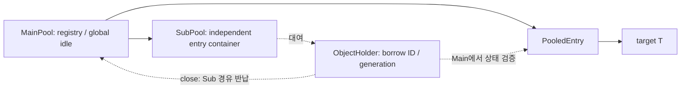

# Main/Sub Object Pool 설계

- 작성일: 2026-10-20
- 상태: 2026-10-20 사용자 설계 승인 후 구현 및 검증 완료.
- 모듈: `object-pool` (독립 Maven utility module)
- Java: 17
- Maven 좌표: `com.inzent.apim.utilities:object-pool:1.0.0-SNAPSHOT`
- 패키지: `com.inzent.apim.utilities.pool`
- 산출물: Java 소스, pom.xml, 수명·실패·동시성 테스트, README 및 구현 계획.

## 1. 목적과 기존 프로젝트와의 관계

Main이 target 객체의 생성·폐기와 전체 대여 상태를 관리하고, Sub가 호출 단위의 객체 재사용 범위를 제공한다. 호출자는 Main → Sub → ObjectHolder 순서로 대여하고 반대 순서로 close한다.

기존 `object-recycle-container`에는 유사한 Main/Sub 구조가 있지만, `AutoCloseable`, `HolderLease.use(...)`, 소유 스레드 제한 및 patrol 정책을 사용한다. 요청한 `Closeable`과 `ObjectHolder.get()` 계약을 기존 공개 API에 덮어쓰지 않고 별도 모듈로 설계한다. 기존 모듈에 의존하지 않는다.

사용자가 명시한 요구는 Java 17, utility module, 3단계 Closeable 수명, Main의 생성·폐기·대여/반납 관리, Sub 종료 후 지연 반납, start 이후 사용이다. 아래의 동시성, 용량, 종료 정책은 이를 구체화하기 위한 제안이다.

## 2. 접근 방식 비교

| 방식 | 장점 | 비용 및 제약 |
| --- | --- | --- |
| **신규 모듈 + Main 단일 락 + 대여별 핸들 (권장)** | 요청 API를 직접 제공하며 소유권·중복 반납·종료 경쟁을 한곳에서 관리 | Main 상태 변경 시 락 경합. 종료 시 대여 중 객체는 반납을 기다리는 정책 필요 |
| 기존 object-recycle-container API 확장 | 일부 기존 수명 관리 코드 활용 | get 기반 접근과 기존 use 보호 계약이 달라 호환성과 안전성 검토 범위가 커짐 |
| Main/Sub 개별 락 또는 lock-free 구조 | 특정 부하에서 병렬성 개선 가능 | 락 순서, 종료와 소유권 이전, 중복 폐기 검증이 복잡함 |

첫 구현은 권장안으로 제한한다. 자동 감시, 강제 회수, timeout, 공정한 대기열, 비동기 API는 포함하지 않는다.

## 3. 구성과 책임

| 구성 | 공개 여부 | 책임 |
| --- | --- | --- |
| `MainPool<T> implements Closeable` | public abstract | start, Sub 대여/반납, target 생성·폐기 훅, 모든 소유권·상태·용량·통계 관리 |
| `SubPool<T> implements Closeable` | public final | 독립 SubPoolContainer 소유, Holder 대여/반납, 종료 후 Main으로의 반납 경로 |
| `SubPoolContainer<T>` | package-private | 각 Sub가 독립 소유하는 실제 entry 관리 Map 및 idle LIFO. 대여·반납과 Main으로의 이전 처리 |
| `ObjectHolder<T> implements Closeable` | public final | 대여별 핸들. get으로 target 제공, close로 소유 Sub에 반납 |
| `PoolConfig` | public record | Main/Sub 초기 객체 수, Main idle 보관 상한, 활성 Sub 상한, Sub idle 보관 상한 |
| `PoolStats`, `SubPoolStats` | public record | 대여/반납 누계와 현재 상태의 불변 snapshot |
| `PoolExhaustedException` | public | 용량 부족 시 즉시 실패하는 unchecked 예외 |
| `PooledEntry<T>` | package-private | 실제 target과 entry ID, 상태, 소유 Sub ID, 현재 대여 세대 보관. 물리 폐기를 위한 내부 close 제공 |

모든 상태와 저장소는 Main 락 아래에서 관리한다. Sub에 독립 락을 두지 않는다. Main/Sub/Holder의 수명 메서드는 thread-safe로 제공하되 target T 자체의 thread-safety는 제공하지 않는다.

Sub와 ObjectHolder는 **대여마다 새 인스턴스**를 발급한다. 실제 재사용 대상은 PooledEntry와 target이다. 반납된 Sub 핸들을 다시 OPEN으로 바꾸거나 같은 Holder를 새 대여에 재사용하지 않는다.

### Closeable 선택

요청의 `Closable`은 Java 표준 `java.io.Closeable`로 해석한다. 세 공개 수명 객체 모두 이를 구현하며 `close() throws IOException`을 사용한다. 중복 close는 아무 작업도 하지 않는다. try-with-resources로 사용한다.

표준 계약은 [Java 17 Closeable 문서](https://docs.oracle.com/en/java/javase/17/docs/api/java.base/java/io/Closeable.html)를 기준으로 한다.

## 4. 공개 API 제안

아래는 구현하는 공개 API의 선언 요약이다.

```java
public abstract class MainPool<T> implements Closeable {
    protected MainPool(PoolConfig config);
    protected abstract T generateTargetObject() throws Exception;
    protected abstract void destroyTargetObject(T target) throws Exception;

    public final void start() throws IOException;
    public final SubPool<T> borrowSubPool() throws IOException;
    public final void recycleSubPool(SubPool<T> sub) throws IOException;
    public final PoolStats stats();
    public final boolean isTerminated();
    public final void close() throws IOException;
}

public final class SubPool<T> implements Closeable {
    public ObjectHolder<T> borrowObjectHolder() throws IOException;
    public void recycleObjectHolder(ObjectHolder<T> holder) throws IOException;
    public SubPoolStats stats();
    public void close() throws IOException;
}

public final class ObjectHolder<T> implements Closeable {
    public T get();
    public void close() throws IOException;
}
```

- Main의 `onBorrowObject` / `onRecycleObject`는 내부 상태 관리 메서드로 구현한다. 공개하거나 override 가능한 알림 훅으로 제공하지 않는다.
- `SubPool.borrowObjectHolder()`는 Main의 내부 `onBorrowObject(sub)`를 호출하고 반환된 새 Holder를 전달한다.
- Holder.close 및 Sub.recycleObjectHolder는 동일한 Main `onRecycleObject` 경로를 사용한다. Sub가 이미 닫혀도 기존 Holder의 반납을 허용한다.
- Main.recycleSubPool과 Sub.close는 같은 종료 경로이다. Main.close는 이 경로를 모든 활성 Sub에 적용한다.
- generate/destroy는 Main 확장 훅이며 호출자가 직접 생성·폐기를 실행하는 API가 아니다. T는 AutoCloseable로 제한하지 않는다. 자원형 T는 destroy 훅에서 target.close를 호출한다.
- null 인수는 NullPointerException, 다른 Main/Sub에서 발급된 핸들은 IllegalArgumentException이다. 소유권 검증 후 이미 반납된 동일 핸들의 반납은 무동작이다.
- 같은 target 인스턴스를 여러 번 생성 결과로 반환하는 factory는 지원하지 않는다. Main은 살아 있는 entry 사이의 target 참조 동일성 중복을 거부하며 이미 관리 중인 target을 잘못 폐기하지 않는다.

## 5. 소유권과 저장소



- Main registry는 전체 entry의 소유권·용량·수명 조정 기준이다. Main idle queue에는 entry ID를 두고, SubPool은 자신의 SubPoolContainer에 실제 PooledEntry의 managed Map 및 idle Deque를 독립 보관한다.
- 하나의 entry는 Main idle, 특정 Sub idle, 특정 Holder 대여, 반환 처리, 폐기 중 하나에만 속한다.
- Main idle과 Sub idle은 LIFO로 사용한다. 순서 보장이나 공정성은 제공하지 않는다.
- Holder는 pool ID, sub ID, entry ID, borrow generation으로 대여를 식별한다. 반납된 예전 Holder의 close/get이 새 대여를 반납하거나 접근할 수 없다.
- Holder는 활성 기간에 Main을 유지하며, 반납 후 Main/target 강한 참조를 해제한다. Main은 outstanding entry를 위해 필요한 Sub 관리 레코드만 유지하고 최종 반납 후 제거한다.
- 종료된 Sub는 미반납 Holder가 있으면 반납 라우팅에 필요한 Main 참조와 컨테이너의 해당 entry를 유지한다. 모두 반납되면 컨테이너가 비워지고 Main 참조를 해제하며 최종 통계를 보관한다. 최종 반납 후에는 target을 보관하지 않는다.

## 6. 상태와 주요 동작

### Main 상태

`NEW → STARTING → OPEN → CLOSING → CLOSED`

- 생성자는 설정 검증만 수행한다. 생성 훅을 호출하지 않는다.
- start는 initialSize만큼 생성한다. OPEN에서 재호출은 무동작, STARTING 중 재호출은 IllegalStateException이다.
- start 전 대여와 CLOSING/CLOSED 이후 신규 대여는 IllegalStateException이다. 종료 후 재시작은 지원하지 않는다.
- 시작 실패 시 생성 완료 객체를 전부 폐기하고 종료한다. 정리 실패도 보존한다.
- NEW에서 close하면 생성 없이 CLOSED가 된다.
- STARTING 중 close하면 이후 생성 결과를 게시하지 않고 폐기한다. 진행 중 생성 훅이 끝날 때까지 CLOSING일 수 있으며 start 호출은 초기화 취소 IOException으로 종료한다.

### Sub 상태

`OPEN → CLOSED` (재개 없음)

Sub 핸들의 CLOSED는 신규 대여 금지 및 idle 이전 완료를 뜻한다. outstanding Holder 수가 0이라는 뜻은 아니다. Main은 닫힌 Sub의 미반납 대여도 별도로 추적한다.

### Entry 상태

`MAIN_IDLE ↔ SUB_IDLE → BORROWED → RETURNING → SUB_IDLE 또는 MAIN_IDLE`

폐기 대상은 `DESTROYING → DESTROYED`로 진행한다. 실제 destroy 훅 실패는 별도 failureCount에 기록하며 entry를 재사용하지 않는다. 생성 중에는 별도의 reservedCreationCount로 진행 수를 추적한다. 객체 생성 요청의 상한으로 사용하지 않는다.

### Sub 대여

Main이 OPEN인지와 Sub 상한을 확인하고 준비 슬롯을 예약한다. Main idle에서 initialObjectsPerSub개를 Sub의 독립 컨테이너에 초기 배정하며, 부족분은 maxSize와 무관하게 새로 생성한다. 다른 Sub의 idle·borrowed 객체는 가져오지 않는다.

초기 배정을 모두 완료한 뒤 Sub를 OPEN으로 게시하고 activeSubPoolCount를 증가시킨다. 준비 중인 Sub는 호출자에게 노출하지 않으며 activeSubPoolCount에 포함하지 않는다. 상한 검사는 `activeSubPoolCount + preparingSubPoolCount <= maxSubPools`로 수행해 동시 준비의 초과 발급을 방지한다.

초기 배정 실패·종료 경쟁에서는 핸들을 발급하지 않고 준비 슬롯과 소유권 이전을 롤백한다. 확보한 객체는 Main이 OPEN이고 idle 공간이 있으면 Main idle로 돌리고, Main idle 상한 초과 또는 종료 중이면 폐기한다. 생성 실패는 IOException 또는 원래 RuntimeException/Error로, 활성·준비 Sub 수 상한은 PoolExhaustedException으로 전파한다.

### Holder 대여

1. Main과 Sub 상태를 확인한다.
2. 해당 Sub idle → Main idle 순서로 entry를 찾는다.
3. 없으면 생성 진행 수를 증가시키고 락 밖에서 generate 훅을 호출한다.
4. 전체 생성·대여 수가 maxSize 이상이어도 생성한다. 객체 수를 이유로 PoolExhaustedException을 발생시키지 않고 다른 Sub 컨테이너의 객체도 가져오지 않는다.
5. entry를 BORROWED로 전환하고 새 generation의 Holder를 발급하며 Main/Sub 대여 누계를 함께 증가시킨다.
6. 생성 도중 Main 또는 해당 Sub가 종료되면 대여를 취소하고 생성 결과를 폐기한다. 예약과 등록을 롤백하며 대여 누계는 증가시키지 않는다.

### Holder 반납

1. pool/sub/entry/generation을 검증한다. 동일 대여에 대해 한 스레드만 반납 전이를 수행한다.
2. Holder를 반환 완료로 표시하고 Main/Sub 반납 누계를 각각 한 번 증가시킨다.
3. Main OPEN, Sub OPEN, 로컬 idle 공간 있음: Sub idle에 저장한다.
4. Main OPEN, Sub CLOSED 또는 로컬 idle 상한: Main idle에 공간이 있으면 이전하고, 이미 maxSize이면 해당 객체를 폐기한다.
5. Main CLOSING: 해당 entry를 물리 폐기한다. 마지막 outstanding 정리 완료 시 Main을 CLOSED로 전환한다.

캐시 보관으로 끝나는 Holder.close는 target.close를 호출하지 않는다. Main idle 상한 초과 또는 Main 종료 시에는 반납에서 물리 폐기를 실행한다. target 재초기화는 제공하지 않으므로 호출자는 반납 전에 재사용 가능한 상태로 만들어야 한다.

## 7. 종료 정책: 대여 중 자원은 지연 폐기

**권장안은 신규 대여를 즉시 차단하고 사용 중 target의 폐기를 Holder 반납까지 지연하는 방식이다.** get이 반환한 T의 실제 사용 구간을 라이브러리가 추적할 수 없기 때문이다.

| 방법 | 의미 | 판단 |
| --- | --- | --- |
| 반납 시 지연 폐기 | idle은 즉시 폐기, borrowed는 Holder.close 시 폐기 | 권장. 사용 중 자원을 임의로 닫지 않음 |
| 모두 즉시 강제 폐기 | borrowed target도 Main.close 안에서 닫음 | 요청 문구를 문자 그대로 충족하지만 get으로 사용 중인 자원과 경쟁함 |
| close에서 무한 대기 | 모든 Holder가 반납될 때까지 block | 같은 호출 흐름이 Holder를 반납해야 하면 교착 가능 |

### Sub.close

1. Main 락에서 Sub를 CLOSED로 바꾸고 활성 Sub 수를 감소시킨다.
2. 해당 Sub의 모든 idle entry를 Main으로 반납한다. Main idle 상한만큼 보관하고 초과분은 폐기하며, Main도 종료 중이면 모두 폐기한다.
3. 미반납 Holder 수와 borrow/recycle 불일치를 진단한다. 해당 entry를 다른 호출자에게 재대여하지 않는다.
4. 미반납 Holder는 기존 대여로 유지한다. Main이 OPEN이면 기존 Holder.get도 가능하다. 이후 Holder.close는 닫힌 Sub를 경유해 Main으로 직접 반납한다.
5. 종료 후 새 borrow는 거절하고, 유효한 지연 recycle은 계속 허용한다.

따라서 요청의 “container의 모든 holder를 Main으로 recycle”은 idle의 즉시 이전과 borrowed의 Main 관리하 지연 반납으로 구체화한다. borrowed를 idle로 간주하는 조기 재사용은 하지 않는다.

### Main.close

1. Main을 CLOSING으로 전환해 신규 Sub/Holder 대여를 차단한다.
2. 활성 Sub와 Holder 대여/반납 현황을 snapshot으로 확인한다. 활성 Sub를 종료하고 idle을 모두 수집한다.
3. 수집한 entry의 내부 close를 통해 destroyTargetObject를 락 밖에서 실행한다. 공개 Holder.close를 물리 폐기 수단으로 사용하지 않는다.
4. borrowed entry는 폐기 예정으로 남겨 두며, 이후 Holder.close에서 내부 entry.close를 실행한다. 새 Holder.get은 Main 종료 이후 거절한다.
5. borrowed, 생성 예약, 반환 처리, 폐기 중 entry가 모두 없어지면 CLOSED가 된다. 그전에는 CLOSING이며 isTerminated는 false이다.
6. close는 자신이 확보한 idle 정리를 수행하고 반환하며 미반납 Holder를 기다리지 않는다. 지연 정리 실패는 해당 Holder.close 호출자에게 전달한다.

요청 시나리오처럼 Holder → Sub → Main 순서로 닫으면 Main.close 반환 시 모든 target의 폐기 시도가 완료되고 CLOSED이다. 미반납 Holder가 있으면 Main.close 반환이 물리 정리 완료를 뜻하지 않는다. 반납 누락은 자동으로 해소되지 않으며 통계와 경고로 확인한다.

get이 반환한 raw T는 Holder.close 이후 보관·사용하면 안 된다. 다른 스레드가 같은 Holder를 close하는 동안 T를 사용해서도 안 된다. 사용이 끝난 뒤 close하도록 호출자가 동기화한다. 강제 사용 중단과 raw 참조 무효화는 이 API로 보장할 수 없다.

## 8. 동시성·예외·자원 정리

- 단일 ReentrantLock으로 상태, queue, registry, 통계 전이를 보호한다. 사용자 generate/destroy 훅은 락 밖에서 실행한다.
- 생성 진행 수는 종료 조정용으로 추적한다. 생성 성공 직후 종료 경쟁을 다시 검사한다. 폐기 진행 중 entry는 정리 완료 전까지 createdObjectCount에 포함하지만 신규 생성을 제한하지 않는다.
- 외부 훅은 동일 풀의 수명 변경 API로 재진입할 수 없다. 같은 스레드의 재진입을 감지해 IllegalStateException으로 거절한다. stats 조회는 허용한다.
- 훅에서 다른 스레드의 동일 풀 작업 완료를 기다리지 않는 것은 확장 구현의 계약이다. 끝나지 않는 훅에 대한 강제 취소는 제공하지 않는다.
- 생성 null은 생성 실패 IOException으로 처리한다. 생성 훅 실패 시 용량 예약을 반드시 해제한다.
- 훅의 checked exception은 IOException에 원인으로 보존한다. RuntimeException/Error는 원래 유형으로 전파한다.
- 일괄 정리는 한 entry의 실패로 나머지 entry 정리를 중단하지 않는다. 첫 실패에 후속 실패를 suppressed로 보존한다. Error가 일반 예외에 가려지지 않도록 Error를 우선 전파하며 치명적인 VM 장애에서 완료를 보장하지 않는다.
- 폐기 훅은 entry마다 한 번만 호출한다. 실패해도 다시 idle로 넣거나 자동 재시도하지 않는다. destroy 훅의 일부 성공/실패를 판단할 수 없기 때문이다.
- close 실패 전에도 논리적 반납/종료를 확정한다. 중복 close로 다시 반납하거나 다른 target을 폐기하지 않는다.
- 모든 정리 시도가 끝나면 CLOSED가 될 수 있다. CLOSED는 외부 자원 해제 성공을 뜻하지 않으며 destroyFailureCount와 예외로 실패를 구별한다.

## 9. 설정과 상태 확인

| 설정 | 기본값 | 검증 |
| --- | --- | --- |
| initialSize | 0 | 0 이상, maxSize 이하 |
| initialObjectsPerSub | 0 | 0 이상, maxCachedPerSub 이하. Sub 발급 시 초기 배정 수 |
| maxSize | 128 | 1 이상. Main idle 보관 상한이며 전체 생성 수 제한이 아님 |
| maxSubPools | 32 | 1 이상. 현재 OPEN Sub 수 제한 |
| maxCachedPerSub | 8 | 0 이상. Main idle 상한과 독립. 0이면 반납 즉시 Main으로 이동 |

최소 유지 수, 대기 timeout, 자동 생성 보충은 두지 않는다. 각 설정의 메모리 비용은 target 크기와 함께 산정한다.

### Main 필수 상태

`MainPool.stats()`가 반환하는 PoolStats에 아래 항목을 제공한다. 각 count는 누계가 아닌 현재 수량이다.

| 항목 | API 이름 | 정의 |
| --- | --- | --- |
| created object count | `createdObjectCount` | 생성 성공 후 Main registry에서 현재 관리하는 전체 target 수. Main idle, Sub 소유, 폐기 중 객체를 포함하며 생성 예약은 제외 |
| idle object count | `idleObjectCount` | Main idle 저장소에서 Sub에 배정 가능한 target 수. Sub idle은 제외 |
| active sub pool count | `activeSubPoolCount` | 초기 배정을 마치고 OPEN 상태인 Sub 수. 준비 중이거나 닫힌 Sub는 제외 |

createdObjectCount는 생성 성공 시 증가하고 폐기 시도 완료 후 registry에서 제거할 때 감소한다. destroy 실패로 제거된 객체도 감소하므로 외부 자원의 실제 해제 성공 수를 뜻하지 않는다. 누적 생성 성공 수는 별도 `totalCreatedObjectCount`로 구분한다. 생성만 성공하고 종료 경쟁으로 발급되지 못한 객체도 정리 완료 전까지 registry에 등록해 createdObjectCount에 포함한다.

Main idleObjectCount는 Main에서 Sub로 배정할 때 감소하고 Sub에서 Main으로 이전할 때 증가한다. Sub 내부의 Holder 대여/반납만으로는 변하지 않는다. 전체 idle 수는 진단용 `totalIdleObjectCount = Main idleObjectCount + 모든 Sub idleObjectCount`로 구분한다.

### Sub 필수 상태

`SubPool.stats()`가 반환하는 SubPoolStats에 아래 항목을 제공한다.

| 항목 | API 이름 | 정의 |
| --- | --- | --- |
| initial object count | `initialObjectCount` | 해당 Sub 발급 시 초기 배정이 완료된 객체 수. initialObjectsPerSub와 같으며 발급 후 고정 |
| managed object count | `managedObjectCount` | 현재 해당 Sub에 귀속된 전체 객체 수. idle, Holder 대여 중, 반납 처리 중 객체를 포함 |
| idle object count | `idleObjectCount` | 해당 Sub의 로컬 저장소에서 즉시 대여 가능한 객체 수 |

initialObjectCount는 설정·초기 배정 이력이며 현재 수량이 아니다. initialObjectsPerSub가 0이면 빈 Sub로 발급한다. 초기 배정 미완료 Sub는 발급하지 않으므로 initialObjectCount가 부분 성공 수로 남는 경우는 없다.

Sub 컨테이너 idle에서 Holder를 대여하면 idleObjectCount만 감소하고 managedObjectCount는 유지한다. Main에서 추가 객체를 받아 Holder를 발급하면 컨테이너의 managedObjectCount가 증가한다. Holder가 같은 Sub idle로 반납되면 idleObjectCount만 증가한다. Main으로 이전하거나 폐기 소유권을 넘기면 컨테이너의 managedObjectCount가 감소한다. 다른 Sub는 해당 컨테이너의 객체를 직접 가져가지 못한다.

Sub.close는 모든 로컬 idle을 Main으로 이전하므로 idleObjectCount는 0이 된다. 아직 대여/반납 처리 중인 객체는 managedObjectCount에 남고 최종 반납 후 0이 된다. initialObjectCount는 종료 후에도 유지한다.

### 상태 일관성과 진단 정보

필수 항목과 함께 상태, 준비 중/미반납을 가진 종료 Sub 수, borrowed/returning/destroying 수, reservedCreation 수, Sub 및 Holder borrow/recycle 누계, 생성·폐기 실패 수를 진단용으로 제공한다. 모든 수치는 동일 Main 락 아래에서 상태와 함께 갱신하고 불변 snapshot으로 조회한다. 여러 번의 stats 호출 사이에는 수치가 달라질 수 있다.

- 안정 상태에서 `holderBorrowCount - holderRecycleCount = borrowedCount`이다. 반납 전이는 동일 락 안에서 통계와 상태를 함께 갱신한다.
- Sub close 이후에도 outstanding Holder 반납을 해당 Sub 통계에 반영한다. 마지막 반납 시 최종 snapshot을 고정한다.
- `Main idleObjectCount <= maxSize`를 항상 유지한다. createdObjectCount와 reservedCreationCount는 maxSize를 초과할 수 있다. 기존 liveEntryCount는 createdObjectCount와 같은 값이며 중복 카운터로 구현하지 않는다.
- `Main idle + 전체 Sub idle + borrowed + returning + destroying = createdObjectCount`이다. 초기 배정 중 entry는 준비 Sub의 idle로 내부 집계하고, 폐기는 Sub 소유권을 해제한 뒤 destroying으로 집계한다. 폐기 완료 entry는 registry에서 제거한다.
- 각 Sub에서 `managedObjectCount = idleObjectCount + borrowedCount + returningCount`이다. 준비 Sub도 내부적으로 같은 식을 유지한다. 소유권 이전과 해당 Main/Sub 카운트 변경은 하나의 락 구간에서 수행한다.
- 종료 시 불일치 진단은 System.Logger를 사용한다. 로그에는 ID와 건수만 기록하고 target.toString을 호출하지 않는다.

## 10. 호출 시나리오

아래는 구현 완료 후 제공할 사용 형태를 보여 주는 설계 예시이다.

```java
try (MainPool<MyResource> main = new MainPool<>(config) {
    @Override
    protected MyResource generateTargetObject() throws Exception {
        return new MyResource();
    }

    @Override
    protected void destroyTargetObject(MyResource target) throws Exception {
        target.close();
    }
}) {
    main.start();
    try (SubPool<MyResource> sub = main.borrowSubPool()) {
        try (ObjectHolder<MyResource> holder = sub.borrowObjectHolder()) {
            MyResource target = holder.get();
            target.execute();
        } // Sub idle로 반납
    } // Main idle로 이전
} // 내부 entry.close → target 폐기
```

Sub가 먼저 닫히는 경우에도 Holder.close는 유효하다. Main도 먼저 닫혔다면 Holder.close에서 target을 폐기한다. 호출자는 get으로 얻은 객체를 Holder 범위 밖으로 전달하지 않는다.

## 11. 구현 후 수용 조건

1. Java 17로 독립 Maven 빌드가 가능하고 운영 외부 의존성이 없다.
2. 정상 호출 시나리오에서 동일 target 재사용, 매번 다른 Holder/Sub 핸들 발급, 최종 target 폐기를 확인한다.
3. start 전 대여, 종료 후 대여/get, 시작 실패 및 초기화 중 close를 검증한다.
4. 닫힌 Sub에 대한 늦은 반납은 Main으로 이동하며, 닫힌 Main에 대한 늦은 반납은 폐기한다.
5. Holder/Sub/Main 중복 close와 다른 풀/다른 Sub 핸들 오반납으로 통계·소유권이 변하지 않는다.
6. 예전 Holder.close/get이 재대여된 entry에 영향을 주지 않는다.
7. Main.close와 대여/반납/생성 완료 경쟁에서 entry 유실, 중복 대여, 중복 폐기가 없다.
8. 동시 생성에서 maxSize 초과 대여를 허용하고, 동시 반납에서 Main idle 및 Sub cache 상한과 컨테이너 격리를 검증한다.
9. 생성 null/실패, 중복 target, 폐기 실패, 복수 정리 실패에도 정리와 예약 해제가 완료된다.
10. 미반납 Holder 존재 시 Main은 CLOSING이고 target을 조기 폐기하지 않으며, 최종 반납 후 CLOSED가 된다.
11. 반환된 Holder와 최종 종료된 Sub가 Main/target을 강하게 유지하지 않는지 확인한다.
12. sleep 시간에 의존하지 않는 latch/barrier 기반 경쟁 테스트와 생성·폐기 건수 계측을 사용한다.
13. Main의 createdObjectCount/idleObjectCount/activeSubPoolCount와 Sub의 initialObjectCount/managedObjectCount/idleObjectCount를 초기 배정, 대여, 반납, cache 초과 이전, 종료, 지연 반납 단계마다 검증한다.
14. Sub 초기 배정의 부분 실패와 동시 준비 시 예약·카운트·소유권을 롤백하고, 실패한 Sub가 활성 수에 포함되지 않는지 검증한다.

## 12. 구현 단계 산출물

Maven 설정, 공개 타입, 내부 상태 관리, 수명 처리, 경쟁·실패 테스트를 구현했다. 기능 구성은 이 project.md에 반영하고, 같은 모듈의 README.md에 설정·예제·반납과 종료 계약·예외·빌드 방법을 작성했다.

사용자가 신규 모듈 분리, 모든 수명 메서드의 thread-safety, 지연 폐기 종료 정책과 필수 상태 카운트가 포함된 설계를 승인했다. 현재 구현은 이 결정을 따른다. 커밋·push는 수행하지 않는다.

## 13. 구현 구성과 검증 기록

- `MainPool`: 단일 ReentrantLock, target 동일성 registry, 생성 예약, 수명 훅, 초기 배정 rollback, 대여·반납·종료 조정.
- `SubPool` / `SubPoolContainer` / `SubState`: 독립 컨테이너의 실제 entry 관리 Map과 로컬 LIFO, 수명·통계 조정, 종료 후 지연 반납, 최종 통계 snapshot. 최초 ID 저장소 방식에서 19절의 요구에 따라 변경했다.
- `ObjectHolder`: 대여 세대 핸들, get 상태 검사, 멱등적 close 및 반환 후 Main 참조 해제.
- `PooledEntry`: 실제 target, 소유권과 물리 close. 폐기 후 target/Main 참조 해제.
- `PoolConfig`, `PoolStats`, `SubPoolStats`, `PoolState`, `PoolExhaustedException`: 설정 검증, 불변 snapshot, 상태와 용량 오류.
- 기본 수명 7개, 실패·참조 해제 10개, latch 기반 경쟁 7개를 작성했다. 초기 배정 중 Sub idle 회수로 initial 2개 중 1개만 남는 경쟁을 재현하고 준비 중 Sub를 회수 대상에서 제외했다. 수정 후 실제 JDK 17.0.10에서 전체 24개 테스트가 통과했다.
- 실제 JDK 17.0.10 / Maven 3.9.11에서 `mvn -f object-pool/pom.xml clean verify` 성공. 테스트 24개, 실패/오류/건너뜀 0. 미반납 상태를 의도적으로 만드는 테스트의 WARNING은 종료 진단이다.
- 생성 JAR의 11개 클래스 모두 major version 61(Java 17)임을 확인했다.
- README의 전체 Java 예제를 추출해 JDK 17 javac `-encoding UTF-8 --release 17`로 컴파일하고 실행했다. `processed: hello`, Sub initial/managed/idle=1/1/1, Main created/idle/activeSub=2/2/0을 확인했다. Windows javac의 기본 MS949 인코딩으로 첫 직접 검증이 실패하여 UTF-8 명시가 필요함을 README에 추가했다.
- 독립 코드 리뷰에서 생성·종료 경쟁, target 중복, 초기 배정 rollback, 예외 집계, 반환 후 참조 해제, 상태 카운트를 검토했다. Critical/Important 지적 없음. raw target 사용 종료 동기화, 훅의 유한 실행, 폐기된 target 재생성 금지는 확장 구현과 호출자 계약이다.
- 기존 다른 모듈 소스와 사용자 변경은 수정하지 않았다. 기존 모듈 회귀 테스트는 이번 신규 독립 모듈 검증 범위에 포함하지 않았다. 커밋·push는 수행하지 않았다.

## 14. 메모리 누수 및 NPE 분석 (2026-10-20)

- 상세: [memory-npe-analysis.md](memory-npe-analysis.md), 재현: [analysis/PoolSafetyProbe.java](analysis/PoolSafetyProbe.java).
- 기존 24개 테스트 재실행 통과. 실제 Java 17 독립 probe에서 null 경계, 훅 NPE, 정상 참조 해제, 지연 반납, 외부 해제 실패 및 로깅 실패 20개 검사항목을 확인했다.
- **추가 확인 결함:** 종료 경고 로거가 NPE를 던지면 Main.close가 destroyAll 전에 중단된다. 남은 Holder 반납과 close 재호출 후에도 CLOSING/created=1/destroying=1이 잔존하는 경로를 재현했다. 독립 리뷰에서도 확인했다.
- 정상 호출·동시성 경로의 라이브러리 내부 우발 NPE는 확인하지 못했다. 미반납 Holder/무한 훅/캐시의 참조 유지와 destroy 훅 실패의 외부 자원 잔존은 별도 계약·운영 위험이다.
- 이번 요청에서는 운영 소스와 기존 테스트를 수정하지 않았다. 위 결함은 미수정이며, 앞선 구현 완료 검증에 추가된 후속 분석 결과다.

## 15. 분석 결과 적용 (2026-10-20)

- 사용자 “분석적용” 요청으로 14절의 로깅 실패 결함 M-01을 수정했다. 14절의 미수정 표기는 최초 분석 시점의 이력이다.
- closeSubLocked에서 경고 snapshot만 수집하고, Sub/Main close의 finishClose가 물리 폐기를 먼저 완료한 뒤 락 밖에서 진단한다. 진단 실패는 다른 Sub 종료나 cleanup 실행을 건너뛰지 못한다.
- NPE·RuntimeException·Error와 폐기/로깅 복합 실패를 정리 후 집계·전파한다. 공개 API와 상태 카운트, 미반납 지연 폐기 정책은 유지한다.
- 회귀 사례 8개 추가. 수정 전 5개 실패를 확인하고 수정 후 전체 32개 테스트가 통과했다. 독립 분석 probe는 수정 후 종료를 검증하는 기본 모드로 갱신했다.
- 실제 JDK 17.0.10에서 최종 clean verify **32개 통과**, probe **20개 확인**. 로깅 NPE 이후 최종 `CLOSED/created=0/destroying=0/destroyed=2`를 검증했다. 독립 리뷰에서 추가 중요 지적 없음.
- 상세 적용 내용은 memory-npe-analysis.md 7절과 README의 종료·예외 계약에 반영했다. 기존 사용자 변경은 보존하고 커밋·push는 수행하지 않았다.

## 16. 설계 구조 및 사용 문서 (2026-10-20)

- 사용자 요청에 따라 README.md에 계층별 책임·보관 참조, 소유권·동시성 구조, Main/Sub/Holder/entry 상태 전이, Mermaid 구조도와 호출 흐름을 정리했다.
- 공개 API와 확장 훅, Maven 의존성·빌드·실행 방법, 전체 Java 예제, 명시적 recycle 및 Sub 종료 후 늦은 반납 예제를 포함했다.
- Main/Sub 필수 6개 카운트, 전체 진단 상태 항목, 정상 수명의 단계별 수치 표, 지연 폐기·동시성·로깅 실패 예외 계약을 실제 구현과 대조했다.
- 전체 예제 및 두 추가 예제를 실제 JDK 17.0.10 javac UTF-8/release 17로 컴파일하고 실행했다. hello/explicit/late return 처리와 최종 activeSub=0/borrowed=0을 확인했다. 문서 변경만 수행했으며 운영 소스와 테스트는 수정하지 않았다.

## 17. 커밋 및 원격 반영 준비 (2026-10-20)

- 사용자 push 요청에 따라 모듈 전체와 루트 기술문서를 develop에 커밋하고 origin/develop로 push한다. 앞선 커밋·push 미수행 기록은 각 작업 종료 시점의 이력이다.
- push 전 실제 JDK 17.0.10 / Maven 3.9.11 clean verify를 다시 실행해 32개 테스트의 실패/오류/건너뜀 0을 확인했다. fetch 후 develop과 origin/develop의 앞섬/뒤처짐은 0/0이었다.
- 다른 모듈의 사용자 변경은 커밋에서 제외한다. target과 IDE 생성 파일은 기존 ignore 규칙에 따라 포함하지 않는다.

## 18. PoolConfig Jackson 역직렬화 (2026-10-20)

- 사용자 요청으로 PoolConfig에 `@JsonCreator(mode=PROPERTIES)` 정적 fromJson factory와 5개 @JsonProperty 이름을 추가했다. 불변 record, 기존 5개 int 생성자·접근자·동등성은 유지한다.
- JSON 속성은 nullable Integer로 받아 누락/null이면 defaults()의 해당 값을 채우고 canonical 생성자의 용량·교차 검증을 적용한다. 명시적 0은 기본값으로 덮어쓰지 않는다. 부분 설정과 기본값의 조합도 검증 대상이다.
- `jackson-annotations:2.20`을 optional 의존성으로 추가했다. Jackson 로딩을 사용하는 애플리케이션이 databind를 선택하며, 모듈에서는 기존 프로젝트와 같은 `jackson-databind:2.20.1`을 테스트 범위로 사용한다. 최초 설계의 Jackson 비의존 기본 사용은 유지하고 선택적 JSON 연동을 추가한 것이다.
- 테스트 15개 추가: 빈 객체, 부분 설정, null 속성, 명시적 0, JSON 설정에 따른 실제 풀 초기화, 범위·교차 검증 9개, 직렬화 왕복. 수정 전 빈/부분/null 3개 오류를 확인한 뒤 전체 47개 통과를 확인했다.
- README에 Maven 의존성, JSON/Java 예제, 기본값·null·검증 및 ObjectMapper 설정 계약을 추가했다. 독립 코드 리뷰 중요 지적 없음.
- 실제 JDK 17.0.10 / Maven 3.9.11 clean verify **47개 통과**, 실패/오류/건너뜀 0. README의 PoolConfigJsonExample을 컴파일·실행해 부분 JSON이 `PoolConfig(2,64,32,1,8)`로 읽히는 것을 확인했다.
- 기존 전체 풀 예제도 컴파일 후 **Jackson JAR을 제외한 런타임 클래스패스**로 실행했다. hello 처리와 정상 카운트를 확인했다. 풀 내부에 ObjectMapper나 JSON 입력을 보관하지 않는다. 이번 변경은 커밋·push하지 않았다.

## 19. Sub 독립 컨테이너와 초기 인스턴스 수 (2026-10-20)

- 사용자 요청에 따라 각 SubPool이 별도 SubPoolContainer를 소유하도록 변경했다. 실제 PooledEntry의 managed Map과 idle Deque가 이 컨테이너에 위치하고 SubState에는 수명·카운트만 남긴다.
- 초기 수 설정은 기존 Jackson 지원 속성 initialObjectsPerSub를 사용한다. Main idle 또는 새로 생성한 target을 초기 수만큼 컨테이너에 넣은 뒤에만 Sub를 발급한다. 초기값 0은 빈 컨테이너이며, 4로 지정하면 반환 직후 initial/managed/idle=4/4/4다.
- Sub 컨테이너 사이의 직접 idle 회수를 제거했다. 자신의 idle이 없으면 Main idle 또는 새 객체로 충당하고, 전체 상한이면 PoolExhaustedException이다. Main 반납 후에는 다른 Sub에 배정할 수 있다.
- 관리 entry는 대여 중에도 해당 컨테이너에 남고, Sub idle 반납 시 재등록 없이 재사용한다. Main 이전·폐기 시 managed에서 제거한다. Sub.close는 idle을 모두 이전하고 borrowed는 최종 반납까지 추적한다.
- Main의 단일 락은 컨테이너 조작·전역 소유권·카운트를 원자적으로 조정한다. 생성·폐기·진단은 락 밖에서 실행한다. 별도 Sub 락이나 공개 가변 컨테이너 API는 추가하지 않았다.
- 테스트 5개 추가 및 기존 cross-Sub 회수 기대 2개를 독립 소유권 계약으로 변경했다. 수정 전 3개 실패를 확인한 뒤 실제 JDK 17.0.10 clean verify에서 전체 **52개 통과**, 실패/오류/건너뜀 0.
- 분석 probe **20개 검사항목 통과**, 로깅 NPE 후 CLOSED/created=0/destroying=0 확인. 독립 리뷰에서 소유권 이전·지연 반납·참조 해제·초기 배정 경쟁을 확인했고 추가 중요 지적 없음. 커밋·push는 수행하지 않았다.

## 20. Main 초과 생성 및 idle 상한 반납 정책 (2026-10-20)

- 사용자 요청으로 maxSize를 전체 객체 수 상한에서 Main idle 보관 상한으로 변경했다. 19절까지의 생성 상한 설명은 당시 이력이며 현재 규범은 본 절과 갱신된 6–9절을 따른다.
- 자신의 Sub idle과 Main idle이 모두 없으면 생성·대여 중 수가 maxSize 이상이어도 새 객체를 만든다. 생성 진행·폐기 진행 수 역시 새 생성을 차단하지 않는다.
- recycleToMainLocked에 Main 반납을 통합했다. Main이 OPEN이고 idle 수가 maxSize 미만일 때만 보관하며 그 외에는 반납 대상을 폐기한다. Holder 반납, 닫힌 Sub 지연 반납, 로컬 cache 초과, Sub.close와 초기 배정 rollback에 동일하게 적용한다.
- 반납 대상 선택과 소유권·카운트 갱신은 Main 락 안에서, 실제 폐기는 락 밖에서 수행한다. 일괄 폐기 오류를 집계하고 폐기 실패에도 local/global 관리 참조를 제거한다.
- maxCachedPerSub의 maxSize 이하 제약을 제거했다. initialSize<=maxSize와 initialObjectsPerSub<=maxCachedPerSub는 각각 초기 idle과 초기 컨테이너의 제약으로 유지한다. maxSubPools는 별도 Sub 수 제한이므로 기존 예외 계약을 유지한다.
- 초과 정책 회귀 7개를 추가하고 기존 상한·JSON·초기 준비 테스트의 기대를 조정했다. 수정 전 8개 오류를 확인한 뒤 실제 JDK 17.0.10 clean verify에서 전체 **58개 통과**, 실패/오류/건너뜀 0.
- 분석 probe **20개 검사항목 통과**, 로깅 NPE 후 CLOSED/created=0/destroying=0 확인. 독립 리뷰에서 초과 객체의 단일 폐기·동시 반납·종료·오류 집계를 확인했고 추가 중요 지적 없음. 커밋·push는 수행하지 않았다.

## 21. 메모리·NPE 재분석 및 저장 공간 회수 (2026-10-20)

- 독립 Sub 컨테이너와 maxSize 초과 생성 정책을 기준으로 재분석했다. 정상 반납 후 새로운 target 참조 누수나 일반적인 내부 NPE는 확인하지 못했다. 버스트 이후 큰 내부 배열과 빈 ThreadLocal 항목이 유지되는 경로를 재현했다.
- 4,096개 대여·반납 후 Main.entries/targets, Sub.managed의 배열이 수정 전 8,192/16,384/8,192 슬롯으로 남았고 수정 후 32/64/32로 줄었다. 정상 캐시는 유지하고 관리 규모가 32를 넘었다가 최고 수의 1/4 미만으로 줄었을 때 저장소를 재구성한다.
- Sub idle의 큰 배열도 감소 시 축소하고, 최종 반납된 Sub 및 완전히 CLOSED인 Main의 빈 저장소를 교체한다. 일반 API의 빈 ThreadLocal은 제거하되 실행 중 훅 재진입 감시는 유지한다.
- 실제 배열·ThreadLocal 검사를 위해 테스트 JVM에만 java.util/java.lang add-opens를 지정했다. 운영 소스는 JDK 내부 reflection이나 이 VM 옵션을 요구하지 않는다.
- 메모리·NPE 회귀 7개 추가. 수정 전 5개 실패 확인 후 전체 65개 통과. 상세는 memory-npe-analysis.md 10절, 계측은 analysis/PoolMemoryProbe.java를 따른다.
- 실제 JDK 17.0.10 clean verify **65개 통과**, 기존 안전성 probe **20개 통과**, 새 memory probe --check-compaction 성공. CLOSED 저장소 길이 0/8/0/1/0/1과 빈 ThreadLocal 키 없음을 확인했다. 독립 리뷰 중요 지적 없음. 커밋·push는 수행하지 않았다.

## 22. 후속 변경 커밋 및 원격 반영 준비 (2026-10-20)

- 사용자 push 요청으로 18–21절의 Jackson 설정·Sub 독립 컨테이너·초과 생성/idle 폐기·메모리 회수 보완을 테스트·분석 프로그램·README와 함께 develop에 커밋하여 origin/develop로 push한다. 각 단계의 미커밋 기록은 당시 이력이다.
- push 전 실제 JDK 17.0.10 / Maven 3.9.11 clean verify를 재실행했다. 테스트 65개, 실패/오류/건너뜀 0. fetch 후 로컬/원격 develop의 앞섬/뒤처짐은 0/0이었다.
- 별도 object-recycle-container 테스트 사용자 변경과 target/IDE 파일은 포함하지 않는다.

## 23. 메모리 검사 모듈 접근 예외 수정 (2026-10-20)

- HashMap.table 등의 JDK 내부 reflection은 Java 17의 모듈 캡슐화로 기본 차단된다. Surefire argLine은 fork 없는 Maven 또는 IDE 실행의 부모 JVM에 적용되지 않아 예외가 발생했다.
- 5개 내부 계측 테스트와 독립 PoolMemoryProbe는 필요한 모듈이 닫혀 있으면 java.util/java.lang을 연 자식 JVM에서 동일 검사를 실행한다. 실패·시간 초과를 전달하며 검사를 생략하지 않는다. 전역 Surefire argLine을 제거하고 운영 코드는 유지했다.
- 수정 전 fork 없는 메모리 검사 7개 중 5개 오류와 독립 probe의 동일 예외를 재현했다. 수정 후 JDK 17 clean verify 65개 및 fork 없는 메모리 검사 7개가 실패/오류/건너뜀 없이 통과했다. 부모 VM 옵션 없는 probe --check-compaction도 성공했다. 독립 리뷰 중요 지적 없음.
- README의 기존 버전 VM options 대응과 분석서 실행 방법을 갱신했다. IDE 자체 실행은 별도로 수행하지 않았다. 커밋·push는 수행하지 않았다.
